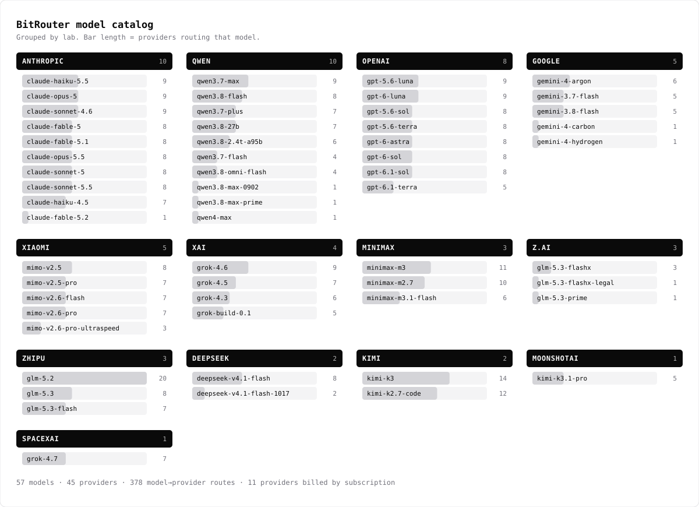

# BitRouter

[](https://github.com/bitrouter/bitrouter/actions)
[](https://crates.io/crates/bitrouter)
[](LICENSE)
[](https://x.com/BitRouterAI)
[](https://discord.gg/G3zVrZDa5C)
[](https://huggingface.co/BitRouterAI)
[](https://bitrouter.ai)
[](https://www.linkedin.com/company/bitrouterai/?viewAsMember=true)
[](https://cal.com/kelsenliu)

**A deployable model gateway with inspectable routing policies.**

Point an OpenAI-compatible agent at your local BitRouter instance and choose
`bitrouter/auto` after configuring an `auto` router and policy. See the
[routing guide](skills/bitrouter/references/adaptive-routing.md) for setup.

```diff
- OPENAI_BASE_URL=https://api.openai.com/v1
+ OPENAI_BASE_URL=http://localhost:4356/v1
```

Then set the request model to:

```text
bitrouter/auto
```

BitRouter runs locally and exposes an OpenAI-compatible API, so existing agents and tools can switch over with minimal changes.

You can also give your coding agent the `/bitrouter` skill to install, configure, migrate to, and troubleshoot BitRouter for you:

```bash
npx skills add bitrouter/bitrouter
```

> **[Try BitRouter Cloud →](https://cloud.bitrouter.ai):** Use `https://api.bitrouter.ai/v1` with a Cloud credential and a catalog model ID. Hosted routing presets use `@<name>`; the local `bitrouter/auto` selector requires a local router.

## Core features

### Minimal core. Lightweight & extensible.

One Rust router sits between your agents and every model provider. Extend it
with providers, routing policies and operator-configured server tools. Install
BRO separately for workspace tools, skills and local agent delegation.

### Interpretable decisions. Under your control.

Routing policy lives in files you own. Routes are inspectable, changes are
diffable, and a live policy changes only when you explicitly publish it.

### A customizable router. Adapt it to your workflow.

Start with `bitrouter/auto` and evaluate the selected model against your own outcomes.
An evaluator can submit evidence through the SDK. An authorized operator publishes
and activates a policy revision explicitly.

## Integrates with your agent stack

- **Model APIs** — OpenAI Chat Completions and Responses, and Anthropic Messages, with cross-protocol routing. Metered Gemini uses Google's OpenAI-compatible Chat endpoint.
- **Tools** — configure upstream MCP servers through `bitrouter mcp`. Server tools run only on routes configured to expose them.
- **Local agents** — install BRO to run a headless native task or prompt a supported external ACP adapter. BRO uses a gateway endpoint and a client credential. It owns workspace tool approvals and local thread history.

## Benchmarks

On **Terminal-Bench 2.1**, BitRouter cut API cost by **40.9%** while achieving nearly the same reward as using `gpt-5.6-sol` alone.

| Configuration | Reward | Cost / trial | Cost savings |
| --- | ---: | ---: | ---: |
| `gpt-5.6-sol` only | **81.56%** | $0.830 | — |
| **BitRouter** | **81.25%** | **$0.490** | **40.9%** |
| Random model mix | 76.50% | $0.553 | 33.4% |

BitRouter dynamically routed between **GPT-5.6, Kimi K3, and DeepSeek V4 Flash**, retaining nearly all of GPT-5.6’s task performance while substantially reducing model cost.

The random baseline used the same model mix, showing that the savings come from **routing decisions—not simply using cheaper models**.

Results use the strict 80-task common-valid set and frozen API prices. This is a research benchmark, not an official Terminal-Bench submission.

See the [full study and limitations](benchmarks/002-2026-09-07-tbench-v2.1-router-random-study.md) and the [`BitRouterAI/benchmarks`](https://huggingface.co/datasets/BitRouterAI/benchmarks) dataset for reproducible results.

## Install

The service package installs `bitrouter`. The optional local harness package
`bitrouter-bro` installs `bro`. From a checkout of this revision:

```sh
cargo install --locked --path apps/bitrouter
cargo install --locked --path apps/bro
```

Each release has separate installers and archives for the two packages. Official
macOS builds target Apple Silicon. The gateway and gateway-shared archives provide
additional service feature selections. See [distribution profiles](docs/DISTRIBUTION.md)
for artifact ownership and how to update each product.

## Quick start

On the machine that holds the provider credentials:

```sh
bitrouter init --yes --use-detected --after exit
bitrouter serve
```

The gateway listens on `127.0.0.1:4356` by default. A client on another machine
needs a reachable gateway endpoint and an authorized client credential.

```sh
export BITROUTER_ENDPOINT=http://127.0.0.1:4356
bro task run 'Summarize this project' --workspace . --read-only --model provider/model
bro thread list
bro acp list
```

Replace `provider/model` with a selector from `bitrouter models`. Set
`BITROUTER_API_KEY` in the BRO environment when the gateway requires a bearer token. Provider keys and gateway databases belong on the service host.
Use `bitrouter policy --help` and `bitrouter tenancy --help` to inspect the
service administration commands. See the [command reference](docs/CLI.md).

## Models & providers

BitRouter routes to a *model*, not a provider. Each model below is served by many
providers — its own lab, hyperscalers, gateways, and serverless clouds. BitRouter
orders eligible routes by configured provider priority and can fall back on
retryable failures. The bars are those routes: the more providers serve a model,
the more room the router has to move. Current cost and latency sort options use
the same deterministic priority order rather than live price or latency scoring.

<p align="center">
  <picture>
    <source media="(prefers-color-scheme: dark)" srcset="https://raw.githubusercontent.com/bitrouter/bitrouter/charts/dist/charts/registry-by-lab-dark.svg" />
    <source media="(prefers-color-scheme: light)" srcset="https://raw.githubusercontent.com/bitrouter/bitrouter/charts/dist/charts/registry-by-lab.svg" />
    
  </picture>
</p>

**Bring your own key** to any of them, or use one **BitRouter Cloud** account with
no keys at all. Frontier models from OpenAI, Anthropic, Google, and xAI also route
over a subscription sign-in (Claude Pro/Max, GitHub Copilot, ChatGPT Codex)
instead of a key.

The chart is generated from [`dist/registry/`](dist/registry) on every catalog
change — it is never hand-maintained, so it cannot drift from what the router
actually resolves. Full catalog in [`registry/`](registry).

## Talk to founders

**[Try BitRouter Cloud →](https://cloud.bitrouter.ai)** or reach out directly:

Want a first-party provider integration, or building an open-source agent/harness? Email [kelsenliu@bitrouter.ai](mailto:kelsenliu@bitrouter.ai) or [book a meeting](https://cal.com/kelsenliu) — open-source builders get **up to 50% off** for you and your community.

## Development

- [Development guide](docs/DEVELOPMENT.md) — documentation policy and engineering guide index
- [`CONTRIBUTING.md`](CONTRIBUTING.md) — contribution workflow, issue reporting, and provider updates
- [`CLAUDE.md`](CLAUDE.md) — guidance for AI coding agents working in this repository
- [`skills/`](skills) — the `/bitrouter` Agent Skill (source of truth)

## Star History

<a href="https://www.star-history.com/?type=date&repos=bitrouter%2Fbitrouter">
 <picture>
   <source media="(prefers-color-scheme: dark)" srcset="https://api.star-history.com/chart?repos=bitrouter/bitrouter&type=date&theme=dark&legend=top-left&sealed_token=x3Lz0HqHPkyoGN8dh_Jdtkc-5lJ4iA_8eOmldMrXMyhVq7WCOxS03oBNGQXOxM962xv1AUhdyLKAtz6d1XK9ZSWUGHHd8HAWjEU44sXlwWT_I7iXPaTfizw7aDpxA-PrsxC3Jd5IN-SWladKBNoK2weKlIKVs9JQax5sbImPT9srpEeKzbYt_VsafBwd" />
   <source media="(prefers-color-scheme: light)" srcset="https://api.star-history.com/chart?repos=bitrouter/bitrouter&type=date&legend=top-left&sealed_token=x3Lz0HqHPkyoGN8dh_Jdtkc-5lJ4iA_8eOmldMrXMyhVq7WCOxS03oBNGQXOxM962xv1AUhdyLKAtz6d1XK9ZSWUGHHd8HAWjEU44sXlwWT_I7iXPaTfizw7aDpxA-PrsxC3Jd5IN-SWladKBNoK2weKlIKVs9JQax5sbImPT9srpEeKzbYt_VsafBwd" />
   
 </picture>
</a>

## License

Licensed under the [Apache License 2.0](LICENSE).
