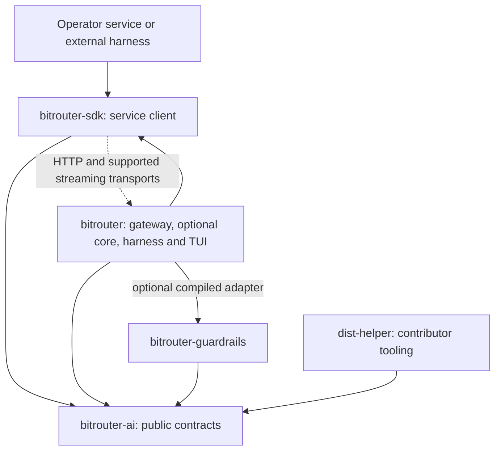

# BitRouter service architecture refactor plan

Status: **accepted architecture direction; P0 implementation in progress.**

See the [progress ledger](BITROUTER_SERVICE_REFACTOR_PROGRESS.md) for verified
results and open acceptance gates. The target tables below are not a claim that
every boundary has already been implemented.

Date: 2026-10-15. Source inventory: `9956a427bd5d4316b3bf2359f88e293b158781d5`
on `main`, version `1.0.0-alpha.33`.

BitRouter will ship as an independently running service assembled by the `bitrouter`
package. Gateway execution is always available. Core scheduling, the headless
harness and the TUI are internal application modules selected by Cargo features.
`bitrouter-ai` becomes the lightweight public contract library;
`bitrouter-sdk` becomes the service client for HTTP and the existing core
WebSocket surface. Telemetry implementation moves into the application.

This document records target ownership and implementation requirements. The
source inventory is pinned to the revision above; a target path or acceptance
criterion is not a claim that its migration has landed or passed validation.
Track implementation evidence separately against the P0 acceptance IDs.

**P0 preserves the current full product while reorganizing ownership and making
the official gateway usable as a standalone single-instance microservice.
P1 adds native gateway multi-instance operation.** Core distribution and a new
plugin transport are outside both milestones.

The two ownership decisions apply together: AI contains the contracts shared by
clients and extensions, while the application owns the implementations that act
on them. This includes protocol conversion and lifecycle execution as well as
telemetry export. Keeping serde definitions in AI does not require keeping
provider clients, conversion algorithms or an exporter there.

This plan changes the target ownership in
[the AI extraction spec](BITROUTER_AI_REFACTOR_SPEC.md) and
[the telemetry crate spec](TELEMETRY_CRATE_SPEC.md). Their historical implementation
records remain valid for their original revisions. Existing protocol fidelity,
authorization, checkpoint and observability semantics remain requirements;
changing the owning module does not waive them.

Navigation:

- [Product and ownership decisions](#product-and-ownership-decisions)
- [Target package graph](#target-package-graph)
- [Public contracts and clients](#public-contract-and-client-boundaries)
- [Consumer migration paths](#consumer-migration-paths)
- [Existing service surfaces](#existing-service-surfaces-and-feature-ownership)
- [Complete source migration inventory](#source-migration-inventory)
- [Feature dependencies and build profiles](#feature-dependency-plan)
- [P0 implementation sequence](#p0-implementation-sequence)
- [P0 acceptance criteria](#p0-acceptance-criteria)
- [P1 gateway multi-instance operation](#p1-native-gateway-multi-instance-operation)

## Product and ownership decisions

| Decision | Target |
| --- | --- |
| Installable product | One `bitrouter` Cargo package; preserve the `bro` binary and existing installer alias |
| Minimum application | The `bitrouter` package built with `--no-default-features` is a gateway with its ordinary CLI management commands |
| Gateway | All service implementation inside `apps/bitrouter` |
| Core | Internal `bitrouter::core` module behind `core` |
| Harness | Internal `bitrouter::harness` module behind `harness`; includes headless execution and its CLI |
| TUI | Internal `bitrouter::tui` module behind `tui`; `tui` enables `harness` |
| Shared contracts | `bitrouter-ai`; no `bitrouter-protocol` package |
| Service client | Repurpose `bitrouter-sdk` for HTTP and supported core streaming clients after removing its server framework |
| Telemetry | Internal optional application module; retire `bitrouter-telemetry` |
| Extensions | Keep concrete capability implementations where useful; no dynamic loader, stable Rust ABI or new remote checker protocol |
| New implementation packages | Do not introduce `bitrouter-gateway`, `bitrouter-core`, `bitrouter-harness`, `bitrouter-cli` or another orchestrator package |

The full default distribution retains current capabilities. A reduced build
deliberately omits optional capabilities and reports its actual support.
"Functionality unchanged" applies to the corresponding supported surface and
the full distribution; Rust import paths and package APIs change in an explicitly
announced alpha breaking release.

A consumer of the official gateway configures the released executable, runs
`bro serve`, then calls it over HTTP or through the new SDK. It does not implement `AppBuilder`,
link the server library, share the server database, or compile a custom host.
Existing trusted custom-host extensions remain an advanced integration path;
this requirement does not turn arbitrary Rust callbacks into remotely loadable
code.

P0 retains existing principal, authorization, policy and usage behavior. It does
not introduce a new enterprise account system or require external operators to
move payment and business RBAC logic into BitRouter. P1 makes gateway resource
authority consistent across instances. Keep the service seams concrete in P0;
do not add unused distributed-store traits, leases or a plugin loader in
anticipation of P1.

### Milestone scope

| Concern | P0 | P1 or later |
| --- | --- | --- |
| Delivery | Official full-product and gateway-only artifacts; gateway configured and called as an independent process | Multiple gateway processes serving one logical service |
| Package ownership | Five packages; service implementation inside `bitrouter`; AI contracts and HTTP SDK separated | No additional framework package required by clustering |
| Local operation | Preserve SQLite, existing durable facts, commands, configuration and session formats | Keep this local path available without a shared backend |
| Tenancy and authorization | Preserve existing principal/scope enforcement and isolation; operator services use supported service credentials | Shared gateway authorization/configuration revisions and resource authority |
| Admission and accounting | Preserve current single-instance limits and finalization | Atomic admission, idempotent finalization and uncertain-attempt reconciliation across instances |
| Extensions | Preserve compiled capabilities and advanced host adapters with new ownership | No new ABI, loader or remote extension protocol in either milestone |
| Core and harness | Move existing behavior; preserve scheduling versus execution/session authority | Distributed core and complete core HTTP coverage require separate future scope |

An operator's business identity is not automatically a service principal. The
HTTP boundary must retain the service's credential and authorized-resource
checks; arbitrary tenant or caller headers from an SDK client do not establish
authority. New account administration, billing and business RBAC APIs are not
prerequisites for the P0 package migration.

### Scheduling and execution state

Core schedules inference and agents: creation decisions, readiness, waiting,
wakeup, allocation, context/model routing, policy and trajectory-based learning.
A scheduled agent creation is a control decision delivered to a harness;
workspace tools and child processes are executed by the harness.

| State or action | Authority |
| --- | --- |
| Resource admission, routing decisions, runnable/waiting agent state, scheduler recovery facts | Core, or gateway for an ordinary inference request |
| Model protocol adaptation and the selected upstream network call | Gateway execution layer |
| Complete conversation, Thread/Turn history, durable checkpoint, tool result, approval and workspace effect | Harness |
| Minimal scheduling checkpoint references, acknowledgements, revisions and reconstruction state | Core |
| Drawing, keyboard editing and terminal restoration | TUI |
| Account administration, business RBAC, payment balance, top-up and invoicing | External operator service |
| Service authentication, authorized resource scope, usage facts and enforcement of configured resource policy | BitRouter service |

Core may retain data necessary to resume scheduling and reconstruct a model
projection; it is not the authoritative store of a user's complete session.
A local deployment may cohost core and harness in the same `bro` process and
database during P0. Their logical ownership and commit authority remain separate.
There is no P0 relocation of existing user session files or database records.

Preserve the core/harness checkpoint acknowledgement boundary and existing
recovery restrictions from [the core spec](ORCHESTRATOR_CORE_SPEC.md).
Disconnecting an observer does not implicitly cancel a run, and a timeout or
expired owner indication is not proof that provider work or a tool has stopped.

The long-term core service must be usable through a complete HTTP API, including
the required event/streaming operations. P0 preserves existing managed HTTP and
WebSocket surfaces and removes internal ownership barriers; keeping those
surfaces does not establish complete HTTP coverage for every core operation.
Local-only harness operations remain explicitly local.

## Target package graph



Solid arrows are Rust dependencies. The dotted arrow is a process boundary.
The `bitrouter -> bitrouter-sdk` dependency supports remote command/client paths;
gateway execution does not route a local request through its own HTTP listener.

P0 reduces the eight existing workspace packages to five: `bitrouter`,
`bitrouter-ai`, the repurposed `bitrouter-sdk`, `bitrouter-guardrails` and the
unpublished `dist-helper`.

| Existing package | Current source | P0 disposition |
| --- | --- | --- |
| `bitrouter` | `apps/bitrouter` | Keep; absorb all product service, scheduling, harness, UI and telemetry implementations |
| `bitrouter-ai` | `crates/bitrouter-ai` | Keep; narrow to public contracts and small contract helpers |
| `bitrouter-sdk` | `crates/bitrouter-sdk` | Keep package name; replace server-framework API with the service client after consumer migration |
| `bitrouter-orchestrator` | `crates/bitrouter-orchestrator` | Merge by ownership into application core/harness modules; remove package |
| `bitrouter-tui` | `crates/bitrouter-tui` | Merge renderer into application TUI; extract shared command/presentation data first; remove package |
| `bitrouter-telemetry` | `crates/bitrouter-telemetry` | Merge exporter into application telemetry; move its public contract to AI; remove package |
| `bitrouter-guardrails` | `extensions/regex-checker/matcher` | Keep matcher and capability implementation; depend on AI instead of the old SDK; move legacy host adapters into the application |
| `dist-helper` | `helpers/dist-helper` | Keep unpublished contributor tool; remove dependency on the old SDK's service configuration |

`bitrouter-providers` and `bitrouter-observe` are already absent at this baseline.
Do not recreate them as migration facades. Published historical versions are not
yanked as part of this refactor.

### Application module layout

These are ownership namespaces, not a requirement to replace every file in one
patch. Existing cohesive submodules can move intact beneath the indicated owner.

```text
apps/bitrouter/src/
  main.rs                 CLI dispatch
  lib.rs                  application composition and intentional host API
  gateway/                HTTP service, inference pipeline, routing and adapters
    model/                upstream client, protocol codecs, conversion and streams
    providers/            authentication mechanisms and provider integration
    catalog/              loaded catalog, refresh and cache runtime
    extensions/           capability registration, execution and legacy adapters
    control/              authenticated remote administration handlers
    metering/             usage, pricing evidence and finalization
    observability/        service observation and metrics
  core/                   scheduling, agent orchestration, policy learning
  harness/                tool execution, durable session authority, ACP/resources
  tui/                    terminal rendering and interactions
  cli/                    argument parsing, thin command adapters and text output
  commands/               shared command vocabulary, validation and operations
  presentation/           terminal-independent reports and conversation views
  client/                 local IPC adapters and endpoint/profile selection
  host/                   assembly, daemon lifecycle, shutdown and upgrade
  config/                 application configuration and feature availability checks
  storage/                bootstrap, migration ledger and shared checkpoint codecs
  telemetry/              optional OTLP implementation
  integrations/           hosted account/product-management clients
```

Runtime decisions live in the owning service; CLI and TUI invoke the same
operations. The TUI may not become a second implementation of an action.
Moving it into the application removes a Cargo-enforced boundary, so enforce the
new boundary through restricted visibility and import checks: drawing code
receives presentation data and emits commands, without directly accessing
database repositories, provider credentials or service execution.

## Public contract and client boundaries

### What belongs in bitrouter-ai

AI has no global initialization, filesystem discovery, credential storage,
network client, async executor, background tasks or service dependency.
Public contracts include:

- Model content, generation/decision input and output, tool declarations and
  results, usage, public stream events and protocol identifiers.
- Public gateway, control and existing core/harness API DTOs needed by an actual
  SDK or extension consumer. A private handler struct does not automatically
  become public API.
- Lifecycle identifiers, stage/outcome definitions and bounded public
  observation views. Request lifecycle semantics are shared; pipeline execution
  is application code.
- Typed extension inputs, decisions and callback/trait signatures for existing
  capabilities. No full application builder, migration handle, mutable pipeline
  context or credential-bearing target is exposed through the capability API.
- The observability schema and extension attribute vocabulary, without OTel or
  tracing subscriber types.
- Published model/provider catalog artifact schemas used by both the application
  and `dist-helper`. Editorial YAML structures and catalog runtime stay outside.
- Stable public errors and conversion-report types where consumers already need
  them; raw internal transport/storage failures stay internal.

Serialization, deserialization, bounded field validation and small contract
helpers are allowed. Cross-provider mapping, conversion admission, provider
history repair, retry/fallback decisions and stream execution are not.

The admission test for a public AI API is an actual client or extension consumer,
not reuse between two application modules. Gateway/core/harness code may share
internal helpers without publishing them. In particular, internal checkpoint
codecs, policy validation and provider compatibility logic stay in the
application even when several of its features need them. A public lifecycle
contract describes the request; it does not own or drive that request.

Start with `std`, `serde`, `serde_json` and, where useful, `thiserror`.
An optional `schema` feature may enable `schemars`. Both the default and
all-public-features dependency graphs must remain free of HTTP clients, Tokio,
Axum, ACP/MCP runtimes, database drivers, terminal libraries and OTel.
A small additional dependency requires an actual public-contract use; there is
no blanket `runtime` or `full` feature that brings the service back into AI.

Public transport DTOs must be independently serializable where the client needs
that direction. Some current request structs are primarily ingress decoders;
moving their definitions alone is not a complete client API. Keep existing field
spellings, optional-field behavior and wire fixtures.

A typed request round trip must preserve extension data that affects gateway
admission, history replay or provider semantics, including nested fields. Do not
silently erase evidence that made the original request invalid. Unsupported
representations must fail explicitly; diagnostic formatting must still redact
opaque or sensitive data. Test the serialized client request at the gateway
boundary, not only as an isolated serde round trip.

Protocol JSON serialization is distinct from semantic conversion. For example,
`ChatRequest <-> JSON` may be contract code; mapping a Chat request to Messages
through canonical model content belongs to gateway codecs. The SDK decodes the
service's declared response/events without embedding provider adaptation logic.

Apply that distinction within mixed modules, rather than moving a directory
wholesale:

| Concern | Public contract in AI | Implementation owner |
| --- | --- | --- |
| Model protocol | Request/response/event structures, field names and serde behavior | Gateway maps protocols, repairs history and executes provider streams; SDK parses service framing |
| Request lifecycle | IDs, stage/outcome enums and bounded observation/capability views | Gateway owns mutable pipeline context, hooks, dispatch and finalization |
| Conversion | Public report, reason and location types already exposed to consumers | Gateway decides admissibility and performs the conversion |
| Agent scheduling | Existing public commands, events and checkpoint references | Core schedules; harness executes and commits its durable session |
| Observability | Schema, attribute vocabulary and small conformance helpers | Application telemetry samples, batches, authenticates and exports |

For each moved type, check its fields, generic bounds, trait signatures and
helper methods as well as imports. A contract-shaped struct that exposes a live
provider client, scheduler handle or storage transaction still violates this
boundary. Keep intrinsic validation beside the contract; validation requiring
credentials, policy evaluation or live ownership belongs to the service.

Organize the final AI public surface by the contract a consumer imports:

| AI namespace | Contents and boundary |
| --- | --- |
| `types`, `decisions` | Shared model semantics and typed decision inputs/results; no selected-provider invocation |
| `protocol` | Public model wire requests, responses and events; serde representation only, with no protocol-to-protocol conversion |
| `conversion` | Public compatibility reports and reason/location/effect definitions; no inspection or admission algorithm |
| `error` | Public service error payloads and intrinsic validation errors; no HTTP-client, credential-store or database error types |
| `catalog` | Published catalog artifact definitions used by real consumers; no fetch, refresh, persistence or activation policy |
| `observe`, `event` | Shared observation schema, lifecycle identifiers and public event data; no exporter, event bus or subscriber runtime |
| `extension` | Existing capability input/decision/callback contracts; no mutable pipeline context or host registration collection |
| Gateway/control/core/harness API modules | DTOs extracted from existing public endpoints; select names during extraction to match those surfaces, without exposing internal scheduler or session-store structures |

The last row is an extraction boundary, not a request to create empty modules.
Add an API type only with its actual handler/client or extension consumer. A
contract review must examine serialization in both needed directions and the
public dependency surface, not just the absence of runtime calls in a type file.

Use the same fidelity checks for request, response and stream-event contracts:

| Contract concern | Required migration evidence |
| --- | --- |
| Field presence | Preserve missing, explicit `null` and empty values wherever the existing protocol distinguishes them; do not synthesize defaults during a wire round trip |
| Nested extension data | Preserve the existing treatment of unknown fields, opaque reasoning/history and continuation evidence at every relevant nesting level; retain rejection of invalid representations |
| Response and event shape | Decode fixtures emitted by the actual gateway serializers, including usage details, tool calls, protocol errors and terminal events; canonical internal types alone do not prove wire compatibility |
| Stream framing | SDK owns bounded HTTP/SSE decoding and explicit incomplete-stream errors; AI owns event data only; gateway owns provider framing and protocol adaptation |
| Diagnostics and schema | Preserve diagnostic redaction and public schema metadata when adding client-side serialization; generated observation/configuration artifacts remain under their existing compatibility gates |

These checks preserve the existing protocol contract; they do not require
byte-identical JSON formatting or acceptance of arbitrary unknown input. A
contract helper may validate a field's grammar or bound, but cannot decide
whether a principal may use a resource or whether a conversion is admissible.

### New bitrouter-sdk

The SDK owns explicit endpoint/authentication options, HTTP transport, request
serialization, public error decoding, streaming response consumption and
capability discovery. Gateway and remote-control methods cover the existing
supported endpoints. Existing core network methods can be added as they are
extracted, with their actual HTTP/WebSocket requirements; local-only harness
operations remain explicitly local.

SDK clients do not start a daemon, inspect local configuration, open service
databases, select provider accounts, perform provider login, or run workspace
tools. Transport retries must not replay inference or a mutation after an
ambiguous dispatch; preserve existing delivery and continuation semantics.

Use public AI types directly rather than duplicating them or adding public
re-export compatibility facades. Keep client transport errors distinct from the
service's public error payload.

The base SDK supports gateway and control HTTP calls. Add an optional client
`core` feature only for the existing core streaming transport when it introduces
additional dependencies. That feature never enables the application's `core`.
Do not add client feature names for hypothetical APIs.

Client construction takes endpoint and credential values explicitly; environment
variables, saved profiles and local credential discovery remain application
adapters. Preserve HTTP status and relevant response headers when decoding a
service error, including when its body cannot be decoded. Bound response/event
buffering, distinguish a protocol terminal event from a disconnected stream,
and do not treat dropping a client stream as proof of provider cancellation.
Credential forwarding, redirects and retries must be explicit transport policy;
none may silently change service authority or replay a dispatched mutation.

### Consumer migration paths

Package retirement changes Rust APIs even when product behavior stays the same.
Document these replacements with compilable examples in P0; an import rename
alone cannot convert an embedded service into a remote client.

| Existing consumer | P0 destination | Migration requirement |
| --- | --- | --- |
| SDK `AppBuilder`, server/pipeline/configuration and provider execution | Official `bro serve` plus configuration; remote application uses the new HTTP SDK | Start the released gateway as its own process, pass only service endpoint/credential to the client, and keep provider secrets and service storage on the server |
| AI selected-model client and protocol conversion helpers | Application gateway implementation | Service consumers call the gateway; existing trusted embedded hosts migrate explicitly to application-owned APIs instead of expecting the new AI library to execute inference |
| SDK observation schema and extension callback types | AI `observe`, `event` and `extension` contracts | Import the actual owning module and preserve schemas and callback behavior; no public forwarding facade |
| Standalone telemetry exporter imports | Internal application telemetry | Configure the gateway's built-in exporter; an external service owns its own business/ingress instrumentation and does not import the gateway exporter as a new general-purpose SDK |
| Guardrails `sdk` hooks and plugin adapter | Application `gateway::extensions::guardrails` with the matcher depending on AI | Preserve the trusted custom-host example and opt-in installation; the official microservice integration does not require custom compilation |
| Orchestrator and TUI implementation imports | Application core/harness/TUI owners | Preserve supported application host entry points where needed; client-visible data moves to AI and existing network calls to SDK, without claiming every local operation is remotely available |

### Existing service surfaces and feature ownership

Preserve these transport boundaries while relocating their handlers. Extracting
a DTO into AI or adding an SDK method does not change where an endpoint listens
or which credential authorizes it.

| Existing surface | P0 implementation owner and feature | Client and compatibility requirement |
| --- | --- | --- |
| `POST /v1/chat/completions`, `/v1/messages`, ordinary `/v1/responses`, `/v1/decisions`; `GET /v1/models` | Gateway, always compiled | SDK gateway methods; preserve each protocol's request, response, error and supported streaming semantics |
| `GET /health`, `/metrics` | Gateway, always compiled | Preserve ordinary health and metrics behavior; metrics do not require an OTLP exporter |
| `POST /mcp/{server}` and the configured aggregate route | Gateway behind `mcp` | Preserve MCP transport and configuration semantics; no agent execution requirement |
| `/control/v1/*` inspection, capability/state reports, reload and operation lookup | Gateway control and host lifecycle, always compiled; optional action providers follow their owner | SDK control methods; retain the dedicated loopback listener, explicit enablement and scoped control credentials; remote exposure remains an operator's tunnel/proxy concern |
| `GET /v1/orchestrator/capabilities`, `/v1/orchestrator/channel` | Core behind `core` | Preserve the authenticated capability endpoint and WebSocket channel; do not describe the channel as a newly implemented plain HTTP API |
| Managed opt-in at `POST /v1/responses` | Core behind `core`; ordinary Responses stays in gateway | Preserve the beta opt-in and managed authority checks; with core disabled, reject an explicit managed request instead of treating it as ordinary inference |
| `/v1/evals/subjects`, `/results`, `/snapshots`, `/status` and subject/snapshot reads | Core evaluation service behind `core`, on the inference listener | SDK provides typed methods for the existing HTTP exchange; preserve virtual-key authentication, tenant ownership and configured `skip_auth` behavior; routes are not mounted without core |
| `/agent/v2/*` ThreadService API | Harness behind `harness` | Preserve the loopback-only listener, separate credential and server-owned workspace limits; this is execution/session access, not the core scheduler API |
| Local daemon IPC and ACP stdio/process transport | Host and harness respectively | Keep local discovery and process ownership in the application; do not expose local IPC over the gateway as part of this refactor |

The baseline route inventories are
[`server.rs`](https://github.com/bitrouter/bitrouter/blob/9956a427bd5d4316b3bf2359f88e293b158781d5/crates/bitrouter-sdk/src/server.rs),
[`remote_control/inventory.rs`](../apps/bitrouter/src/remote_control/inventory.rs),
[`orchestrator_api/mod.rs`](../apps/bitrouter/src/orchestrator_api/mod.rs),
[`eval/api.rs`](../apps/bitrouter/src/eval/api.rs) and
[`agent_api.rs`](../apps/bitrouter/src/agent_api.rs). Move the corresponding
route and authorization tests with their owners. Control capability reports
must describe the selected build, configured services and caller's scope;
for example, a gateway-only build must not advertise a local harness action.
Preserve its useful gateway policy inspection and exporter-disabled status.
The evaluation methods use the SDK's ordinary HTTP transport; they do not
require a separate feature merely because the server gates evaluation on core.
Preserve the distinction between an unavailable endpoint and an empty evidence
ledger. Full/core builds retain evidence admission and snapshot behavior;
gateway-only builds retain their own request facts and metering independently.

### Telemetry ownership

The exporter becomes `bitrouter::telemetry`. Move transport, endpoint
configuration, bearer refresh, batching, sampling, cardinality limiting,
span/metric rendering, HTTP ingress span and tracing bridge together.
The observer interface used by the application can remain internal; only
genuinely shared observation views and schema move to AI.

Always-on request facts, metering and scheduler observation must work with no
OTLP feature. `otel-http` and `otel-grpc` control egress, not correctness.

Preserve `plugins.bitrouter-telemetry`, `BITROUTER_TELEMETRY_*`, endpoint opt-in
behavior and current default sampling/export behavior during P0. The historical
configuration namespace does not require a plugin package. Permanently preserve
the `io.bitrouter.observe` scope, `bitrouter` meter name and
`bitrouter::observe::*` log targets.

External services own their ingress/business spans, while the gateway owns its
model attempts, fallback and usage spans. Preserve the trust rules for incoming
trace context when separating processes. An external host using the old exporter
must migrate deliberately; package removal is not evidence of consumer migration.

Preserve the current transport distinction: HTTP takes precedence when both
transport features are enabled; refresh-aware bearer resolution is HTTP-only,
while gRPC uses configured static metadata. Moving the exporter does not add
new gRPC authentication behavior. Verify each transport in its own build.

### Extension boundary and guardrails compatibility

`extensions/<name>/<package>` groups implementations and documentation; it
promises no loader or ABI. Keep the matcher in its current directory, without
requiring a second package merely to justify the nesting.

The matcher default depends on AI capability contracts and its own rule engine.
Move `hooks.rs` and `plugin.rs` from its legacy `sdk` feature into
`bitrouter::gateway::extensions::guardrails`, behind application `guardrails`.
This keeps the dependency direction `application -> matcher -> AI` and avoids
`matcher -> application -> matcher`.

Move the registration collection and runner to the application. If authors need
a registrar abstraction, keep only the capability-shaped interface in AI; the
host owns activation, duplicate/revision validation, resource limits and cleanup.
Preserve fail-closed request checks and permit lifetime after cancellation or
timeout. Native callbacks remain trusted in-process code.

The official default binary currently does not register the regex matcher.
Preserve that default. The optional `guardrails` feature provides the compiled
host adapter; enabling it alone does not install global hooks or activate a
checker. Keep the custom-host example and migrate its imports. P0 does not
introduce a new regex configuration language or restore the removed HTTP checker.

Retain the existing legacy global input/output block/redact semantics in the
application adapter. Router-bound input checks are not a replacement for those
semantics. Removing the old guardrails `sdk` feature and old SDK builder APIs is
an announced breaking Rust API migration with a concrete replacement example.

## Source migration inventory

Every crate-root source module at the baseline appears below. A row owns all
descendant files, private modules, snapshots and adjacent unit tests unless a
split is stated explicitly. `lib.rs`, `main.rs`, build scripts, integration tests
and non-source assets have separate entries. New source added during execution
must be assigned before its migration patch is accepted.

The inventory was checked against all eight package manifests and their source
entry points: application 72 library-root modules, AI 12, SDK 16, orchestrator
12, TUI 19, telemetry one `otel` root with 11 child modules, matcher six root
modules including tests, and helper three binary-root modules. Counts describe
the source revision above; they are an audit aid, not a new architectural limit.

### Current bitrouter application

All paths in this table are relative to `apps/bitrouter/src`. There are 72
crate-root module declarations at the inventory baseline.

| Current module | Target owner and required split |
| --- | --- |
| `acp_cli` | `cli::acp` command adapter; execution/acceptance helpers under `harness::acp`; evolution operations delegate to core |
| `acp_runtime` | `harness::acp` product runtime assembly; startup registration through host |
| `acp_trajectory` | `harness::trajectory` capture, entities and durable checkpoints; learning/analysis consumers in core |
| `actions` | `commands` shared operations/reports; `administration/models/requests/route/status` delegate to gateway/control, `code/session/supervised` to harness, skills to their existing resource owner |
| `adequacy` | `core::adequacy` existing evidence/read/report behavior; do not reactivate legacy learning merely by moving it |
| `administration_target` | `client` endpoint/transport selection; portable remote HTTP implementation in SDK |
| `agent_api` | `harness::api` handlers; public wire DTOs to AI, portable supported HTTP client methods to SDK |
| `agent_local` | `client::agent_local` OS-local client and IPC; shared wire DTOs to AI; do not claim arbitrary remote access |
| `agent_registry` | `harness::registry` program metadata and selection |
| `agent_sessions` | `harness::sessions` session-facing adapters and listings |
| `agent_store` | `harness::storage` existing codecs and durable execution repositories |
| `agents` | `commands::agents` and `harness` service operations; menu rendering to TUI |
| `assemble` | `host::assemble`; compose only enabled runtimes and install built-in gateway behavior |
| `auth` | `gateway::auth` keys, principal resolution, repositories and authorization enforcement |
| `bundled_registry` | Gateway model/provider baselines; agent/runtime baselines under harness; gate their loading independently |
| `catalog` | `gateway::catalog` catalog runtime; CLI reports through commands/presentation |
| `chat` | `tui::chat` rendering/input pump and adapters; shared session commands and headless behavior to harness/commands |
| `claude_code` | `integrations` external-client configuration/import helpers; model/provider protocol execution to gateway |
| `cloud` | `integrations::hosted` account/management clients; CLI adapter to `cli`; provider and settlement wiring to gateway/host |
| `codex_router` | `integrations` external-client routing/configuration; gateway-facing behavior remains in gateway |
| `commands` | Split into `cli` argument/interaction adapters and `commands` reusable operations; interactive selectors gated by TUI |
| `config_synthesis` | `harness::config_synthesis` agent launch configuration |
| `conformance` | `harness::conformance` ACP/harness checks; presentation through shared command reports |
| `contexts` | `client::contexts` saved endpoint/profile selection; no server initialization for remote reads |
| `continuation` | `gateway::continuation` authority, native context and replay/publication enforcement |
| `daemon` | `host::daemon` local lifecycle and IPC dispatch; operations delegate to enabled owners |
| `daemon_handoff` | `host::upgrade` compatible handoff and rollback behavior |
| `daemon_locator` | `host::locator` discovery and instance identity |
| `dashboard` | `tui::dashboard`; data collection/report operations outside renderer |
| `db` | `storage` connection/bootstrap and complete historical migration sequence |
| `error_report` | `cli::error_report` and terminal-independent presentation; public API error payloads in AI only where shared |
| `eval` | Evaluation admission/compiler/control/storage to `core::eval`; split the gateway trajectory settlement path out of `settlement`, retaining required observation snapshots and routing-evidence helpers without core; public exchange DTOs to AI |
| `evolution` | Catalog, scheduler, learning, job, scoring and control to `core::evolution`; existing persisted request-reservation/replay enforcement and settlement-protection events from `costs/runtime`, plus their required record readers/validators, to gateway admission/metering; workspace execution delegates to harness |
| `gateways` | `harness::gateways` launch-time integration configuration |
| `harness` | `harness::catalog` existing generated harness metadata and lookup |
| `host` | `host` foreground lifecycle, listeners, readiness, reload, signals and ordered shutdown |
| `local_cli` | `harness::local_cli` external program execution bridge |
| `managed_store` | `harness::storage` durable managed checkpoint authority; core retains references and scheduler facts |
| `managed_task` | `cli` headless driver plus `harness::managed` execution adapter; local core connector requires both features |
| `mcp_registry` | `gateway::mcp` gateway discovery/proxy support and `commands::mcp` diagnostics; workspace MCP use remains harness-owned |
| `metering` | `gateway::metering` usage, pricing/tariff evidence, persistence and reconciliation; native execution adapters gated with their consumers |
| `native_acp` | `harness::acp::native` local endpoint/stdio bridge; CLI dispatch separated |
| `native_code` | Split headless/native driver to harness/CLI, drawing/editor loop to TUI, `presentation` data to shared presentation |
| `onboarding` | `cli::onboarding` noninteractive validation/setup; terminal interaction under TUI |
| `optimization` | Controller, cohort analysis and learning to `core::optimization`; published exploration policy types, deterministic assignment and certificate identity/digest validation from `exploration/identity` to gateway policy/routing; shared application helpers remain available without core |
| `orchestrator_api` | `core::api` authenticated handlers, channels and Responses managed opt-in; public messages in AI, remote clients in SDK |
| `output` | `cli::output` text/JSON formatting and shared reports; no mandatory Ratatui types |
| `paths` | `config::paths` application-owned path decisions |
| `policy` | `gateway::policy` current request authorization/runtime enforcement and repositories |
| `policy_compile` | `core::policy` compilation and publication tooling |
| `policy_lock` | Gateway reads/validates published policy artifacts; core produces/publishes them |
| `policy_table_router` | `gateway::routing` applying a published table; optimization/learning stays in core |
| `prompt` | TUI prompt implementation; required noninteractive input/options remain in CLI without terminal dependencies |
| `provider_credentials` | `gateway::providers` credential selection/import assembly; interactive adoption UI in CLI/TUI |
| `providers` | `gateway::providers` activation, apply/builtin/registry and credential integrations; external-client import helpers can use integrations |
| `reload` | `config::reload` validation and owner-specific application of supported changes |
| `remote_control` | Server `auth/inventory/operations/reads` to `gateway::control`; HTTP client to SDK; DTOs to AI; runtime reload coordination stays host-owned |
| `request_checks` | `gateway::extensions` registration binding, runner assembly and execution limits |
| `result_contract` | Harness result validation; shared externally serialized result definitions to AI |
| `router_migration` | `config::router_migration` explicit compatibility parse/write operations |
| `session_identity` | `gateway::session_identity` request correlation and pure extraction; move its ACP runtime/route-lease lookup adapter behind harness and its workflow-analysis integration behind core; no ownership of harness session history |
| `skills` | Harness workspace material discovery; gateway Skills-over-MCP relay remains gateway; shared CLI entry delegates to the correct owner |
| `spawn` | `cli::spawn` plus `harness::spawn` process execution/cleanup |
| `style` | TUI styling; CLI output uses plain presentation values and optional color without a Ratatui dependency |
| `supervisor` | `harness::supervisor` agent process/session lifecycle |
| `tools` | `commands::tools` existing gateway/MCP diagnostics; do not confuse this module with orchestrator workspace tools |
| `tracing_filter` | `host::logging` basic logs independent of optional OTLP |
| `trajectory` | Gateway request evidence/correlation/settlement, operational evaluation-envelope construction, durable outbox persistence, request-time progress guards and required health/state validation; core owns evaluation admission/outbox consumption, offline analysis/replay and policy publishing; preserve pending outbox rows without core |
| `update` | `host::update` updater implementation and thin CLI entry |
| `upgrade` | `host::upgrade` upgrade coordination and thin CLI entry |
| `upgrade_preflight` | `storage` schema compatibility checks plus host upgrade coordination |
| `workflow_state` | Serving-time `OnlineWorkflowState` projection, routing-key derivation and published-policy validation support to `gateway::routing`; learning, measurement, classifier training, reward, replay and policy analysis to core; gateway response observer is a narrow optional adapter |

For split observation modules, ordinary gateway completion must not require a
core worker. Preserve necessary gateway evidence writers and usage finalization;
enable higher-level analysis and policy work only with `core`. Do not move
everything named "trajectory" into a scheduler or everything named "session"
into core storage.

In particular, `session_identity` currently imports both `AcpRuntime` and
`workflow_state` extractors. Move reusable identity extraction below those
optional consumers; gating the whole observer would lose gateway attribution,
while retaining those imports would defeat the minimum feature profile.

`policy_table_router` derives lookup keys through `OnlineWorkflowState`, and
`policy_lock` validates predictive route keys and predictor contracts when loading
a published policy. Retain these serving-time projections, validators and their
supporting data under gateway ownership. Core produces learned artifacts; the
gateway must still validate and apply an existing artifact with core disabled.
This service logic does not belong in AI merely because both owners use it.

The same split applies to `optimization::exploration` and
`optimization::identity`: `policy_table_router` uses `RouteExploration::assignment`
while serving requests, and `policy_lock` checks experiment identities and
compiler digests when admitting a published artifact. Keep those policy data,
assignment and verification helpers available to gateway builds. Core owns
creating, evaluating and promoting experiments; disabling core must neither
disable an already published experiment nor skip its certificate checks.

Published policies may also carry `progress_guard`. Ordinary routing calls
`trajectory::store::begin_guarded_request`, whose evaluation and event append
depend on `trajectory::health::reduce`. Keep this request-time guard path, its
required persisted history and integrity checks available without core. The
gateway must preserve protected-tier escalation and tool safety floors when
applying an existing policy. Core owns offline analysis and policy production;
the shared reducer's use by those consumers does not make request-time policy
enforcement core-only. These are gateway request facts, not harness session
authority or a reason to start a learning worker.

Two further mixed paths must be split before gating core:

- `evolution::costs::JudgeCosts::admit` checks durable judge reservations before
  authentication. Its replay-rejection event tells `MeteringRecorder` not to
  overwrite an earlier attempt's charge. Preserve that ordering and rejection
  behavior in gateway builds, including reads of reservations created by a full
  build. Canonical replay-rejection markers and their existing accounting
  protection also belong below the core feature boundary. Core owns creating
  jobs and executing authorized evaluations; disabling it does not authorize
  reuse of their reserved request IDs. This retains existing protection, not a
  new general idempotency API in P0.
- `eval::settlement::EvalSettlementRecorder` currently invokes trajectory
  settlement, and `trajectory::settlement` builds an operational evaluation
  envelope and persists its outbox row with the terminal fact. Extract a
  gateway-owned settlement hook, observation snapshots, routing evidence and
  envelope/digest validation. Keep the original ordering after authoritative
  metering, tracked/untracked disposition and core adapter's pending-decision
  cleanup. Missing authoritative usage must remain unknown rather than becoming
  zero-valued evidence. The core adapter retains ordinary eval admission;
  gateway finalization must not require `EvalService`.

Without core, existing and newly produced trajectory evaluation outbox rows stay
durable and pending. Do not construct an eval publisher, report delivery, discard
rows, or repeatedly schedule attempts against an unavailable consumer. Pending
state remains inspectable. Re-enabling core resumes the existing bounded,
idempotent drain and validation; it must not append a second terminal fact or
settle usage again. Envelope construction and validation are internal gateway
implementation even if their serialized public DTOs come from AI. These records
are request evidence, not authority over the harness conversation.

### Current bitrouter-ai

| Current module | Target owner |
| --- | --- |
| `auth` | `gateway::providers::auth`, including `auth_code/credentials/device_code/file/listener/login/oauth/pkce/store`; provider secrets and refresh transactions stay internal |
| `catalog` | Public distributed artifact types remain AI; `fetch/store` and loaded catalog runtime to `gateway::catalog`; editorial types stay in helper |
| `client` | `gateway::model::client` selected-upstream calls, timeouts and cancellation |
| `conversion` | Shared report/reason/location/effect data in AI; conversion inspection, admission and policy enforcement in `gateway::model::conversion` |
| `decisions` | Public semantic request/result definitions and intrinsic validation remain AI; execution-specific validation/error handling stays with gateway |
| `diagnostics` | `gateway::model::diagnostics` provider diagnostic redaction and internal presentation policy |
| `error` | Split contract errors into AI and execution/auth/storage/transport errors into gateway; avoid exposing raw provider bodies |
| `protocol` | Shared wire DTOs in AI; `chat_completions/responses/messages/decisions/managed` codecs, adapters, transport registry, commitments and stream state machines to gateway |
| `providers` | `gateway::providers`, including `anthropic/claude_code/codex/copilot/google_chat/hosted/login/retired/supergrok`; product account assembly remains integrations/host |
| `stream` | Shared event/error representation in AI where public; framing/collection/provider processing in gateway, service-response parsing in SDK |
| `target` | Credential-bearing `ModelTarget` and credential priority to gateway; expose only bounded public resource references where needed |
| `types` | Keep public model semantics; split out service-only auth/compatibility settings and execution details based on actual consumers |

Moving codecs includes their snapshots, history and Decisions tests. Preserve
unknown-field handling, native reasoning, opaque payload provenance, tool-call
identity, conversion rejection and accounting evidence. This is not an occasion
to reintroduce retired Gemini protocol support or finish unrelated fidelity work.

### Current bitrouter-sdk

| Current module | Target owner |
| --- | --- |
| `app` | `host` and `gateway` application/pipeline assembly; legacy trusted-host builder API stays application-owned during migration |
| `caller` | Shared identity DTOs to AI; transport extraction, authentication and internal context to gateway |
| `config` | `config`, including `agent/checker/decision/pattern/presets/router/routing_table`; pure shared API/artifact types extracted individually |
| `decision_model` | `gateway::model::decision` executor, Typesafe/provider adapter and shared `policy` definitions/validation; `DecisionPolicy` and `DecisionPricing` remain available without core; core owns its planning/accounting consumers; public request/result/error data to AI, preserving existing distinct operation semantics |
| `error` | Public error payloads to AI; server and internal error types to gateway; SDK transport errors newly client-owned |
| `event` | Public lifecycle/event DTOs to AI; EventBus, subscription and dispatch runtime to gateway/core as used |
| `extension` | Capability input/decision/callback types to AI; registry collection/activation to `gateway::extensions` |
| `invocation` | `cli` product invocation/name helpers; no reason for a client library to own the executable hint |
| `language_model` | Gateway pipeline implementation, detailed below; shared semantic data to AI only |
| `mcp` | `gateway::mcp`, including `aggregating_executor/caching_executor/config_routing/rmcp_executor/skills/transport`; harness owns its separate workspace connections |
| `metrics` | Internal rendering seam and service metrics to gateway; externally meaningful schema to AI |
| `observe` | `schema/span_attributes` public contract to AI; preserve generated schema and conformance helpers |
| `plugin` | Application trusted-host migration/hook assembly; capability metadata to AI only if actually shared |
| `routing` | `gateway::routing` for `assessment/input/plan/preparation/signals` runtime behavior; public API descriptions extracted, learning in core |
| `server` | `gateway::http` routes, middleware, state and graceful response handling |
| `url_validator` | Gateway/config endpoint policy; SDK independently validates its own service endpoint requirements |

Within `language_model`:

| Descendants | Target owner |
| --- | --- |
| `builder/context/hooks/pipeline/timing` | `gateway::pipeline` runtime, internal contexts and observer dispatch |
| `executor` and `executor/input_count/stream_bridge/response_body` | `gateway::model` execution/transport; no upstream-provider transport in AI or new SDK; service HTTP transport belongs to SDK |
| `types/operations/routing` | Public operation/wire descriptions in AI; pipeline envelopes, target credentials and routing implementation in gateway |
| `request_checks` | `gateway::extensions` bounded input projection and host runner |
| `settlement/stream` | `gateway::metering` and `gateway::pipeline` finalization/stream lifecycle |
| `native/native_accounting/native_auth/native_auxiliary/native_context/native_continuation/native_output/native_preparation/native_projection/native_report/native_stream/native_work` | Gateway's core-native model boundary; existing public envelopes in AI, core-specific adapters gated where necessary |
| `server_tools` | `gateway::server_tools` behind `server-tools`; preserve existing request-local tools and nested model calls |

The gateway's server-tool loop is not the durable harness or the agent
scheduler. Its existing `sub_agent` nested inference call does not justify
enabling `core` or workspace shell/file tools in a gateway build.

Likewise, `decision_model::policy` is not exclusively a core concern.
Ordinary generation uses `routing::preparation::Prepared::from_prompt`, including
the policy bounds and confidence thresholds, while configuration validates both
`DecisionPolicy` and `DecisionPricing`. Keep those definitions and validation in
the always-available application/gateway layer, consumed by core as needed.
Core's cost-estimation consumer does not turn declared planning prices into
gateway settlement facts. These shared internal settings do not move to AI
solely because both gateway and core use them.

### Current bitrouter-orchestrator

| Current module | Target owner |
| --- | --- |
| `core` | `bitrouter::core`; public `protocol` and shared checkpoint/event envelopes to AI |
| `agent` | `harness::agent` runtime contract and legacy execution; `agent/native` harness-side journal, budget, artifacts and tool dispatch stay harness-owned; local core connection lives in host behind both features |
| `context` | Shared `validate_history/prepare_tool_results/tool_result_metadata` helpers to always-available `gateway::model::history`; harness instruction/context assembly stays harness-owned; routing/conversion admission delegates to gateway/core |
| `control` | Harness steering, cancellation and execution-boundary controls; public messages to AI |
| `harness` | `bitrouter::harness::resources`, including `instructions/managed/mcp/skills`; core connection separated from workspace execution |
| `item` | Public item/call presentation definitions to AI where used by clients; harness projection/identity implementation stays harness |
| `service` | `harness::service` ThreadService, queue, commit, approval, ownership, recovery, observation, verification, workspace exclusion and startup discovery |
| `store` | `harness::storage` execution store traits/implementations and durable authority; shared record envelopes extracted only as needed |
| `thread` | Harness durable conversation state/settings; externally serialized API views to AI |
| `turn` | Harness accepted input, receipt, approval, verification and durable turn state; public views to AI |
| `tools` | `harness::tools` declarations, validation and `read/glob/grep/write/edit/shell` execution |
| `acp` | `harness::acp` client/controller/child-process stack and `native` server; CLI and TUI remain adapters |

Within `core`, live `accounting/activity/allocation/checkpoint/collaboration/
context_router/reconstruction/routing/session/signals` behavior remains scheduling
implementation. Split `protocol` definitions and serializable checkpoint
envelopes from validation that requires live scheduler authority. Neither
extracting a checkpoint type nor moving `service` transfers harness commit
authority to core.

There is also a persisted-data dependency: ThreadService recovery calls native
replay, which decodes `SessionSnapshot` and validates context-store history.
Move shared internal snapshot codecs, immutable-history checks and supporting
types to application `storage::checkpoint`, available with either `core` or
`harness`. Extract only genuinely public envelopes into AI. Harness journal
replay/commit stays harness-owned; live scheduler restoration and authorization
stay core-owned. Both consume the same format checks without making harness
depend on the scheduler or exposing internal replay machinery through AI.
A harness-only build must inspect and validate existing native records even
when it cannot resume their local core execution; unavailable execution must
produce a capability diagnostic rather than bypassing validation or rewriting
the records.

Core reconstruction, routing and session pairing currently call the shared
`context` helpers directly. Move those helpers and their model-history tests
without a harness dependency; keep workspace-instruction assembly and its
fixtures behind harness. Preparing a tool result changes only a model projection,
never the authoritative harness journal. This split is required by the core-only
build and must not become a second conversion implementation in AI.

Within `acp`, `capture` writes through harness-owned storage, `translate` maps
ACP updates at the harness boundary, and `telemetry` retains its protocol/context
meaning. This module is not the OTLP exporter; the exporter integration is
owned by application telemetry.

### Current bitrouter-tui

| Current module | Target owner |
| --- | --- |
| `agents`, `agents_menu` | `tui` rendering/navigation; shared agent menu/report data in presentation |
| `code`, `composer`, `editor` | `tui` interaction/editing only |
| `cost` | Shared cost/provenance value in presentation; terminal rendering in TUI |
| `journal` | Conversation presentation model usable by headless output; isolate any terminal-specific cache |
| `lifecycle` | Terminal enter/restore lifecycle in TUI; process ownership remains host |
| `log_tail` | Terminal-independent failure text, truncation count and file path in presentation; optional styling in TUI; service/log source supplied through commands/client |
| `machine` | `Command/PromptCommand/resolve` and their tests to commands; retire the unused legacy reducer after verifying that the active `code` view retains product interactions |
| `native_agent` | Native presentation types to presentation; view/editor rendering to TUI |
| `permission` | Approval decision/policy in harness; prompt UI in TUI; retain each existing headless approval policy |
| `picker`, `select` | Active selection UI stays TUI; retire the unused legacy picker with its old reducer; command arguments and noninteractive selection remain CLI |
| `plain` | CLI plain output using terminal-independent presentation; remove Ratatui `Line/Size` requirement |
| `render` | `tui::render`; extract shared content formatting only where headless output needs it |
| `view`, `wrap`, `writer` | Active TUI layout/writer/cache stay internal; retire the unused legacy View and frame scheduler; retain shared cost tests and terminal-independent transcript data outside the renderer |

The current `plain` path shares Ratatui rendering, and headless paths consume
types from `machine` and `permission`. A directory move alone does not isolate
headless builds. Preserve rendered content, ordering, cost provenance and output
schemas while separating terminal layout. Do not silently replace existing
noninteractive denial policies with a blanket approval, or change an explicitly
configured headless policy.

Before replacing the current plain renderer, capture transcript fixtures for
Markdown/code blocks, tool results and diffs, reasoning, cost attribution and
failure log tails. Retain once-per-settled-turn output and closed-pipe behavior.
Moving Ratatui-backed `Line`, `Size` or a renderer cache into a module named
`presentation` does not satisfy headless isolation; shared formatting must have
terminal-independent data and dependencies.

### Current telemetry, matcher and helper modules

| Package and module | Target owner |
| --- | --- |
| Telemetry `otel/acp` | `telemetry::acp`, compiled only when harness and a telemetry transport are enabled |
| Telemetry `otel/auth_client/bearer/config/transport` | Application telemetry egress configuration/auth/transport |
| Telemetry `otel/cardinality/processor_runtime` | Application telemetry bounded processing/runtime |
| Telemetry `otel/exporter/metrics` | Application telemetry model spans/metrics; contract definitions in AI |
| Telemetry `otel/http_layer/subscriber` | Application telemetry ingress and tracing bridge |
| Telemetry `lib` | Remove package facade; feature availability reported by application |
| Matcher `checker/config/rules` | Keep in `bitrouter-guardrails`, consume AI capability types |
| Matcher `hooks/plugin` | Application `gateway::extensions::guardrails`; preserve legacy host behavior |
| Matcher `tests` | Rule/callback tests stay with matcher; hook/host integration tests move with application adapters |
| Helper `registry` | Keep editorial parsing, validation and artifact generation; import only pure shared artifact types from AI |
| Helper `schema` | Delegate schema generation to an application-owned development target; no server configuration in new SDK |
| Helper `chart` | Keep contributor/chart generation |
| Helper `main` | Keep helper commands; update schema orchestration without changing established contributor entry points unnecessarily |

### Entry points and non-source assets

| Surface | Required treatment |
| --- | --- |
| Package `lib.rs` files | Update module declarations/docs and intentional visibility; delete removed package roots; no public forwarding facades |
| Application `main.rs` | Keep `bro`; thin feature-aware command dispatch; TUI and CLI share commands |
| Application `build.rs` | Gate agent/runtime catalog generation by harness; preserve handoff/migration fingerprint inputs needed by gateway |
| `apps/bitrouter/tests` | Keep real-process/HTTP/PTY integration role; gate suites by the features they exercise, not wholesale; update explicit CI test shards when a suite changes packages so its supported platform coverage is retained |
| AI and old SDK `tests` | Move provider/auth/codec/runtime suites to application; keep independent contract/serde tests with AI and client tests with SDK |
| Orchestrator tests/examples | Move scheduling tests to core, runtime/tools/store tests to harness, public contract tests to AI or application integration as appropriate |
| Telemetry tests/benchmarks | Move ingress, hierarchy, schema conformance and overhead coverage with exporter; do not change frozen wire names |
| Application examples | Preserve native checker custom host and checkpoint examples; add appropriate required features; PTY fixture stays test support |
| `registry` and `dist/registry` | Preserve model/provider and agent/runtime artifact ownership and data-driven behavior; runtime consumers are independently gated |
| `span-schema.json` | Move old SDK artifact to AI; relocate generator/staleness/conformance checks together |
| `dist/schema` | Application configuration owns generation; preserve schema shape except explicit feature-availability metadata |
| `helpers/dist-helper` bootstrap | Registry generation must work before application compilation; configuration schema uses an application generator after registry bootstrap |
| Root Cargo manifests/lockfile | Update membership, paths, optional dependencies and isolated feature definitions |
| `release-plz.toml`, `dist-workspace.toml`, installation/container/CI definitions | Remove retired package publishing, preserve binary/alias, publish gateway-only artifacts and verify package contents |
| `docs/DEVELOPMENT.md` and affected specs | Replace ownership claims as implementation lands; keep historical evidence dated |
| `skills/bitrouter` and agent-plugin manifests | Update when CLI/features/config guidance changes; do not advertise unavailable commands or a plugin loader |
| Templates and deployment examples | Keep existing configuration usable; show the official gateway executable and HTTP client integration |

Do not solve schema generation by making `dist-helper` depend on the application
whose build script requires helper-generated artifacts. Keep the registry
bootstrap independent; the helper may delegate its schema command to an
application development executable after that bootstrap. The new SDK never
becomes a configuration-schema workaround.

## Feature dependency plan

These are target features to implement in P0, not existing manifest behavior.
There is no optional `gateway` or `cli` feature: gateway and essential command
parsing/configuration/management are always present.

The public libraries have separate feature namespaces; none selects application
runtime behavior:

| Package | Public feature policy |
| --- | --- |
| `bitrouter-ai` | Empty default; optional `schema` enables only schema derives and optional `testing` exposes existing pure conformance helpers. Every combination stays contract-only. |
| `bitrouter-sdk` | Gateway/control HTTP client by default; an optional `core` feature is justified only by additional dependencies of supported core transports. It never enables server code. |
| `bitrouter-guardrails` | Rules and native capability implementation by default; remove the old `sdk` feature once its adapters move into the application. |
| `dist-helper` | No product capability flags; registry bootstrap stays independent of application compilation. |

| Application feature | Enables | Must not imply |
| --- | --- | --- |
| None | Gateway HTTP APIs, model protocols/conversion, provider integration, configured routing/fallback, auth, metering, SQLite persistence, basic logs and CLI/control | Core, harness, terminal UI or OTLP |
| `core` | Scheduler, managed-agent scheduling, context/model routing, policy learning and core API | Harness, ACP tool execution or TUI |
| `harness` | Headless harness, durable sessions/tools/resources, existing native/external ACP stack and CLI; `mcp` for current workspace resource support | Core or TUI |
| `tui` | `harness` and terminal render/input dependencies | Core |
| `mcp` | Existing gateway MCP proxy/aggregation and transport runtime | Core, harness or TUI |
| `server-tools` | Existing gateway request-local tool loop; `mcp` for supported tool integration | Durable agent orchestration, harness or TUI |
| `guardrails` | Optional matcher dependency and application legacy/native host adapters | Activation of rules, global hooks, core or TUI |
| `otel-http` | Internal telemetry runtime and OTLP/HTTP transport | Core, harness or TUI |
| `otel-grpc` | Internal telemetry runtime and OTLP/gRPC transport | Core, harness or TUI |
| `otel` | Alias for `otel-http` | A transport-less exporter |
| `db-postgres` | PostgreSQL driver in ORM and migration dependencies | Multi-instance semantics |
| `db-mysql` | MySQL driver in ORM and migration dependencies | Multi-instance semantics |

Target default feature set:

```toml
default = [
  "core",
  "harness",
  "tui",
  "mcp",
  "server-tools",
  "otel-http",
  "db-postgres",
  "db-mysql",
]
tui = ["harness"]
harness = ["mcp"]
server-tools = ["mcp"]
otel = ["otel-http"]
```

The default database drivers reflect today's full application, which enables
SQLite, PostgreSQL and MySQL. SQLite remains available without a flag. Retaining
a driver is distinct from promising distributed correctness.

Provider login, hosted authentication and explicit file-store implementation
move out of AI and remain available to the gateway's existing product paths.
Their current `hosted/pkce/hosted-login/file-store` AI features disappear from
the public contract package. Narrow their Tokio features and keep interactive
terminal presentation separate from the authentication mechanisms.

Use internal `cfg(any(feature = "otel-http", feature = "otel-grpc"))` gates for
telemetry common code. With both transports enabled, preserve the current
selection rule. ACP telemetry needs both harness and an exporter; gateway
telemetry works without harness. There is no standalone `server` feature because
every application build is a gateway.

The host's local managed-agent connector is compiled with
`all(feature = "core", feature = "harness")`. A harness-only build retains its
supported standalone/external-agent paths; commands requiring local core report
that requirement. A TUI build includes every CLI/headless capability supported
by the same feature set, without fabricating local core availability.

### Existing feature migration

Feature names belong to their package. Removing an old library feature does not
remove its product behavior; the implementation moves to the application owner
and is selected there. The new SDK does not retain empty server-feature aliases.

| Existing package feature or dependency | P0 destination |
| --- | --- |
| AI `hosted`, `pkce`, `hosted-login`, `file-store` | Gateway provider/authentication implementation; remove these features from AI and preserve the existing product login and credential paths |
| SDK `server` | Always-available gateway HTTP server in the application; no server code in the new SDK |
| SDK `config_file` | Always-available application configuration parsing; SDK takes explicit client options |
| SDK `mcp` | Application `mcp`; harness workspace connections belong to `harness`, which enables `mcp` |
| SDK `testing` | AI `testing` for pure observation-schema conformance helpers; runtime fixtures stay with their implementation |
| Orchestrator `acp` | Application `harness`; preserve native and external ACP support without enabling core or TUI |
| Application's unconditional TUI dependency | Application `tui`; command vocabulary, approval policy and plain output move outside that gate |
| Telemetry `otel`, `otel-http`, `otel-grpc` | Application features of the same names, with the existing alias and transport precedence |
| Telemetry `server` | Exporter ingress integration under the selected application OTLP transport; a gateway is always present |
| Telemetry `__otel-core` | Internal application conditional compilation; no independently selectable transport-less feature |
| Guardrails `sdk` | Application `guardrails` adapter; remove the matcher's old SDK dependency and feature after moving consumers |
| Unconditional PostgreSQL/MySQL driver activation | Application `db-postgres` and `db-mysql`; retain both in the full default distribution |

Cargo features select compiled capability, while configuration selects runtime
activation. Enabling `guardrails` does not register callbacks; enabling an OTLP
transport does not override endpoint opt-in. The startup checks below enforce
this distinction for reduced builds.

### Supported build profiles

| Profile | Feature selection | Purpose |
| --- | --- | --- |
| Full product | Default | Preserve current local product behavior |
| Minimum gateway | `--no-default-features` | Small single-instance model service with SQLite |
| Gateway with existing optional integrations | `--no-default-features --features mcp,server-tools,otel-http,db-postgres,db-mysql` | Official service artifact without agent runtime or TUI |
| Scheduling service | `--no-default-features --features core` | Gateway plus core, without workspace execution |
| Headless harness | `--no-default-features --features harness` | Supported harness/ACP paths, no terminal drawing |
| Local managed headless | `--no-default-features --features core,harness` | Existing native managed execution without TUI |
| TUI without local core | `--no-default-features --features tui` | TUI plus supported harness/CLI paths |
| Full local scheduling and TUI | `--no-default-features --features core,tui` | Local core/harness/TUI with only explicitly selected integrations |

Every optional dependency must follow the same ownership as its code. The
application declares terminal drawing/input dependencies under `tui`, ACP
process/controller dependencies under `harness`, MCP transports under `mcp`,
OTLP dependencies under the selected transport and non-SQLite database drivers
under their backend feature. Shared workspace declarations must not enable
those optional features unconditionally. Headless startup must also avoid
terminal initialization through an indirect onboarding, prompt or log helper.

Ship and document gateway-only artifacts so service operators do not need to
recompile merely to obtain the supported gateway profile. Optional trusted custom
extensions still require their own build. Default installations keep the full
product and its existing binary name.

The P0 delivery set includes the full-product artifact and the minimum gateway
artifact. Record each artifact's source revision, target platform, enabled
features and checksum. Feature selection happens when building an artifact;
configuration cannot enable a capability that was omitted from it. The optional
gateway profile above is a supported build profile, not an implied commitment to
publish every feature combination. Test the packaged gateway executable in the
independent-process acceptance scenario, so development-tree builds alone do not
stand in for the service an operator will install.

### Configuration and runtime isolation

Configuration schema can describe disabled features without compiling their
implementations. Distinguish dormant stored configuration from an instruction to
activate an unavailable capability. The latter fails before readiness with a
clear required-feature diagnostic; it is never silently ignored.

Gateway startup does not construct a ThreadService, open a harness workspace,
load agent catalogs, spawn agent workers, initialize a terminal or run a policy
learning scheduler. Shared full-product configuration must not make gateway
startup depend on those runtimes. Runtime enablement remains explicit.

Keep auth, service metering and the current SQLite persistence path in the
minimum profile. P0 does not replace durable gateway behavior with memory-only
stores to improve a size number.

Preserve every historical migration ID, order and ledger entry across feature
profiles, including the intentionally unused migration slot. Do not conditionally
remove old migrations based on `core` or `harness`. Disabled subsystems omit
runtime repositories/workers; lightweight migration definitions may still create
their historical tables. Feature changes must not reinterpret schema history.

## P0 implementation sequence

Each stage produces a buildable, reviewable change. Temporary implementation
ownership is allowed while moving consumers, but no permanent forwarding crates,
duplicate model types or service runtime in the final SDK/AI graph remain.

| Stage | Reviewable result | Principal final acceptance gates |
| --- | --- | --- |
| P0 0 | Recorded behavior, serialized-data and performance baselines | Evidence required by A07–A16 |
| P0 1 | Shared contracts and matcher dependency direction established | A02, A13, A15; A02 completes in P0 3 |
| P0 2 | Core/harness, TUI and telemetry merged into the application | A01, A10–A13 |
| P0 3 | Application owns gateway execution; AI is contract-only | A02, A07, A09, A14 |
| P0 4 | HTTP SDK and independent client/server example | A03, A04, A15 |
| P0 5 | Feature isolation, startup and persistence transitions | A05, A06, A08–A12 |
| P0 6 | Complete validation, packaging and migration documentation | A01–A16 together |

These mappings identify review responsibility, not early acceptance: moving
three packages does not complete P0 while gateway/SDK separation or feature
isolation is unfinished. Validate the complete candidate against every gate
after the final ownership and feature graph are in place.

### Evidence required from each stage

Keep a migration ledger alongside the implementation. For each completed stage,
record the source revision, moved modules and destination owners, affected
features, consumer changes, and the test/fixture families that moved with them.
Record validation commands with their exact feature selection and results;
distinguish a successful build from an exercised runtime path. Link unresolved
items to the acceptance IDs below rather than declaring the stage complete by
file movement alone.

Treat baseline test removal as a separate review decision: identify the behavior
it covered and its replacement evidence, or establish that the code has no
supported caller. Do not silently turn a behavior change into a relocation by
changing expected output. The final P0 record must reconcile every inventory row
and A01–A16; publication, external consumer migration and P1 remain separately
reported outcomes.

### P0 0 Record compatibility and delivery baselines

- Record the actual package/module inventory, feature graphs, command and API
  surfaces, schema artifacts, database migration ledger, session formats and
  representative serialized fixtures.
- Record full-product behavior and minimum relevant request/stream/daemon paths,
  including Decisions, native continuations, auth refresh and optional tools.
- Retain baseline-written database/checkpoint bytes as compatibility fixtures;
  accepting a historical version number is not proof of decoding its payload.
  Identify the evidence for each supported historical format separately.
- Cover legacy guardrails through the real plugin installation entry point,
  including hook order, pre-dispatch denial, streamed block/redact and dynamic
  per-request rule isolation. Hook unit tests alone do not establish registration
  behavior. Establish HTTP-only and gRPC-only collector baselines before moving
  telemetry.
- Inventory known external Rust consumers of old SDK/AI/telemetry/guardrails
  APIs. Prepare their destination/import/behavior mapping without claiming that
  external repositories have migrated.
- Record binary size, isolated normal dependency counts, idle memory and a
  bounded request/stream benchmark for later comparison. Agree a regression
  budget from those measurements rather than inventing a numeric target here.

Exit: every current capability has a retained full-product owner, a feature
requirement and a regression fixture or existing test family.

### P0 1 Extract shared contracts and remove package cycles

- Move old SDK observation schema and capability definitions to AI, separating
  them from registration, pipeline contexts and execution errors.
- Extract shared gateway/control/core DTOs only from existing interfaces; preserve
  their wire representation. Keep lifecycle definitions distinct from event
  dispatch and stream runtime.
- Change matcher default to depend on AI contracts. Move legacy hook/plugin
  adapters into the application and update the custom-host example. Move the
  real plugin-installation tests with those adapters.
- Update existing consumers to owning paths; remove duplicate definitions and
  public forwarding exports as the owner changes.

Exit: the matcher compiles against AI without old SDK service types; no
application/matcher dependency cycle; contract fixtures and checker semantics
pass. AI becomes fully lightweight after its runtime moves in P0 3.

### P0 2 Merge application implementations before retiring the SDK

- Absorb orchestrator into core/harness according to the inventory, preserving
  ThreadService ownership, checkpoint ACKs, workspace cleanup and recovery.
  Extract shared snapshot decoding and offline history validation before gating
  the scheduler, so harness recovery remains independently usable.
- Absorb TUI after extracting command vocabulary, approval policy and presentation
  data. Remove Ratatui types from headless output and compare the retained
  transcript/failure-output fixtures before removing the old renderer path.
- Move the telemetry implementation into the application, keeping schema
  conformance tests, independent HTTP/gRPC transport tests and frozen names
  intact.
- Remove the three retired packages after consumers/tests/examples have moved.
  Their relocated code may still use the old SDK during this intermediate stage.

Exit: existing full-product tests and isolated matcher tests pass, no retired
package remains in workspace consumers, and UI/service responsibility checks
replace the old TUI crate boundary.

This ordering prevents `orchestrator -> application -> orchestrator` and
`telemetry -> application -> telemetry` cycles when the old SDK server moves.

### P0 3 Move gateway runtime and make AI lightweight

- Move old SDK server, application builder, pipeline, configuration, routing,
  MCP, server tools, finalization and host extension machinery into the application.
- Move AI codecs, conversion algorithms, upstream execution, auth/provider and
  catalog runtime into the application.
- Keep serving-time workflow projection and published-policy validation in the
  gateway, including deterministic assignment for published experiments and
  their identity/certificate checks, plus progress-guard evaluation and its
  required trajectory health/state checks; only learning and scheduling depend
  on core.
- Keep ordinary request preparation and decision-policy/pricing validation
  available without core. Preserve configured decision assessment and its bounds;
  core-only planning/accounting consumers must not own the shared settings.
- Extract persisted reservation/replay checks and their accounting-protection
  events from evolution before gating its jobs. Extract gateway trajectory
  settlement and operational outbox construction from the eval bridge; retain
  terminal facts and pending rows when the core consumer is unavailable.
- Split DTOs from implementation within mixed files; keep public API errors and
  observation views free of credentials and internal runtime objects.
- Move runtime tests and fixtures with their implementations. Preserve protocol
  conversion, opaque history, streaming and usage behavior.
- Move configuration schema generation to its application owner and make registry
  bootstrap independent of application compilation.

Exit: AI default and all-public-features graphs meet the contract-only
requirements; the application owns all gateway execution; no remaining workspace
consumer requires the old SDK server API.

### P0 4 Establish the HTTP SDK and independent gateway use

- Replace SDK contents with explicit service clients, extracting the existing
  remote-control client and adding typed gateway invocation/streaming.
- Reuse AI wire types and stable service error payloads. Do not encode provider
  policy or local discovery in the client. Compare raw and SDK-serialized
  requests at gateway admission, including opaque replay metadata and nested
  extension fields, to prove that serialization preserves their meaning.
- Verify typed responses and stream events against actual gateway output,
  including missing/null fields, terminal events and usage details. Exercise
  malformed, oversized and disconnected responses without losing HTTP error
  context or causing an unintended second dispatch.
- Preserve supported gateway/control paths and auth behavior; document exactly
  which core methods are remotely supported. Preserve the existing WebSocket
  boundary where used.
- Carry the service-surface table into endpoint/capability tests. Preserve
  separate inference, control and execution credentials and listener exposure;
  never route an unsupported managed request into ordinary inference.
- Provide a standalone example consumer with only SDK/contract dependencies,
  service endpoint and credential. Use the official gateway executable plus
  ordinary configuration as its server.
- Keep local command/IPC adapters in the application and move portable remote
  clients into SDK.

Exit: a separate client process can call the gateway, consume a stream and query
supported remote control without custom server code or access to server files.

### P0 5 Isolate features and service lifecycle

- Add the feature graph above and gate dependency activation, modules,
  commands/routes, workers, examples, tests and build-script assets.
- Remove unconditional all-backend database, ACP and terminal feature activation
  from shared dependency declarations; activate each at its actual owner.
- Ensure minimum gateway startup initializes only gateway services and required
  storage/logging. Keep the full migration ledger.
- Use one host lifecycle for official and advanced custom-host entry points:
  readiness follows required listener/service startup; failure and shutdown clean
  up owned resources; reload reports applied versus restart-required state.
- Preserve session/credential/config locations and serialized formats.
  Unsupported-feature activation fails clearly before readiness.
- Execute core-only and harness-only behavioral suites, not just compilation.
  Reopen the baseline data through full-product, minimum and full-product builds
  in sequence; no feature selection may discard another subsystem's records.
  Also test full-product → harness-only → full-product with native checkpoint
  records, including malformed snapshots and immutable-history violations.
- Across full-product → minimum → full-product, reject reused reserved judge
  request IDs before any provider call and preserve the original accounting.
  Verify trajectory terminal facts, cost-based progress guards, pending outbox
  rows and idempotent publication after core returns.

Exit: all supported isolated feature combinations build, headless output has no
TUI dependency, and a gateway starts with agent/UI resources unavailable.

### P0 6 Validate and prepare the reorganized delivery

- Run the compatibility and feature gates below; repair behavioral regressions
  within the migration rather than rewriting fixtures to accept new behavior.
- Update release/package manifests, gateway artifacts, CI package names,
  install/container examples and public API guards.
- Produce the full-product and minimum-gateway candidate artifacts with build
  identity and feature manifests. Run the independent SDK consumer against the
  packaged gateway executable; verify installation, configuration discovery and
  capability reporting for that artifact. Preserve the normal publication
  process rather than treating an implementation test as a public release.
- Prepare release order so the AI contract package precedes dependent packages,
  and the repurposed SDK carries explicit breaking migration notes. Remove
  retired packages from future release automation without yanking previous
  releases. Actual publication follows the normal release process; preparing an
  implementation PR does not require publishing packages.
- Update development docs, CLI references, affected specs, skills and distribution
  manifests in the same implementation changes where their facts change.
- Record known external consumer migrations or explicit remaining blockers to
  those consumers' releases. The SDK-only integration example proves the generic
  microservice boundary, not completion of an external product migration.

Exit: all P0 acceptance criteria pass for the supported profiles and candidate
artifacts, and the migration/release notes identify every retired or repurposed
Rust API surface. Record publication separately from implementation acceptance.

## P0 acceptance criteria

These are implementation exit gates. They do not assert that the planned
refactor has already been implemented or tested.

| ID | Acceptance |
| --- | --- |
| A01 Package ownership | Exactly the five target workspace packages remain; all baseline modules/assets have an owner; no new gateway/core/harness/protocol/TUI framework package |
| A02 AI boundary | Default and all-public-features AI builds have no service/SDK dependency or network/runtime/DB/UI/OTel dependency; public API scan also rejects runtime types leaked through signatures |
| A03 SDK boundary | SDK-only consumer compiles without application, ORM, server, provider authentication or terminal dependencies; service endpoint and explicit credential suffice |
| A04 Gateway artifact | Official gateway profile runs as an independent process using configuration; no consumer-provided AppBuilder, hooks, database handles or source changes |
| A05 Feature closure | Minimum/core/harness/tui/core+harness/core+tui/optional-gateway/default/all-features builds succeed in isolation; `tui` contains harness/CLI, harness does not implicitly enable core |
| A06 Runtime isolation | Minimum gateway serves requests without loading harness resources or starting core/TUI/ACP workers; no terminal required; remote CLI reads do not bootstrap local service state |
| A07 Protocol parity | Existing generation and Decisions endpoints, stream/nonstream conversion, native reasoning/history/continuation, errors, usage and fallback behavior remain equivalent on supported builds; typed client serialization preserves admission and replay semantics, and response/event contracts preserve gateway output including presence/null semantics; capability reports match available actions and explicit managed requests cannot fall through to ordinary inference |
| A08 Lifecycle parity | Readiness, bind failures, reload diagnostics, disconnect, cancellation, SIGTERM, body draining, required finalization and endpoint cleanup retain existing guarantees |
| A09 Data compatibility | Baseline-written database/session/checkpoint fixtures reopen correctly; full → minimum → full and full → harness-only → full preserve records and the migration ledger; reserved request-ID rejection preserves earlier accounting; trajectory terminal facts/outbox survive feature changes without duplicate settlement/publication; offline recovery still rejects corrupt native checkpoints without core; SQLite/PostgreSQL/MySQL execution evidence is distinct from driver compilation |
| A10 Core and harness authority | Scheduler still decides agent creation/wait/wake; harness owns session commits/tools/approval; core-only and harness-only behavior tests run; local bridge cannot bypass checkpoint ACK or recovery checks |
| A11 CLI and TUI parity | Existing full-product commands and supported TUI actions use shared operations; headless text/JSON output and permission behavior remain correct without Ratatui |
| A12 Telemetry | Exporter is application-owned; contract/schema in AI; no-OTLP preserves essential facts; HTTP-only and gRPC-only collector tests verify delivery/metadata/flush; ingress lifetime, names, attribution and opt-in behavior remain correct |
| A13 Extensions | Matcher needs only contracts; real plugin installation preserves legacy global/output behavior and rule isolation; native checker fail-closed, revision/binding and permit lifetime tests pass; default activation is unchanged |
| A14 Build and packaging | Registry bootstrap and schema generation work from a clean checkout; no helper/application bootstrap cycle; package contents and required-feature test/example metadata are correct; full-product and minimum-gateway candidate artifacts identify their features/revision, and the packaged gateway passes the independent SDK consumer scenario |
| A15 External migration | Every consumer migration path above has an explicit replacement example or documented local-only boundary; old SDK builder, AI ModelClient, telemetry imports and guardrails SDK adapter are covered; no claim that HTTP transparently replaces arbitrary custom hooks |
| A16 Performance | Compare size, normal dependency graph, idle memory and bounded throughput/stream behavior against P0 0; explain and resolve regressions outside the agreed budget |

### Isolated build and behavior matrix

Use separate Cargo invocations and inspect normal/build dependency closures;
workspace-wide feature unification and dev-dependencies must not conceal leaks.
Check both default and all public features for AI and SDK. Do not use absence of
a package name from an unchecked `cargo tree` invocation as proof that it built.

For the application, check `--no-default-features` with each of:

- No feature; `core`; `harness`; `tui`.
- `core,harness` and `core,tui`.
- `mcp`; `server-tools`; `guardrails`.
- `otel-http`; `otel-grpc`; both transports; `harness,otel-http`.
- `db-postgres` and `db-mysql`; the standard optional-gateway profile.
- Default and `--all-features`.

Gateway-only normal/build closures exclude Ratatui/Crossterm, ACP conductor and
agent runtimes; minimum additionally excludes optional MCP, OTel and non-SQLite
drivers. Plain CLI setup and management remain available. Tests can depend on
fixtures without changing the production closure.

Pair the isolated builds with these behavioral gates. Record the selected and
executed test identities, so a broad feature gate cannot silently remove the
coverage that justifies a profile.

| Profile or boundary | Required behavior evidence |
| --- | --- |
| Minimum gateway | Real-process inference/control, configured authentication, decision-policy/pricing validation and bounded decision assessment, published-policy load/validation and equivalent routing including published experiment assignment, certificate rejection and progress-guard escalation/tool safety floors with persisted-history validation, usage finalization and shutdown without agent resources or a terminal |
| Core only | Relocated `core_contract` and relevant `core_execution` ACK/recovery/cancellation tests using the mock harness port, without enabling production harness; existing eval HTTP subject/result/snapshot/status behavior and tenant isolation |
| Harness only | ThreadService ownership/queue/approval/recovery, historical native snapshot decoding and corruption rejection, and supported headless execution tests, without production core or terminal drawing |
| Core and harness | Existing managed execution, scheduling-to-tool boundary and durable checkpoint acknowledgement tests |
| TUI | Existing PTY actions and terminal restoration; shared command results agree with the corresponding headless paths |
| Guardrails | Real `GuardrailsPlugin::install` path plus native checker host tests; denied input makes zero upstream calls, output block/redact works, dynamic rules do not leak between requests |
| HTTP-only telemetry | Trace/metric delivery to a test collector, configured headers, current bearer-refresh behavior and shutdown flushing |
| gRPC-only telemetry | Trace/metric delivery through actual gRPC transport, configured metadata and shutdown flushing; all-features tests cannot substitute because HTTP wins there |
| No telemetry | Essential request/usage facts and finalization remain available with no exporter |
| Persistence | Baseline serialized fixtures reopened after migration; full → minimum → full and full → harness-only → full transitions preserve the complete ledger and harness data; backend execution results recorded separately |
| Reserved request identities | Create judge reservations and accounting in a full build; submit the reserved IDs through the minimum gateway, including an early authentication rejection; assert zero upstream calls and unchanged original attempt/charge records; retain canonical replay accounting protection where its existing scope applies |
| Trajectory settlement and outbox | Minimum gateway records terminal facts only from authoritative metering and applies equivalent cost-based progress guards; preexisting and new outbox rows remain pending without core, with no disabled-consumer retry loop; restoring core validates and drains them idempotently without repeated settlement or duplicate admitted evidence |

Historical-format compatibility requires payload fixtures with known provenance,
not newly written data with a different version field. Reuse existing historical
fixtures where available and record any unsupported evidence claim as an open
acceptance item. Likewise, a PostgreSQL/MySQL driver build does not establish
that migrations or reads have been exercised against that backend.

The independent process test starts the packaged official gateway with a Rust mock
provider and a private temporary server configuration/database directory.
A separate SDK consumer uses a different working directory and receives only
the endpoint and credential. Verify stream/nonstream generation, supported
Decisions, model listing, invalid credentials, public errors, disconnect,
supported control/capabilities and graceful shutdown. Count upstream calls to
detect accidental replay. No Python fixture or in-process server import is
needed in the consumer.

Retain the existing test families for request-check hosts, protocol/history,
provider/auth, continuations, metering/finalization, telemetry hierarchy,
configuration state, daemon/handoff, managed core, native/ACP harness, durable
recovery and PTY interactions. Run the repository's required formatting, strict
lint, test and rustdoc gates at implementation time, including Linux/macOS/Windows
coverage where existing CI promises it.

## P1 Native gateway multi-instance operation

P1 begins after P0. Its scope is multiple gateway processes serving one logical
gateway behind an ordinary load balancer. It does not distribute the core
scheduler, migrate live streams, transfer workspace tools or change harness
session authority.

### Shared state and local state

| Shared authority | Instance-local state |
| --- | --- |
| Tenant/principal resource scope and authorization revision | HTTP connections, request bodies and active response streams |
| Published routing/configuration generation and resource pool identity | Connection pools and immutable cached snapshots |
| Credential authority/version and coordinated refresh state where credentials are shared | Bounded queues and local admission protection |
| Global quota/concurrency admission records for actual shared resources | Per-instance health, logs and exporter buffers |
| Idempotency binding, execution/attempt identity and terminal usage facts | Work already dispatched by that process, until reconciled |
| Continuation authority and durable state needed to serve it across instances | Reconstructible caches |
| Trajectory correlation key/epoch authority, tenant-scoped episode identity/history, progress-guard counters and holds | Cached correlation-key versions and read projections; no independent authority for guard decisions |
| Durable delivery/outbox records for external consumers | Delivery workers |

The first shared backend is PostgreSQL, enabled through a P1 `multi-instance`
feature that implies `db-postgres`. Local SQLite remains the default. PostgreSQL
support in P0 alone does not provide these semantics. No mandatory Redis,
coordinator daemon or cluster service is added to local operation.

Share policies and identities at explicit revisions. A stale cache cannot
authorize a request after the relevant authority has changed. Provider
credentials and continuation bindings must retain the same account/resource
identity across instances; process-local file locks are not a shared refresh
protocol. Secret storage and operator access remain outside client DTOs.

Trajectory correlation currently uses an installation-private HMAC key. Sharing
the database while independently generating that key would fragment one logical
conversation's episode history. P1 must coordinate key identity/epochs and
rotation, with tenant scoping preserved, and coordinate each episode's history
append and progress-guard decision. A stale counter or unrecognized key epoch
cannot be treated as a new empty history to bypass escalation or an active hold.
These are gateway routing facts; sharing them does not move harness session
storage into the service.

### P1 implementation steps

1. Introduce concrete local/shared state backends around the existing gateway
   ownership points. Use explicit startup mode; report shared-state readiness
   and prevent accidental mixing of local-only authority with clustered traffic.
2. Define tenant-scoped idempotency keys bound to a request fingerprint and
   operation. Keep client correlation IDs, execution IDs, provider attempts and
   continuation IDs distinct. Conflicting reuse is rejected; duplicates query
   the same durable execution instead of causing another upstream call.
3. Add atomic global admission for tenant limits and the actual provider
   account/resource pool. Local semaphores are additional protection, not a
   substitute that multiplies configured capacity by the instance count.
4. Persist dispatch and attempt state, terminal accounting evidence and
   idempotent finalization. Use short transactions; never hold a database
   transaction/row lock across inference or a response stream.
5. Add reconciliation for uncertain attempts and durable outbox delivery.
   Network failures or a worker crash can leave provider execution unknown:
   avoid blind replay, duplicate charging/finalization or automatic permit
   release based solely on an expired lease.
6. Add routing/config generation propagation, bounded backpressure, drain and
   rolling-restart behavior. In-flight streams remain attached to their original
   instance; new requests need no sticky routing for shared gateway authority.
7. Coordinate trajectory correlation and per-episode guard updates across
   instances. Preserve history completeness, cost/counter reductions and holds
   under concurrent requests and key rotation, without a gateway-wide lock or
   holding an episode transaction across inference.

Choose the exact quota dimensions and acknowledgement/error responses in the P1
implementation spec. The invariant is one authoritative decision for shared
resources and one committed terminal result per execution, not an unsupported
exactly-once claim about upstream providers or external event delivery.

If the shared backend is unavailable, shared hard limits and authority checks
must not silently fall back to independent local decisions. Outbox delivery may
be at least once; consumers deduplicate by stable event identity. Business
billing, top-ups and ledger policy remain in the operator service.

### P1 acceptance

- Two or more independent gateway processes enforce one configured shared quota
  and provider-account concurrency limit under concurrent traffic.
- Duplicate and conflicting idempotency submissions across instances do not
  create unintended provider calls; ambiguous outcomes remain queryable.
- Killing a worker before dispatch, during inference, during streaming and
  around finalization produces correct durable status and bounded recovery.
- Concurrent finalization/outbox retries do not duplicate usage records or
  terminal effects; unknown provider execution is not represented as safely
  cancelled.
- Auth/config/credential changes and continuation access behave consistently
  across instances, including stale cache and shared backend failure cases.
- Alternating and concurrent requests for the same tenant-scoped trajectory
  across instances retain one coherent episode history and equivalent guard
  counters, cost thresholds, holds and routing decisions. Verify key-epoch
  changes and tenant isolation; fresh local keys or stale caches cannot reset
  the guard's effective history.
- Slow clients, hot tenants and overload do not create unbounded queues or
  monopolize a global lock.
- Rolling shutdown drains supported work and reports interrupted streams
  truthfully; it does not claim stream migration.
- The single-instance SQLite profile starts without any shared infrastructure,
  retains its feature/dependency footprint, and meets the measured local
  performance budget.
- Core/harness multi-instance scheduling, workspace ownership transfer and
  transparent tool replay remain outside the delivered claim.

## Architectural history and related contracts

The directory and package decisions are intentionally revised rather than treated
as permanent product requirements:

- [PR 701](https://github.com/bitrouter/bitrouter/pull/701) folded the old plugin
  directory into shared crates because directory taxonomy obstructed real
  dependencies.
- [PR 810](https://github.com/bitrouter/bitrouter/pull/810) moved the
  exporter into the SDK because its spans encode BitRouter semantics.
  [PR 851](https://github.com/bitrouter/bitrouter/pull/851) separated it again
  after the schema became an independent contract, avoiding OTel-related public
  dependency commitments in the foundation library. That rationale requires
  separating the contract from implementation; it does not require a permanent
  exporter package. This plan keeps the contract in AI and the implementation
  with the service that emits it. PR 851 explicitly rejected dependency-count
  and build-cache savings as reasons for its split; this consolidation likewise
  treats footprint improvements as measurements to verify, not benefits implied
  by a smaller package count.
- [PR 923](https://github.com/bitrouter/bitrouter/pull/923) established compiled
  capability extensions and shared custom-host startup. The nested extension
  directory groups the regex capability and its matcher package; it does not
  establish a dynamic plugin mechanism. P0 preserves those behaviors with new
  import ownership. Telemetry is service observability implementation and has no
  need to join that capability-extension directory.
- [PR 962](https://github.com/bitrouter/bitrouter/pull/962) extracted a standalone
  selected-model integration library. This plan deliberately replaces that
  library product promise with a public-contract library and service client.

Behavioral references remain
[model history](MODEL_HISTORY_COMPATIBILITY_AUDIT.md),
[core scheduling](ORCHESTRATOR_CORE_SPEC.md),
[router extensions](ROUTER_EXTENSION_SPEC.md),
[host lifecycle](HOST_EXTENSION_DX_SPEC.md),
[configuration state](CONFIGURATION_STATE_CONTRACT_SPEC.md),
[daemon upgrade](LOCAL_DAEMON_UPGRADE_SPEC.md) and
[telemetry schema history](TELEMETRY_CRATE_SPEC.md).
