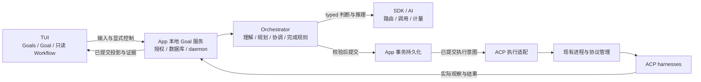

# BRO Goal Oriented Workflow Implementation Spec

状态：v0.2，基于已 review 的 [PRD v0.4](BRO_GOAL_ORIENTED_PRD.md)，供 Codex Goal 实现时遵循。更新日期：2026-10-13。

本 spec 把产品要求转成工程合同、实施阶段和可核对的完成条件。实现及受控本地 MVP 验收已完成，最终结果、范围和源码绑定见 [implementation ledger](BRO_GOAL_ORIENTED_IMPLEMENTATION.md)。原始日志及逐轮评测见其固定提交归档；文档清理不代表重跑原 campaign。源码基线为 `9b9a176288896809040a6fce11c92d146a4f5909`；继续实现时必须重新核对实际 checkout、未提交修改与相关代码。

这里有两种不同的 Goal：**Codex Goal** 是驱动本次开发的持久目标；**BRO Goal** 是需要实现的产品对象。Codex 的完成状态、token 预算与停止规则不能代替 BRO 的运行时状态或产品验收。

## 1 合同优先级与实现范围

用户后续明确指令优先，其次遵循仓库 [AGENTS.md](../AGENTS.md)、本 spec 与 PRD。PRD 定义产品语义；本 spec 定义实现约束与证据。发现两者有实质冲突时记录具体问题，继续不受影响的工作，不自行改写完成标准。

现有 native runtime、Core 与 ACP 合同继续约束各自的执行路径。本 spec 改变默认产品入口和 Goal 交互，不授权破坏未迁移的底层身份、权限、预算、持久化或外部 ACP 合同。旧文档中的默认 Conversation、工作中 Enter FIFO 和 `bro code <agent>` 产品要求在新的 Goal 路径中由本 spec 替代；旧 native Thread API 的行为不能因此被静默改变。

必须实现一个本地、可持续运行的完整 MVP：用户委托 Goal，BRO 自动分解和选择可用 ACP 执行资源，至少两个分支可以独立推进，验证并交接结果，运行中接受 Goal 输入，按当前条件完成或准确停止。只完成 UI、单次 prompt 转发或 scripted demo 不满足终点。

### 1.1 已确定的产品要求

| ID | 要求 |
| --- | --- |
| G01 | 裸 `bro` 与 `bro code` 进入 Goals；打开目录不启动执行，旧默认 agent 不自动抢占入口 |
| G02 | 直接移除 `bro code <agent>`，无兼容执行期、静默改投或隐藏的同义入口 |
| G03 | `bro claude`、`bro codex` 等继续原生交互；`bro acp serve <agent>` 继续透明服务指定 harness |
| G04 | 中间是当前 Goal 的交互；左侧跨 Goals，右侧展开 Workflow；浏览不改变输入范围或调度优先级 |
| G05 | MVP 右侧及底层会话完全只读，无编辑、执行控制、批准或可操作终端 |
| G06 | Enter 在 worker 运行期间仍处理；询问、明确修改、执行控制和假设可以共存 |
| G07 | System One 做多意图判定与有限选择；复杂修改交给推理模型；Runtime 校验和持久提交 |
| G08 | 接收、要求保存、安排调整、送达、采用和结果验证分别由实际证据支持 |
| G09 | 默认交付经过验证、可 review 的结果即可完成；人工验收只由 Goal 显式约定 |
| G10 | 完成绑定当前要求、产物、必需证据和已确认的相关执行状态 |
| G11 | 预算耗尽、阻塞、停滞和用户停止分别记录，保留部分结果，不自动变成成功 |
| G12 | 协议接入不绑定品牌名单；可选控制能力依实际协商与验证，不伪造 context、model、恢复或 steering 能力 |
| G13 | TUI 是观察与输入客户端；退出、重连、浏览和历史恢复不隐式取消、批准、重放或恢复工作 |

第一版不实现右侧接管、拖拽 DAG、完整资源控制台、远程 ACP 执行、新的公开 HTTP Goal API、跨设备调度或把 BRO Goal 暴露为 ACP server。需要内部本地协议支持，但不借此扩展外部产品范围。

## 2 当前基础与工程归属

阅读 [DEVELOPMENT.md](DEVELOPMENT.md)、[orchestrator 源码指南](../crates/bitrouter-orchestrator/README.md)、[native runtime 合同](BRO_AGENT_RUNTIME_SPEC.md)、[Core/harness 边界](BRO_AGENT_RUNTIME_HANDOFF.md) 和 [ACP controller 合同](ACP_CONTROLLER_SPEC.md)。文档中的历史验收不代表本次新增 Goal 能力已经通过验证。

| 当前来源 | 可以复用的基础 | 不能直接推断的能力 |
| --- | --- | --- |
| [CLI dispatch](../apps/bitrouter/src/main.rs)、[onboarding](../apps/bitrouter/src/onboarding.rs) | 命令解析、配置定位、首次配置 | 默认 Goals 产品入口 |
| [ThreadService](../crates/bitrouter-orchestrator/src/service.rs)、[数据库实现](../apps/bitrouter/src/agent_store.rs) | 持久提交、身份、owner/version fence 与有界查询的模式 | 将 Thread 改名即可获得 Goal 或 ACP workflow 恢复 |
| [ACP supervisor](../apps/bitrouter/src/supervisor.rs)、[Code services](../apps/bitrouter/src/actions/code.rs) | ACP 进程管理、控制授权、事件与成本事实 | daemon 重启后所有 harness 内部工作可恢复 |
| [ACP glue](../apps/bitrouter/src/acp_cli.rs)、[orchestrator ACP](../crates/bitrouter-orchestrator/src/acp) | harness 启动、路由配置、client/controller 与协议生命周期 | 任意 harness 内部 context 或任意外部 shell 可被控制 |
| [Core](../crates/bitrouter-orchestrator/src/core/session.rs)、[managed native](../apps/bitrouter/src/managed_task.rs) | 已有调度与受控 native 集成的合同和组件 | managed native 已经等于 ACP Goal 产品 |
| [有界分类](../crates/bitrouter-sdk/src/routing/assessment.rs)、[Decisions 合同](DECISIONS_API_SPEC.md) | typed 判断、分布、拒绝与错误处理、调用生命周期 | 现有 task/role/progress 分类已经理解 Goal 输入 |
| [TUI](../crates/bitrouter-tui/src)、[native host](../apps/bitrouter/src/native_code.rs) | Editor、Writer、正常 scrollback、导航与事件驱动 | 当前 Thread 或 supervisor 目录已经是 Goals |
| [workflow state 提取](../apps/bitrouter/src/workflow_state/mod.rs) | 路由分析与证据提取 | 推断出的 trace 是授权修改或执行状态的权威 |

工程归属遵循以下边界，具体新增模块名在 S0 记录，不预先创建空模块或泛化框架：

- `bitrouter-orchestrator`：Goal 领域规则、规划与协调、输入处理、证据和完成校验，依赖被注入的执行、存储与模型接口。
- `apps/bitrouter`：本地 daemon 生命周期、事务数据库与迁移、ACP/supervisor 适配、授权和配置、资源/计量装配、本地协议、CLI 与终端事件泵。
- `bitrouter-tui`：同步的界面状态、composer、导航、渲染；只消费 Goal 投影，不拥有持久执行状态或后台 scheduler。
- `bitrouter-sdk` / `bitrouter-ai`：复用现有模型路由、调用、typed 判断和计量生命周期，不复制 provider/auth 客户端或引入应用依赖。

`bitrouter-tui` 不能依赖 app 或 async runtime；app 负责终端 I/O，绘制仍由 TUI crate 完成。App 将权威快照映射为 TUI 自有展示数据，不能为复用领域类型把 runtime 依赖带入 renderer，也不先创建未消费的共享 crate。新的 Goal 调度只有一个有效 owner，ACP 进程只有一个 supervisor owner，不能让 UI 与 daemon 分别启动同一任务。



不要求为此重写整个 native/Core。S0 必须说明复用哪些调度与存储组件；任何适配不能把外部 harness 私有 session 当作 native Core checkpoint。

## 3 持久模型与本地协议

### 3.1 身份与事实

至少区分下列事实；这是语义要求，不规定一张表对应一个概念：

| 对象 | 必须保留的信息 |
| --- | --- |
| Goal | 稳定身份、项目/workspace、有效要求版本、完成条件、约束、授权、运行意图、预算与累计记录 |
| Task / Branch | 稳定身份、所属 Goal、依赖、输入与产物引用、当前状态、阻塞和分配的执行资源 |
| Execution | 所属任务与尝试身份、使用的要求/输入版本、ACP run/session 映射、实际启动/结束/控制事实 |
| 输入处理 | 原文、Goal、明确引用、接受顺序、操作身份、理解结果、提交和各项处理状态 |
| Decision | 授权或人工验收的对象、条件版本、实际 request 身份、有效性和用户决定 |
| Artifact / Evidence | 产物版本、来源、实际检查环境与结果、支持哪些完成条件、适用要求版本 |
| 修改传播 | 原输入/修改版本、受影响范围、已调整/送达/采用/验证与失败或未知依据 |
| 完成与停止 | 对应要求/交付版本、条件依据、必要评估或验收、执行确认、停止原因、剩余条件与恢复路径 |

Goal、Task、Execution 与 harness session 不能用同一个字符串碰巧相等代替明确映射。一个 task 可有多个执行尝试，一个 session 可服务多个轮次；旧记录不能因为资源替换而覆盖。

### 3.2 提交与派发合同

1. 每个提交带稳定操作身份、Goal 身份、明确对象引用和必要的预期版本。相同身份、相同内容查询或重试返回原处理结果；身份相同而内容不同必须拒绝。
2. 输入接收记录与要求修改是不同提交事实。仅保存原文不能显示要求已接受。
3. 模型调用不持有长时间的 Goal 提交锁。基于快照形成提议，提交时重新检查当前版本、对象、权限、预算与能力。
4. 有效要求/控制意图与可派发操作先持久提交，之后才启动 ACP 请求或外部效果。事务失败时不派发。
5. 用已持久化的操作身份协调提交后的派发和结果记录。崩溃窗口不能靠无条件重试承诺外部效果 exactly once；效果未知时保留身份并限制相关工作。
6. 输入按接受顺序累积或明确替代要求，模型处理并发不造成后到提议覆盖新要求。查询、显式控制和复杂修改可以独立处理，但不能违背其接受顺序和依赖。
7. 权限、工作空间写入和完成提交使用同一有效状态权威；UI、模型、worker 文本和 trace extractor 都不能绕过它。

### 3.3 查询 观察与恢复

本地服务至少支持 create/list/open、输入提交及处理查询、显式 pause/resume/stop、Decision 响应、快照/事件/有界历史、产物和证据查询。名称不预设为新增 CLI 命令；沿用现有本地传输、版本协商与授权模式，查询权限不能自动获得执行权限。

观察投影包含可信 cutoff/revision 和信息新鲜度。有界事件过期时从持久快照/历史重建，不重新启动任务。打开、列表、浏览及 UI detach 不隐式执行、批准或恢复。

旧 Thread/session 保持原身份与合同，本版不自动导入为 Goal。保留已有查询与执行消费者需要的存储兼容；迁移不能清空旧记录或用户配置。首次 schema 迁移、已有数据、重启和不兼容客户端必须有实际验证。

## 4 Workflow ACP 与资源协调

### 4.1 规划与调度

推理模型基于当前 Goal 和证据产生可校验的任务安排；Runtime 检查依赖、授权、预算、资源和 workspace 约束后提交。模型负责开放规划，程序负责合法性；不以固定的两个 mock workers 代替动态分解。

任务依赖形成可推进的有向安排，拒绝环路、失效引用和跨 Goal 意外引用。至少证明两个独立分支实际重叠推进，依赖分支只在正确的版本产物可用后启动。查看一个 Goal 或 task 不改变它的优先级。

复用已知产物与仍有效的安排；只有新事实可能改变执行选择时才修复计划。并行写入要隔离或有可执行的排他安排；harness 直接访问 workspace 时，不能只用 BRO 内部标记假装已经限制它。隔离方式和交接检查在 S0/S2 记录并验证。

### 4.2 ACP 能力合同

接入使用实际支持的 ACP 版本和协商能力，不建立品牌 allowlist。生产入口使用真实协议 client/controller；测试用 Cargo 构建的 Rust ACP 进程 fixture，不能把 Python 解释器或脚本引入测试依赖。

| 能力 | 实现要求 |
| --- | --- |
| 新建与恢复 session | 使用 harness 原生身份；恢复能力不存在或旧执行状态未知时不伪造恢复成功 |
| 运行中输入/steering | 有支持依据时采用；普通 prompt 排队、prompt cancel 和进程停止分别记录 |
| Model | BRO 选择可用模型/路由，记录要求配置与实际报告；不把 ACP model 名称等同于实际 provider model |
| Context | 控制 BRO 提供的材料与可用接口，不声称能任意修改 harness 内部压缩或私有历史 |
| Tools permission | 使用已有授权和实际 permission 请求/响应；硬边界还依赖可执行隔离或 harness 支持，不通过模型文本扩大权限 |
| MCP / skills | 分别展示可用、配置、选择与实际使用；为任务选择所需资源，不能以发现目录证明已使用 |
| 成本与停止 | 记录 BRO 能计量的调用和实际停止事实；外部费用、子进程或效果不明时标未知 |

不支持中途修改时，提交新要求后限制 BRO 可控制的旧版本派发，在下一可控边界采用，明确展示未改变的在途部分。不能静默改走 native agent 来伪装外部 harness 支持该能力。

### 4.3 控制与必要决定

Pause 停止该 Goal 的新派发及暂停期间自主启动，并协调其全部所属执行；其他 Goal 不受影响。收到要求修改只保存，不隐式恢复暂停/停止状态。Resume 使用最新要求和产物，重新核对权限、预算、依赖与未知效果。

Stop 结束本轮推进并保留结果；已发生的效果不宣称自动回滚。ACP 请求取消确认不自动证明 workspace 或外部子任务已停止，未确认范围进入协调/恢复状态。

授权和验收响应绑定实际 Decision 与版本，过期响应拒绝。普通已授权 Goal 修改没有第二次计划批准。权限不足形成具体事项，独立工作继续；不让 worker 返回的文字自动生成已批准状态。

权限材料保留实际请求的原字段和身份；同一 run、同一 toolCallId 在请求前声明的工具种类、路径和参数可作为独立上下文关联，不能覆盖原请求或称为执行结果。上下文须有完整、有序、可追溯且有界的事件依据；缺失、矛盾、工具身份复用或后续范围扩大时不得自动批准。请求前的流式非路径参数可以更新，原始最终请求保持不变；所有先前路径声明仍须一致，不能用内容更新掩盖范围变化。请求后的参数变化仍拒绝原授权。派发前重新读取原请求和工具声明，拒绝与已审阅材料不一致的授权；记录用户选择、controller 选择确认、协议送达和工具结果各自的证据。停止时的拒绝或取消不能补写为用户批准，也不能独自证明工具或外部效果已经终止。

ACP 的工具通知与 permission 请求分开，后者是可选能力（[ACP v1 Tool Calls](https://agentclientprotocol.com/protocol/v1/tool-calls)）。对没有实际 permission 请求的失败工具，仅在声明为已授权 workspace 内的 read/edit/search、路径明确且无矛盾、工具身份未复用、失败终态稳定、历史完整、所属进程终止确认且 workspace 快照稳定时，可把可能已发生的本地部分效果纳入协调；这不是用户批准或零副作用证明。已有 permission 请求仍必须核对其实际结果，不能走这个分支绕过；成功但无请求、范围不明、未结束或外部效果仍保持阻塞。

下游上下文应提供当前已验证的上游产物及实际检查报告，按 hash 与 task/产物版本冻结在派发输入中。Review 校验的是当时实际提供的上下文，不能事后把新证据说成 worker 已收到。配置/输入提供、controller 记录和 harness 私有采用仍分别报告。

## 5 中间 Enter 与执行生效

### 5.1 输入处理路径

1. UI 提交当前 Goal、原文、明确引用和操作身份，服务记录接收。右侧选中节点不参与隐式定向。
2. 服务准备可信快照：有效要求、运行意图、明确引用、必要最近对话、合法候选和任务稳定身份。其他 Goal 私有历史不默认塞入上下文。
3. System One 判定多意图并匹配有限对象/控制候选，保留原生分布、confidence、拒绝与错误语义。unknown/不适用是合法结果，不强行选目标。
4. 复杂约束、任意字段抽取、混合冲突或不确定结果进入推理模型。强理解后仍有真实歧义才请求用户澄清；备用模型调用也计入预算。
5. Runtime 检查组合结果、目标、版本、授权、预算和能力，提交有效修改/控制；查询可以返回事实，但不改变运行意图或有效要求。
6. 已提交意图进入执行协调；按受影响范围逐项反馈实际事实，不生成固定的全局 Applied 文案。

一条混合消息可以分项回答与处理。各项效果关联原输入和稳定操作身份；有依赖或冲突的修改需要一致提交，不能分别按高分执行互相矛盾的操作。明确暂停可先反馈已接受，而复杂修改仍处理中；暂停之后的处理不得重新派发工作。

仅查询缺少事实时，query 类型澄清可以与同一原输入中独立且已明确的修改或控制共存，仍由 runtime 校验版本、范围和原授权后持久提交。例如缺少失败证据的“为什么失败？先暂停当前 Goal”应保存暂停并澄清失败来源，不编造原因。要求、授权或控制对象自身的澄清属于 change/unknown，不能据此提交猜测的效果；query 标记不提供额外授权。

### 5.2 模型接入与升级

复用现有 SDK/AI typed 调用，不以生成模型输出假概率充当 System One，不把不同 backend 的原生 schema 强行抹平。S0 选择当前可接入 backend 和配置路径，记录依据；不把另一个未合并的分类 API 重构作为自动前置范围。

暂停/停止等显式 UI 动作直接进入 Runtime 校验，避免依赖模型解释。自然语言有限控制仍经过多意图理解。各操作的接受策略按语义错误和副作用代价选择并记录，不能把全局 `0.85` 当作未经评测的产品事实。

低 confidence、矛盾、拒绝、超时和 backend 错误升级到可用推理路径；仍不能确定时保留输入并显示具体问题。模型不可用不授权猜测后派发，升级也不默认暂停整个 Goal。

### 5.3 持久反馈

| 状态 | 必须有的依据 |
| --- | --- |
| 已记录 / 理解中 | 原输入已绑定 Goal，处理状态可查询 |
| 已保存要求 | Runtime 已持久提交该修改版本 |
| 已调整安排 | 实际派发、依赖或控制意图更新 |
| 已送达 | 该执行指令得到真实传递确认 |
| 新执行已采用 | 请求/执行记录使用对应要求或配置；若仅已发送 prompt，不声称内部行为已遵守 |
| 新结果已验证 | 当前产物实际检查支持新条件 |
| 等待 / 失败 / 未知 / 不支持 | 指出对象、原因、已确认事实与下一步 |

切换 Goal 或响应丢失后查询原操作，不改投或重复提交。连续输入保留累积与明确替代关系；当前 Goal 的要求不自动变成全局个人记忆。

## 6 完成 验证 预算与阻塞

### 6.1 完成评估

执行 harness 提出候选，验证流程取得实际证据，推理模型处理必要语义判断，Runtime 最后提交。机器可直接验收的条件不强制额外模型评估；开放语义审查可检查实际产物与检查依据，不只阅读 worker 总结。

完成记录必须满足：当前全部必需条件有适用证据，原始约束未被擅自降低，交付物实际可访问且版本匹配，显式人工验收已满足（如有），相关必需执行和影响交付的在途效果已结束或确认停止。条件、产物或执行状态在评估期间变化时重新核对受影响部分。

并行分支分别通过不能代替集成验证；修改测试或出现冲突证据时回看原始要求。独立审查触发规则在 S0/S4 写入决定记录并验证，不增加每轮完整 review 的固定开销。

必需条件未验证就不能完成。范围外未知项可以标注，调查报告按其约定的证据与未知项标准完成。完成不默认等待用户 review，也不默认合并或部署。后续明确修改保留历史完成版本，进入同一 Goal 的新一轮工作。

### 6.2 证据合同

证据关联条件、要求版本、产物版本及相关未提交修改、执行环境/材料、真实检查与来源。实际集成、行为与约束检查以及交付可用性按目标需要记录；不要求每类任务都运行同一套检查。

复用证据说明其仍适用的依据。fixture、真实 harness、真实 provider、hosted CI 与生产证据分别记录。模型结论、stdout 中出现的成功句子、tool 返回和真实结果之间保持可追溯关系；stdout 成功句子不能覆盖非零退出或未确认操作。

### 6.3 预算

Goal 预算包含规划、分类、推理、执行、验证、完成评估和可计量工具费用；并行派发前进行统一预留与核对。按验证计划留出检查资源，不预设未经评测的固定比例。

上限后不新增超预算的付费执行、验证或总结。保存现有事实，协调在途工作，展示部分交付和剩余条件；停止请求与实际停止分别反馈。未知外部成本不能包装成精确总成本或保证硬上限。恢复保留累计消费，不隐式扩大预算。

如果全部完成证据已经成立，预算恰好耗尽仍可提交完成；若需要新的付费判断或验证才能成立，保持未完成。UI 可用已有事实生成摘要，额外模型解释仍遵守预算。

### 6.4 阻塞与恢复

暂时失败在预算内有界重试或改用可行资源。单个分支受阻时保留具体事项，其他有效分支继续；无可推进路径时保留 Goal、受阻条件、已尝试路径、当前不可达依据和解锁条件。

反复调用工具不证明有进展，排除假设或取得新证据可以是进展；无新事实的自主循环进入停滞处理。单次 harness 失败或评估模型 impossible 不自动清除 Goal。

UI detach 后 daemon 可以继续已接受工作。daemon/worker 崩溃后先检查持久意图与实际执行，不把 supervisor 的 Interrupted 改成运行中，不无条件重新发送 prompt。确认旧执行结束、输入/产物适用且授权有效后，才能恢复对应工作；未知效果保持受限。

## 7 TUI 与 CLI 迁移

默认采用 Inline 单焦点和正常终端 scrollback，左右作为层级导航；复杂只读详情可临时全屏，返回恢复草稿和阅读位置。后台输出不持续冲走重要事件，不抢焦点或自动重排当前目录。

```text
bro / bro code
    |
    v
Goals -- select/new --> Current Goal -- Right --> Read-only Workflow
  ^                         |                          |
  |                         | Enter                    v
  +--------- Left ----------+                    Task / Evidence
                            |                          |
                            v                          |
                   Goal input + controls <--- return --+

bro claude / bro codex ---> Harness native TUI
External ACP client -----> bro acp serve <agent> ---> Harness sessions
```

中间常驻当前 Goal、有效条件、结果版本、输入范围和必要事项。运行中输入照常处理；右侧 task 展开不改变 composer 目标。每个 Goal 有独立草稿和阅读状态，未确认操作保留原目标与身份。

空 composer 的普通 Left/Right 导航，非空 composer 保留编辑；提供显式导航入口处理有草稿的情况。Paste/换行只编辑，明确提交才执行。Esc 返回不取消；退出与停止分开。键位冲突按现有 Editor 解决并记录，不能沿用 native busy Enter FIFO 作为新语义。

右侧无控制、授权、编辑或交互终端；原始 ACP output 是只读证据。未知资源与费用显示未知，整体百分比和因果边只有可靠依据才展示；MVP 不生成没有依据的百分比。

入口切换放在可工作闭环之后。移除 `bro code <agent>` 时同步帮助、示例、onboarding、相关测试和内部合同；旧参数不得被解析成新 Goal。S0 盘点 `bro code` 旧 flags/aliases 的消费者，明确保留、拒绝及替代方式；`--thread-id` 不能静默变成 Goal ID。不得用旧 alias 重新暴露已移除入口。

`bro claude` / `bro codex` 直接交互、`bro run <agent>` 既有 headless 合同、`bro acp serve <agent>` stdio 与未迁移 native API 保持各自行为。`serve` 的 stdout 只有 ACP，诊断使用 stderr，不显示 Goals，不自动创建或切换 BRO Goal。

实现 CLI/config/harness wiring 变化时，在同一变更中同步 `skills/bitrouter/`、`.claude-plugin/`、`.codex-plugin/`、`.agents/plugins/marketplace.json` 相关引用。只修改实际受影响内容，skill 主文件保持约 200 行以内；开发用 spec 和 ledger 留在 `docs/`。

## 8 Codex 的阶段执行协议

开始实现时创建或接续 `docs/BRO_GOAL_ORIENTED_IMPLEMENTATION.md` 作为实现 ledger，记录当前实际基线、进度、决定、发现和验收证据。已有 ledger 不覆盖重建；不要把本 spec 的文字或空 checkbox 当作已实现证据。

| 阶段 | 交付与退出条件 |
| --- | --- |
| S0 基线与具体选择 | 核对实际 checkout、指令、源码与可用配置；记录 Goal owner/存储/本地传输方案、复用路径、写入隔离、旧 flags/aliases、typed backend、键位与验证策略。创建 ledger 和测试安排；无空框架或产品代码占位 |
| S1 持久 Goal 与观察 | 实现被真实本地服务消费的 Goal 身份、要求/控制/输入记录、事务与版本校验、目录/快照/历史。用实际数据库验证原操作查询、重连与 cold read 无效果，不建立第二个 transcript 权威 |
| S2 ACP 工作闭环 | 接通实际协议、动态计划、至少两个独立分支、依赖交接和资源/权限适配。Rust fixture 可复现并行与能力不足；生产路径使用同一服务，完成 workspace 隔离验证 |
| S3 Enter 与传播 | 接通实际 typed backend 和推理升级、混合意图、当前 Goal 作用域、明确控制、提交后派发及逐分支反馈。验证输入不等待 worker 结束、询问不修改、暂停后修改不恢复 |
| S4 完成与停止 | 接通条件/证据/集成验证、必要审查、完成版本校验、显式人工验收、预算预留、部分交付、阻塞和停滞。证明必需证据缺失、版本竞态及未知效果均不能完成 |
| S5 三个视图 | 用真实 Goal 服务驱动 Goals、中间和只读 Workflow，保留独立草稿/位置、scrollback、状态新鲜度与证据入口。PTY 验证导航、paste、resize、焦点、运行中输入与右侧无效果 |
| S6 入口迁移 | `bro` / `bro code` 进入 Goals，移除 agent 参数入口，保留原生/外部 ACP/headless 合同；同步 CLI、配置引导、skill/manifests 与内部 docs，检查旧记录可读 |
| S7 最终验收 | 完成下述 A01–A37、故障矩阵、真实 harness/provider/typed backend 闭环与最终 workspace 检查，形成逐项证据和可 review 的最终 diff |

各阶段完成可使用的最小纵向切片，不为了后续阶段预先创建未消费的类型/API。允许按真实依赖调整批次顺序并记录原因，不跳过退出条件。普通工程取舍由 Codex 选择、记录并继续；只对改变产品语义、扩大授权或不可推导的真实需求询问用户。

### 8.1 每轮执行与恢复

每轮按以下顺序推进；上下文压缩、自动继续或用户补充要求之后仍接续已有工作：

1. 核对当前 Codex Goal 的目标、状态、预算和最新用户约束；宿主提供 Goal 工具时使用其实际状态。阅读 ledger 的最后可靠记录，并检查 checkout、未提交改动及适用指令。不能把旧摘要当作当前源码或检查结果。
2. 对账未结束的模型调用、构建、测试和诊断。保留命令、handle/PID、最近观察与结束结果；观察仍运行的原任务，不因一次读取无输出就另开同一检查。无法确认旧任务时记录未知状态再协调，不假定成功或安全重放。
3. 选择当前阶段的下一项可验证切片，写清它要满足的条件、涉及的真实入口，以及本轮如何取得证据。按实际依赖实施，随后运行必要的针对性检查。
4. 将结果、决定、剩余条件和下一项工作写回 ledger。一次阶段交付应同时给出实际实现位置、可复现行为及证据边界；未接入的代码或配置不能记为能力已经可用。
5. 对照第 10 节审计完成条件。存在可推进工作时继续；需要结束本轮时留下可接续状态，不能把结束一轮解释为整个开发 Goal 完成。

长时间检查可与不依赖其结果的工作交错推进，遵循宿主工具的并发约束。只控制本任务拥有的进程与工作区；不通过终止其他 chat 的进程、覆盖他人修改或更改系统安全设置解决环境问题。

### 8.2 推进 失败与受阻

进展应是新增可用行为、新验证证据、排除一个有依据的假设，或解除具体依赖。重复陈述计划、重复读取相同内容和重复观察同一无变化状态不计为进展。

排查前记录实际症状和下一项诊断能够区分的假设。无新信息时改用有依据的独立诊断，或先推进不依赖该检查的实现；不无限重试同一命令，也不未经证据便归因于本次修改。验证失败先修复相关问题；无关既有失败记录实际来源和影响，不通过删除、skip、allow 或降低断言绕过。

缺少凭据、真实 backend 或某种 harness 能力时，明确标记对应验收 gate，推进其他独立工作。需要用户介入时提供具体缺项、已尝试路径、失败证据、解锁条件和仍可推进的工作，避免笼统请求“是否继续”。凭据值不进入日志、ledger、fixture 或模型上下文。

Codex 的自动继续、暂停、阻塞和完成工具遵循当前宿主合同；不在 spec 中另造宿主生命周期规则。用户后续要求讨论或只改文档时按该轮范围工作，保留原目标与已完成进度；不由阅读 spec 自动启动新 Goal。达到预算或真正没有可推进路径时保留未完成及恢复条件。未满足最终门槛不能因为轮次、时间、token 或上下文紧张标记完成。

### 8.3 证据对账与交付

Ledger 为 S0–S7、G01–G13、A01–A37、F01–F12、输入评测、真实闭环及最终仓库检查建立可检索的对应关系。一个测试可支持多个要求，但每个要求都要说明它实际验证了什么；例如数据库回滚测试只覆盖 F01 的事务部分，未观察 ACP 无派发时不能把完整 F01 标为通过。

证据至少包含：适用要求 ID、实现位置、源码版本及未提交 diff 标识、必要配置与 harness/backend 版本、命令或操作、结果、证据路径及覆盖范围。记录只保留复现所需且可安全披露的信息。Git HEAD 相同不代表源码相同；源码或配置变化后核对受影响证据并重新验证。

验收状态区分未实现、已实现待验证、验证受阻和已验证。Fixture、真实协议进程、真实模型调用、PTY、hosted CI 和生产观察分别标注。正在运行、被终止、未执行或缺失输出的检查不能记为通过。阶段退出、模型自报完成和局部测试通过均不能代替第 10 节的最终审计。

## 9 验证与故障矩阵

新增测试围绕实际边界、竞态和不允许发生的效果，不写只重复实现的断言。进程 fixture 使用 Cargo-built Rust binary；可控事件/屏障与有界等待证明执行在途和停止，不能靠固定 sleep 猜测状态。

| ID | 场景 | 必须观察的结果 |
| --- | --- | --- |
| F01 | 要求或派发意图提交失败 | 无对应外部派发，不能显示要求已保存 |
| F02 | 提交已成功但回复丢失 | 原操作身份查询返回原结果，不产生第二次输入或重复派发 |
| F03 | commit/dispatch/结果记录之间崩溃 | 保留原身份与已知结果，先协调真实状态；未知外部效果不无条件重放 |
| F04 | 输入理解期间 Goal/task 版本变化 | 重新核对或明确澄清，不自动改投相似节点或覆盖新要求 |
| F05 | 两个分支运行时暂停并修改条件 | 停止新派发，逐项协调活动执行；保存修改不隐式恢复 |
| F06 | 并行派发争用最后预算 | 预留在同一权威下核对，拒绝超预算新工作；在途/未知费用真实显示 |
| F07 | 完成评估期间产物变化或旧结果晚到 | 旧证据不直接支持新版本完成或下游交接 |
| F08 | 过期权限/人工验收响应 | 拒绝不再适用的响应，不扩大授权或完成错误版本 |
| F09 | TUI detach、观察事件过期、重连 | 既有工作按约定继续；有界历史重建，不重复执行或错投草稿 |
| F10 | 不支持 steering/model/context 控制 | 显示能力限制和下一可控边界，不伪造采用或切换 native 路径 |
| F11 | typed backend 拒绝/超时/矛盾/错误 | 推理升级或真实澄清，不能按无效分数派发控制效果 |
| F12 | 一个分支失败/模型判 impossible/无新事实循环 | 有效路径继续；真正阻塞/停滞保留证据和 Goal，不自动成功或清除 |

### 9.1 输入评测

用“原始消息 + Goal 状态 + 明确引用 + 预期效果”作为 case，不只评一句话标签。覆盖下列例子及变体：

- “暂停会怎样？”：询问，不暂停。
- “可以先暂停吗？”：礼貌控制请求，按上下文理解，不能仅按问号当询问。
- “不用暂停，先解释为什么失败”：否定控制，不执行暂停。
- 当前 Goal 没有失败证据时询问失败原因：可以澄清具体尝试或日志，不编造原因、不保存执行控制、不增加完成条件；独立工作继续。
- “为什么 Safari 失败？先别改实现，重新复现”：询问、约束与工作安排分别处理。
- “这个分支先停”：无明确引用且有多个候选时不猜目标。
- “/task left 这个分支先停”：默认暂停 left 及其下游依赖，保留恢复意图；独立分支不变。临时停一下不理解为结束执行。仅提醒保留部分结果不修改要求，保存控制与实际暂停确认分别反馈。
- 暂停 Goal 内补充要求、连续替代方案、已失效 task、引用的 worker 文本中含命令。

标注意图集合、范围、要求变化、运行意图、允许与禁止效果。分别报告语义误判、runtime 拒绝、实际错误效果；guard 挡住错误分类不能算分类正确。所有明确禁止效果的回归 case 必须无对应副作用，混合消息的明确控制不能被回答问题掩盖。

比较规则＋推理与 typed＋必要升级路径，记录相同输入/状态、阈值依据、各类 precision/recall、升级与用户澄清比例、处理延迟和成本。小样本无错不等于已校准；不虚构总体准确率或厂商性能收益，不为 MVP 创建新的通用 benchmark 产品。

### 9.2 PRD 验收追踪

最终 ledger 必须为每个 ID 记录实现来源、测试/实际观察、证据范围和未验证项，不能仅复制此表后填 done。

| PRD ID | 主要验证面 |
| --- | --- |
| A01 | 无需先选 worker/model 的已授权 Goal 委托 |
| A02 | 分支形成与只读 Workflow，无新增前台 tab |
| A03 | 验证、依赖交接与正确产物消费 |
| A04 | 其他 Goal 的事项不抢焦点或草稿 |
| A05 | 独立草稿、位置、输入范围与无浏览效果 |
| A06 | 运行中明确修改、无二次计划批准、实际新执行采用 |
| A07 | 不支持 steering 与未停止操作的真实等待反馈 |
| A08 | 依赖新版本与独立分支继续 |
| A09 | 具体授权事项及既有授权内直接修改 |
| A10 | 接受回复丢失、重连与未知效果不重放 |
| A11 | worker 结束和部分结果不冒充 Goal 完成 |
| A12 | 右侧与底层会话完全只读 |
| A13 | 客户端退出后运行与重连观察 |
| A14 | resize/paste/返回/后台更新和未知资源 |
| A15 | 询问、假设、混合意图及明确控制 |
| A16 | 多意图、有限候选与推理升级 |
| A17 | Runtime 校验、提交失败无效果 |
| A18 | 接收至验证的逐范围实际依据 |
| A19 | 连续输入、暂停中修改与持久控制意图 |
| A20 | 晚到旧产物与 Goal/全局要求边界 |
| A21 | 两个默认入口、旧配置和目录无启动 |
| A22 | 移除 agent 参数入口，无静默改投 |
| A23 | 原生 harness 直接交互回归 |
| A24 | 外部 stdio ACP 与 harness session 权威 |
| A25 | 协议接入和可选能力的实际支持状态 |
| A26 | 默认自主完成与可 review 交付 |
| A27 | 显式人工验收与过期版本拒绝 |
| A28 | 条件/版本/环境/检查/来源证据关联 |
| A29 | 集成验证、修改测试与矛盾证据 |
| A30 | 完成版本竞态、相关在途写入与未知效果 |
| A31 | 完整预算、预留与上限禁止新派发 |
| A32 | 部分结果、未完成条件和预算边界上的合法完成 |
| A33 | 计量来源与停止中/已停止区别 |
| A34 | 局部分支阻塞与无可行路径说明 |
| A35 | 有界恢复、impossible 与停滞 |
| A36 | 重连后记录、消费、控制与恢复合法性 |
| A37 | 必需验证、范围外未知和调查类完成标准 |

### 9.3 必须具备的真实闭环

在隔离的本地 workspace，用至少一个真实 ACP-compatible harness 与实际可用 provider 跑通：自然语言委托、动态产生至少两个可独立推进的分支、实际执行重叠、依赖交接、运行中 Goal 修改、当前版本验证以及自主交付可 review 结果。真实选择由当前环境决定，不要求某个品牌名单。

还需有真实 typed backend 调用与推理路径的接入证据；mock 输出只能覆盖故障或确定性回归，不能证明真实理解质量。客户端 detach/reconnect、暂停中修改与预算耗尽/阻塞用独立场景验证。协议取消或确认不能冒充未知外部效果已结束。

缺少凭据、能力或环境时记录明确 gate，继续其他验证；不能把 fixture 通过改写成全部真实闭环通过。此门槛只要求本地受控 MVP，不要求 production 部署或所有 harness/provider 的全量认证。

## 10 最终检查与 Codex Goal 完成条件

源码修改后，最终交付前执行仓库要求。nextest 不运行 doctests，必须单独运行：

```sh
cargo nextest run --workspace --all-features
cargo test --workspace --doc --all-features
cargo clippy --workspace --all-targets --all-features -- -D warnings
cargo fmt --all -- --check
git diff --check
```

没有 nextest 时，以 `cargo test --workspace --all-features` 替代前两项。每阶段先运行相关测试；最终检查通过后，仅因新改动、失败或未解决风险再扩大或重复。不得在有无关修改的 workspace 使用自动 clippy fix。

若实际改动 registry，还需 registry validate/build 和 dist check 并提交相应生成数据；不为未修改的 catalog 加冻结品牌/count 的测试。SDK API、feature 边界、文档生成等实际受影响检查遵循现有 CI 合同。这里只提供未来实现命令，不表示当前已经运行。

Codex Goal 只有同时满足以下条件才能标记完成：

1. S1–S7 产物已接入真实生产入口，不以隐藏 mock、未消费框架或仅通过 native 路径代替 ACP Goal。
2. G01–G13 与 PRD A01–A37 有逐项证据，F01–F12 和输入难例覆盖实际边界；必需 gate 不留 unresolved。
3. 真实闭环及最终 workspace 检查通过，证据对应最终源码/配置；源码改变后更新受影响验证。
4. CLI、onboarding、内部合同、skill/manifests 与实际行为一致；无关改动被保留，旧数据不被误迁移或删除。
5. ledger 保存已实现、验证范围、已知限制、最终 diff 与复现方式，结果可 review。hosted CI、真实 provider、平台与 production 范围分别说明。

默认实现交付是可 review 的本地代码和证据，不自动要求开 PR、push、merge、release 或部署。用户另行要求其中动作时，其实际结果加入完成条件。未实现或必需验证受阻时保留未完成，报告实际 blocker；只调整了文档或完成某个阶段不能宣告整个 MVP 完成。

## 11 可直接使用的 Codex Goal 指令

以下文本供用户在实现 chat 中使用；撰写本 spec 本身不启动该 Goal。

```text
/goal 实现 docs/BRO_GOAL_ORIENTED_PRD.md v0.4 的 BRO Goal-oriented MVP，严格遵循 docs/BRO_GOAL_ORIENTED_IMPLEMENTATION_SPEC.md。

先核对当前 checkout、AGENTS.md 和相关 runtime/ACP 合同，创建或接续 docs/BRO_GOAL_ORIENTED_IMPLEMENTATION.md，按 S0-S7 完成最小可用切片，持续记录决定、验证与剩余工作。每轮遵循 spec 第 8 节，恢复已有工作与运行中的检查，不重复启动或覆盖进度。

目标是让 bro 和 bro code 直接进入 Goals，移除 bro code <agent>，保留原生 harness 交互和透明 acp serve；真实 ACP 长期并行闭环、运行中 Goal 输入、持久提交、只读 Workflow、版本化验证、自主完成以及预算/阻塞处理全部接入生产入口。

只有 G01-G13、PRD A01-A37、F01-F12、输入评测、真实 harness/provider/typed backend 闭环及最终仓库检查全部有对应最终版本的证据，并满足 spec 第 10 节，才能完成开发 Goal。

遵守当前预算和授权；普通工程选择记录后继续，不例行询问是否继续，不通过降低标准、mock 或删测试绕过验收。缺少凭据/环境时先推进独立工作，真正受阻时按宿主 Goal 合同报告 blocker 与解锁条件并保留未完成。交付可 review 的本地代码、复现方式与证据，不自动 push、merge、release 或部署。
```

需要分多次运行时，可明确把 Codex Goal 限定为某个阶段，同时引用本 spec 和该阶段退出条件；阶段完成只表示该次开发 Goal 完成，不能更新为产品 MVP 已完成。

### 11.1 Ledger 最小格式

```markdown
# BRO Goal Workflow Implementation

## 基线与进度

- 实际 HEAD、初始修改、当前阶段、已通过退出条件、下一步。

## 决定

- 问题、选用方案、源码依据、理由、影响范围与对应验收。

## 发现与阻塞

- 实际观察、失败命令/结果、是否还有独立工作、恢复条件。

## 验证证据

- PRD ID / F ID、实现位置、命令或操作、退出/结果、源码与产物版本、证据路径、验证范围。

## 最终交付

- 已实现、仍未完成、限制、复现步骤、最终检查与交付状态。
```

开发中的原始长日志和多轮快照放在私有输出目录；交付时迁入独立、可追溯的归档并固定提交与逐文件校验值。`docs/evidence/bro-goal-workflow/` 只保留最终验收摘要、必要复现材料和归档定位；ledger 保存摘要和引用。不要将凭据、token、私有用户内容写入文档或 fixture。

## 12 参考

- [BRO PRD](BRO_GOAL_ORIENTED_PRD.md)：产品语义、线框、完成与停止条件。
- [Core 工程合同](ORCHESTRATOR_CORE_SPEC.md)、[native runtime](BRO_AGENT_RUNTIME_SPEC.md)、[ACP controller](ACP_CONTROLLER_SPEC.md)：各执行路径的权威与证据边界。
- [OpenAI Using Goals in Codex](https://developers.openai.com/cookbook/examples/codex/using_goals_in_codex)：持久开发目标、证据审计与预算停止。
- [OpenAI Using PLANS.md](https://developers.openai.com/cookbook/articles/codex_exec_plans)：可独立验证的阶段和持续记录决定/发现。
- [OpenAI Long Horizon Tasks](https://developers.openai.com/blog/run-long-horizon-tasks-with-codex)：以 spec、执行计划和进度文件维持长期实现目标；案例不能替代本仓库的实际验收。
