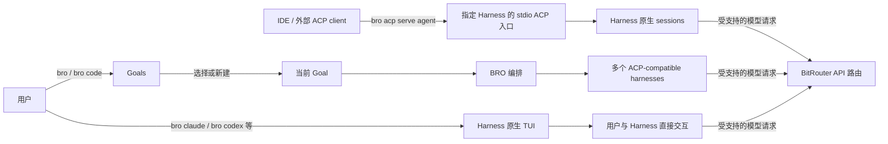
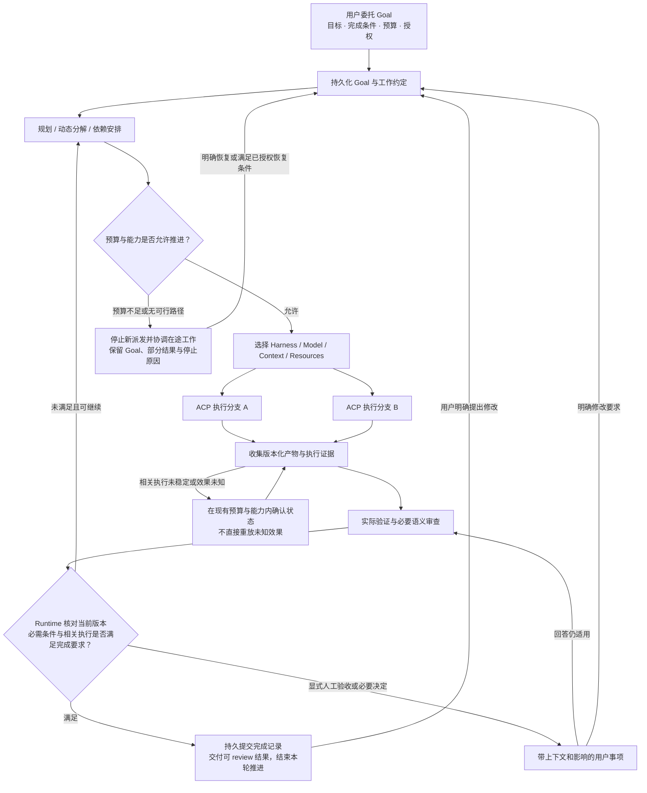
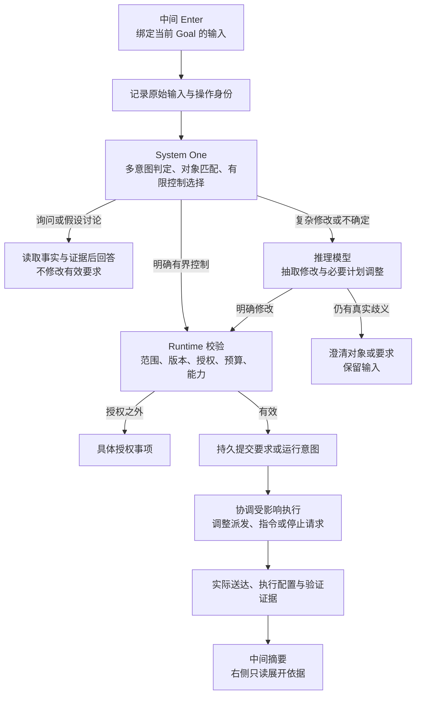
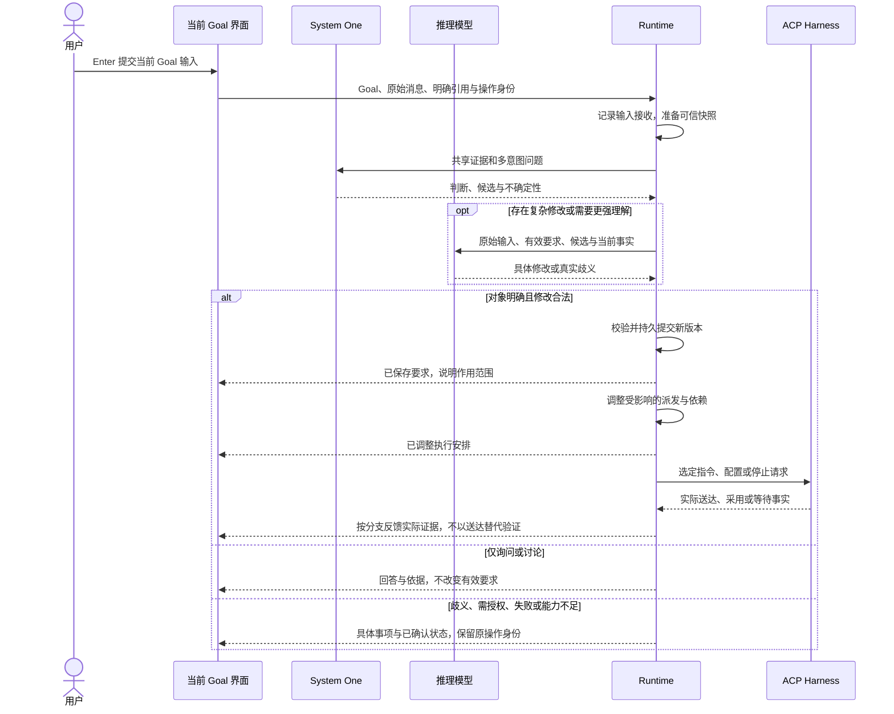

# BRO Goal Oriented Workflow PRD

状态：Draft v0.4，供产品 review。日期：2026-10-12。

BRO（bitrouter-orchestrator）面向 long-running、parallelizable workflows。用户委托 Goal 并控制目标、边界和结果；BRO 通过 ACP-compatible harnesses 持续推进工作，按能力选择模型、上下文、工具权限与 MCP/skills 等资源。

本 PRD 定义目标产品行为和 TUI 信息架构，不表示这些能力已经实现。当前实现基线为 `9b9a176288896809040a6fce11c92d146a4f5909`。本文不修改现有 CLI、执行协议或运行时合同；采用后需要单独制定迁移和实现方案。

## 1 产品定位与成功条件

**BRO turns ACP-compatible harnesses into self-driving workflows.**

BRO 的用户面对一个持续存在的 Goal。内部任务分解、session 更换、模型切换、验证和重试，都属于这个 Goal 的推进过程。Harness 负责具体执行，BRO 负责跨执行轮次的协调、结果交接和后续推进。

Self-driving 的完成标准是：在用户给定的目标、预算和授权范围内，BRO 能继续选择下一步、推进依赖、处理可恢复问题，并根据证据判断完成或请求介入。一次 harness 回复结束不能直接使 Goal 完成。

用户获得的主要价值是减少主动监督和手工协调：无需不断切换会话、复制结果给其他执行者、安排下一步或回答例行的“是否继续”。用户仍可查看事实和纠正方向；直接接管执行属于后续范围。

### 1.1 已确定的产品方向

| 决定 | 产品要求 |
| --- | --- |
| Goal-oriented | Goal 是默认导航、交互与交付单位，不以 agent/session 为主要对象 |
| 默认入口 | 裸 `bro` 与 `bro code` 进入 Goals；移除 `bro code <agent>`，不保留兼容执行入口 |
| 直接交互 | `bro claude`、`bro codex` 等原生快捷入口继续进入对应 harness 的原生 TUI |
| 外部 ACP 集成 | 保留 `bro acp serve <agent>`，由外部 ACP client 驱动指定 harness，不自动创建或编排 BRO Goal |
| 左侧 Goals | `←` 打开跨 Goal 的选择与管理视图 |
| 中间当前 Goal | 展示单个 Goal 的 dynamic workflow 交互：进展、决定、结果和用户指令 |
| 右侧 Workflow | MVP 中 `→` 只读展开当前 Goal 的任务、状态、依赖、资源与执行证据，不提供分支编辑或执行控制 |
| 中间 Enter | 向当前 Goal 提交输入；运行期间仍处理，不统一排到当前 worker 执行结束后 |
| 输入理解 | System One 做多意图判定和有限控制选择；开放的复杂修改由推理模型抽取与规划 |
| 状态权威 | Runtime 校验作用范围、当前版本、授权与能力，然后持久提交；模型判断不直接成为有效修改 |
| 生效反馈 | 依据实际执行证据区分已保存、已调整、已送达、已采用和已验证，不以模型 confidence 宣告生效 |
| 默认完成 | 当前必需条件满足、相关执行已稳定，并交付经过验证且可 review 的结果后，BRO 可以自主完成 Goal；人工验收只由 Goal 显式约定 |
| 完成权威 | 执行者提出候选，BRO 验证与必要语义审查提供依据，Runtime 核对当前版本、条件和执行状态后持久提交完成记录 |
| 验证证据 | 证据逐项关联完成条件、要求版本、产物版本与实际检查结果；分支分别通过不能代替集成产物验证 |
| 预算与阻塞 | 分别记录目标是否满足和推进停止原因；预算耗尽或阻塞保留 Goal、部分结果及解锁条件，不自动计为完成 |
| 长期与并行 | 支持动态分解、并行分支、依赖交接、暂停、重连与继续 |

### 1.2 本稿提出的默认值

以下是待 review 的默认设计，不代表已决定的实现细节：

- 默认 Inline 单焦点，左右代表导航层级；专家用户可主动进入临时全屏或并排检查。
- 中间采用当前状态摘要与 Goal 级重要事件历史；原始 worker 输出放入详情。
- BRO 自主提出和更新内部执行计划，普通已授权工作不强制经过启动确认表单。
- 全局预算或授权之外的扩展需要明确决定；通过中间提交的明确、已授权修改不增加二次计划确认。

### 1.3 产品入口

| 入口 | 用户体验与推进责任 |
| --- | --- |
| `bro` / `bro code` | 直接进入 Goals；用户选择已有 Goal 或明确新建 Goal，BRO 负责长期与并行工作编排 |
| `bro claude` / `bro codex` 等原生快捷入口 | 进入对应 harness 的原生 TUI；用户与 harness 直接交互，BitRouter 按集成提供 API 路由配置 |
| `bro acp serve <agent>` | 为 IDE 或其他外部 ACP client 提供指定 harness 的 stdio ACP 入口；外部 client 驱动交互，harness 管理自身 sessions |

`bro code <agent>` 直接移除，不保留兼容别名或过渡执行期。需要直接交互的用户使用原生快捷入口；需要外部 ACP 集成的用户使用 `bro acp serve <agent>`。不能把旧参数静默当作 Goal 内容或自动启动指定 harness。

Goals 是默认入口，不根据旧的默认 agent 设置自动进入某个 harness。必要的配置引导完成后返回 Goals。新建 Goal 是明确动作，进入 Goals 本身不启动执行。

简单任务适合直接驱动原生 harness；`bro` / `bro code` 面向 long-running、parallelizable workflows。选择入口表达用户要与谁交互，不由系统根据输入复杂度悄悄切换模式。中间输入始终面向当前 BRO Goal，不直接等同于发送给某个 harness 的单次 prompt。



### 1.4 外部 ACP 入口的用途与边界

`bro acp serve <agent>` 让 IDE 或其他 ACP client 用统一的启动入口连接指定 harness，复用 BitRouter 支持的启动配置、模型路由与协议转接。外部 client 如果能直接启动该 harness 的 ACP adapter 并自行配置 BitRouter API，也可以采用直接集成；serve 的价值是统一这段接入过程。

这条路径保持协议纯净的 stdio，stdout 承载 ACP 消息，诊断信息使用 stderr，不显示 Goals 或其他 TUI。指定的 agent 决定连接哪个 harness；prompt 与交互控制由外部 client 发起，session 身份、历史、生命周期和持久化仍由 harness 管理。

这条路径不因用户输入复杂或运行时间变长而自动创建 BRO Goal，也不自动引入多 agent 编排。未来若要把 BRO Goal 暴露给外部 ACP client，需要单独定义 Goal、session、完成与控制语义，不改变 `serve <agent>` 的指定 harness 合同。

## 2 用户与典型工作

主要用户是委托长时间、多阶段或多个独立分支工作的开发者和技术团队成员。他们需要可审查的结果，并希望在明确范围内减少监督。

典型工作包括跨服务修改、实现与验证并行、迁移与兼容性检查，以及围绕代码或其他可验证产物的调查工作。执行环境或 harness 的能力不足时，BRO 需要显示具体限制。

核心用户故事：

1. 我提交目标和约束，BRO 选择执行资源并推进，不先要求我组建 agent 团队。
2. 我离开后回来，可以迅速知道已验证什么、还差什么、是否需要我。
3. 多个 Goal 同时推进，我查看其中一个不会改变其他 Goal 的优先级。
4. 我在中间补充当前 Goal 的要求或明确指向某个任务，BRO 及时处理，并显示哪些相关执行已采用新要求；右侧用于只读核对。
5. 我审查交付物并提出修改，BRO 将反馈送到正确的工作范围。
6. 我需要排障时，可以逐层只读查看状态、资源和底层会话，并回到中间纠正要求或控制当前 Goal。直接接管保留为后续能力。

## 3 产品对象与控制范围

这些是产品概念，不预先规定数据库表或 Rust 类型，也不把它们直接等同于现有 Thread/Turn。

| 对象 | 含义与边界 |
| --- | --- |
| Goal | 持续存在的委托目标，包含完成条件、约束、授权、结果及推进历史 |
| Workflow | Goal 当前的动态执行安排，包含任务、依赖、状态与交接；可随证据调整 |
| Branch / Task | 可独立追踪的工作范围，有稳定身份、输入、输出、依赖和执行状态 |
| Execution | 为推进任务发生的一次或一组实际执行；可涉及多个 harness sessions |
| Harness session | ACP harness 管理的执行会话，其内部历史和能力遵循 harness 自身合同 |
| Decision | 需要用户作出的具体决定，绑定受影响范围和当前有效条件 |
| Deliverable | 用户可以审查或使用的版本化结果，绑定验证证据和未验证项 |

Goal 在重新规划、更换执行资源和恢复连接后保留身份。历史 Goal 可继续产生新版本结果，旧结果与旧证据不被覆盖。

并行分支不等于多个 harness 同时修改同一目录。BRO 必须根据实际执行能力隔离或串行化冲突写入，并在交接时验证产物来源、版本和适用性。

### 3.1 三种范围

- **观察范围**：用户当前看的 Goal 或分支。
- **输入范围**：中间 Enter 默认属于当前 Goal；明确回复或引用可以定位该 Goal 内的任务、结果或决定。全局设置必须使用显式入口或明确的全局指令。
- **调度范围**：任务实际的执行优先级与资源分配。

三者独立。浏览某个任务不提升其优先级；右侧选中分支不改变中间输入范围；资源优先级只因明确指令或已授权策略改变。未明确引用对象的中间输入属于当前 Goal，不根据最近浏览的节点猜测范围。

## 4 信息架构与导航


### 4.1 左侧 Goals

Goals 视图回答：有哪些目标、进展到哪里、哪些需要用户、哪些已有可用结果。

默认行展示 Goal 名称、项目、结果导向摘要、必要事项和信息新鲜度。Harness 数量、session ID 和模型信息属于详情。创建入口为“新建 Goal”，输入从目标与边界开始。

默认顺序保持稳定；提供运行中、需要我、有结果、已完成、暂停、预算受限、阻塞和归档等筛选。后台更新不自动重排正在浏览的行。打开和搜索不暂停工作；选择 Goal 只切换观察。

每个 Goal 保存独立草稿、输入范围、阅读位置与展开状态。未确认的提交保留原目标和原操作身份，不因切换 Goal 而改投或重复提交。

### 4.2 中间当前 Goal

稳定区域展示当前项目、Goal、有效完成条件、输入范围和当前交付版本。动态内容展示已验证、正在推进、未验证、必要决定与结果。

重要历史记录进入正常终端历史：目标变化、主要计划调整、验证结果、用户决定和交付。中间不持续转发所有 worker 输出。新事件不替换用户正在阅读的决定或结果；以可打开的提示告知更新。

BRO 的解释与执行事实要可区分。“验证通过”“已停止”“已生效”必须有对应事实；模型可以组织摘要和提出判断，但不能独立制造这些状态。

Enter 默认提交给当前 Goal 的 BRO，询问、修改和控制可以在同一输入中共存。询问或假设讨论不自动修改有效要求；明确修改进入校验和持久提交；控制动作使用明确范围。执行中的 worker 不阻塞输入处理。第 7 节定义理解、提交与生效反馈。

### 4.3 右侧 Workflow

MVP 右侧完全只读，默认呈现任务树、当前状态、依赖和阻塞。可以导航、搜索、折叠、展开和查看证据，不能编辑分支、派发指令、切换资源、批准动作、暂停执行或直接接管。任务可以嵌套，已完成节点仍可追踪；折叠节点保留失败、必要事项和未知状态的汇总。

用户需要纠正某个分支时，回到中间并明确引用该任务。返回保留阅读位置，原草稿不会因浏览对象变化而改投。右侧原始 session 展示也只读，不提供可直接操作的终端。

宽屏可展开局部 swimlane；窄屏优先任务树、状态与阻塞。Lane 以分支为主，harness 为资源标签。Transition 需要实际依赖、委托、结果消费或控制事件依据；事件提交顺序不能被绘制成虚假的因果边。

第一版不展示没有可靠估计依据的整体完成百分比，也不以无真实起止时间的图形暗示精确耗时。

## 5 ASCII 线框

以下数据、名称、费用和结果均为产品示例。线框使用英文标签以保持等宽对齐，不限定最终界面语言。

### 5.1 Goals 目录

```text
+--------------------------------------------------------------------------+
| BRO / Goals                                      [New Goal] [Search]     |
| Filter: All | Running | Needs me | Results | More                         |
+--------------------------------------------------------------------------+
| > Fix login expiry       storefront   Verifying           No action       |
|   Upgrade payment API    payments     Contract decision    Needs you       |
|   Analyze slow queries   analytics    Report v2 verified   Complete        |
|   Refactor permissions   platform     Paused by you        Paused          |
|                                                                          |
| Selected: Fix login expiry                                               |
| Verified: API regression checks. Remaining: browser session refresh.       |
| Last confirmed update: just now.                                          |
+--------------------------------------------------------------------------+
| Up/Down select   Enter open   / search   Esc return                        |
| Opening a Goal changes your view; execution priority stays unchanged.      |
+--------------------------------------------------------------------------+
```

### 5.2 当前 Goal 的默认工作界面

```text
BRO / storefront / Fix login expiry                         Result: draft v3

Goal
Fix session expiry after refresh and add regression coverage.
Boundary: edit this project, run local checks; deployment is outside scope.

Progress
  Verified    Failure reproduced; API regression checks passed for v3.
  Active      Browser session-refresh verification.
  Remaining   Old mobile client compatibility.

Needs you: none.  Observation: current.  Other Goals: 1 needs your decision.

Recent history
  API fix v3 generated. Browser verification started.
  Compatibility review waits for the browser result.

--- Input for: this Goal --------------------------------------------------
> Keep the public API unchanged and finish browser verification first.

Running | Priority: normal | Recorded: $3.20 | In-flight: not settled
Enter submit to Goal | Shift-Enter newline | [Pause Goal]
< Goals       [View result]                       Read-only Workflow >
```

“无需介入”与“观察状态可信”分别展示。状态过期时，上例的 observation 区域改为最后确认时间及不确定范围，不能继续显示健康状态。

### 5.3 Goal 级必要决定

```text
BRO / payments / Upgrade payment API

Decision: allow generating a database migration file?

Why
The selected implementation needs a session-version field.
Generating the migration exceeds the current application-code scope.

Choices
  [Allow migration file]  [Use another approach]  [Pause this branch]

Impact
  Blocked: API implementation and its dependent compatibility checks.
  Continuing: independent documentation checks.
  This choice does not authorize applying a production migration.

Evidence: [Implementation proposal] [Affected files]
Input scope: current Goal / Upgrade payment API
The decision cards explicitly bind each response to this request.

< Goals                  [View all decisions]                 Workflow >
```

决定在用户响应前必须仍然有效。条件已变化的决定显示已解决或已失效，不接受过期响应。相同根因可合并展示，授权仍绑定各自范围。

### 5.4 Goal 交付与审查

```text
BRO / storefront / Fix login expiry                           Result: v4

Goal: complete. Human acceptance: not required by this Goal.
Delivery: available for review
  Changed   Session refresh expiry logic; regression coverage added.
  Verified  API, browser refresh and mobile compatibility checks for v4.
  Unknown   Production behavior; deployment is outside this Goal.
  State     Patch prepared; not merged or deployed.

[View diff] [Open evidence] [Create PR]

--- Feedback for: result v4 / this Goal ------------------------------------
> Keep the existing function name. Change only the expiry check.

This feedback starts another execution cycle for the same Goal.
< Goals                                                    Workflow >
```

默认情况下，经过验证、可 review 的结果交付后 Goal 已完成，用户无需再点击接受。Goal 显式要求人工验收时，同一区域显示“等待验收”，结果可 review，但 Goal 尚未完成；验收绑定要求与产物版本。

按钮只在对应动作实际支持且满足既有授权时提供。应用补丁、创建 PR、合并和部署是不同操作；没有统一含糊的“接受并继续”按钮。后续明确反馈保留原完成记录，并在现有预算与授权允许时启动新一轮工作；单纯打开结果或询问不启动执行。

### 5.5 右侧 Workflow 与分支展开

```text
+--------------------------------------------------------------------------+
| BRO / Fix login expiry / Workflow                         [Back to Goal] |
+--------------------------------------------------------------------------+
| Tasks                              | Selected: Browser verification      |
|                                    | State: running                      |
| [done] Reproduce failure           | Input: patch v3                     |
| [done] Implement API fix           | Context: repro + API test evidence  |
| > [run] Browser verification       | Harness: selected ACP harness       |
|   [wait] Compatibility review      | Model: actual model, if reported     |
|          depends on Browser        | MCP: browser tools configured       |
|                                    | Skills: applied IDs, if confirmed   |
|                                    | Waiters: compatibility review       |
|                                    | [Evidence] [Session] [History]       |
+--------------------------------------------------------------------------+
| Read-only. Return to Goal to give an instruction with a task reference.    |
+--------------------------------------------------------------------------+
```

右侧区分可用资源、当前配置与实际使用。未知的 model/context/skill 使用情况明确标为未知，不能由目录存在或配置成功推断实际使用。

### 5.6 中间 Enter 与按证据反馈

```text
BRO / storefront / Fix login expiry

Input scope: current Goal
> Keep the public API unchanged. Prioritize Safari verification.

[Submit]   [Pause Goal]

Recorded   Goal requires API compatibility; Safari verification is first.
Adjusted   No new implementation work will use the old interface proposal.
Adopted    Safari verification started with patch v3 and the new instruction.
Waiting    API branch write termination has not been confirmed.
Unverified API compatibility of the current patch still needs evidence.

Independent branches continue. There is no second plan approval.
< Goals                                    [Read-only execution details] >
```

Enter 或 Submit 是明确提交动作，编辑和 paste 本身不执行。上例的各阶段依赖对应实际证据，不是提交后的固定文案；暂停写入是接口约束产生的具体影响，单独提高 Safari 优先级不会默认停止其他有效工作。

### 5.7 窄屏 Workflow

```text
+--------------------------------------+
| BRO / Login fix / Workflow            |
| [done] Reproduce                      |
| [done] API fix v3                     |
| > [run] Browser check                 |
|   [wait] Compatibility                |
|          needs Browser result         |
|--------------------------------------|
| Browser check: running                |
| Input: patch v3                       |
| Context: repro + test evidence        |
| Model: unreported                     |
| [Detail] [Evidence] [Session]          |
|                                      |
| Read-only / Enter detail / Esc back   |
+--------------------------------------+
```

低于支持尺寸时保留 Goal、分支、草稿和操作状态，提供 resize 提示与离开入口；不得隐藏必要信息后仍允许误导性的提交或批准。最终最小尺寸由实现验证确定，现有 TUI 基线为 40×16。

### 5.8 预算耗尽与阻塞

```text
BRO / storefront / Fix login expiry                           Result: v4

Goal: incomplete. Execution: stopped -- budget reached.
Deliverable: patch v4 available as a partial result.

Verified  API regression and compatibility checks for v4.
Missing   Required Safari verification.
Budget    Recorded: $8.00 / Limit: $8.00 / In-flight: none.
Next      Run Safari verification and review its result.

[View patch] [View evidence] [Add budget and continue]

--- Input for: this Goal --------------------------------------------------
> Explain which conditions remain unmet.

< Goals                                    [Read-only execution details] >
```

如果在途执行尚未确认停止，上例 execution 改为停止中，并指出未确认范围。费用未知时单独展示，不填写虚假的精确剩余额度。已记录事实可直接查看，额外调查或模型解释仍受预算约束。

阻塞时同一区域显示受阻条件、原因、已尝试路径和解锁条件，例如“Safari 验证缺少所需环境”。若其他分支仍可推进，显示“运行中，Safari 分支需要环境”，而非整项工作已停止。恢复动作在中间提供，右侧仍只读。

## 6 Self driving 执行闭环



中间步骤完成后由 BRO 验收和交接，不例行通知用户。目标冲突、必要授权、预算不足和无法确认的执行形成明确事项。BRO 不自行降低完成条件以宣告成功。

### 6.1 完成条件与默认交付

完成条件的定义权属于用户。BRO 可以从目标补全可验证的表达，展示理解并推进普通已授权工作，不强制增加启动前验收表单。BRO 可以选择验证方法，但不能自行增加业务目标、删除难以满足的必需条件或降低标准；影响终点的真实歧义需要澄清。

默认情况下，当前 Goal 的必需条件满足、约束保留、相关执行已稳定，并交付经过验证且可 review 的结果后，BRO 可以自主判定完成。人工验收只有在 Goal 显式约定时才成为必需条件；这时可先提供结果供 review，但收到适用的验收决定之前不标记完成。

完成后结束本轮推进，不默认继续无限自我改进；后续明确修改进入同一 Goal 的新一轮工作。

交付范围来自 Goal：准备可 review 补丁、创建 PR、合并和部署分别有不同的完成条件。提供补丁的 Goal 可以在补丁验证并可访问后完成；要求创建 PR 的 Goal 必须确认 PR 实际存在且对应正确版本。后续合并或部署不被自动添加为默认完成条件。

未知项是否妨碍完成取决于其与目标的关系。必需条件仍未验证时不能完成；目标范围外的未知项可以随交付明确标注。调查报告可以以准确区分确认事实、受阻 claims 和未知项为完成标准，不能把这一标准用于替代修复 Goal 的必要验证。

### 6.2 判定责任与独立审查

| 责任方 | 责任与边界 |
| --- | --- |
| 执行 harness | 产出结果与执行证据，提出完成候选；一次最终回复不改变 Goal 完成状态 |
| BRO 验证流程 | 实际运行所需检查，核对产物与条件，必要时安排独立审查；遵守同一预算与授权 |
| 推理模型 | 判断行为、覆盖范围及开放语义是否符合目标，指出遗漏与不确定性；可以检查实际产物，不只阅读 worker 总结 |
| Runtime | 校验证据来源、适用版本、必需条件和在途执行状态，持久提交完成记录；不把技术校验等同于所有语义已被证明 |
| 用户 | 定义或修改成功标准；Goal 显式要求人工验收时作出接受或修改决定 |

机器可直接检查的条件由程序判断；复杂语义交给推理模型。System One 可筛查缺失条件、识别矛盾或选择后续验证路径，不以 confidence 替代检查结果，也不独立改变有效完成条件。

不要求每个执行轮次都运行完整 review。完成候选出现时根据目标与证据安排审查；并行集成、测试本身被修改或证据相互冲突时，需要重点检查原始要求是否仍被覆盖。执行者自行修改测试后获得全绿，不能单独证明要求已经满足。独立评估的上下文应包含目标与实际产物依据，不仅包含执行者的解释。

### 6.3 验证证据与适用范围

证据逐项回答哪项完成条件成立，必需条件分别标记已满足、未满足或未验证。日志存在、命令结束和 harness 声称已完成不能替代这种关联。

| 证据范围 | 示例与要求 |
| --- | --- |
| 行为结果 | 复现与回归检查、浏览器行为、benchmark 或其他目标所需的实际观察；适用时保留修复前失败和修复后结果 |
| 约束保留 | API 差异、兼容检查、相关审查或其他边界依据，核对原始要求仍成立 |
| 集成结果 | 多个分支交接或合并后的共同产物及相关验证；各分支分别通过不代表组合通过 |
| 可交付产物 | 实际补丁、报告、PR 或约定结果可访问，内容与验证版本一致 |

每份证据关联完成条件、Goal 要求版本、产物版本（包含相关未提交修改）、执行环境或材料、实际检查与结果来源。复用证据时说明其对当前版本仍适用的依据；结果变化后只重新检查受影响条件，不默认所有证据继续有效或所有检查必须重跑。

Worker 总结用于组织与索引证据。验证流程必须能检查其依据；fixture、模拟、真实 harness、真实 provider 和生产证据保留各自适用范围。证据能支持某项结论，不代表它证明了目标之外的行为。

### 6.4 完成提交与版本变化

Runtime 提交完成记录前，核对最新有效要求、相关产物与证据、必要的语义判断，以及显式人工验收（如有）。必需工作已结束，可能改变交付物或结论的相关在途执行已完成或确认停止，不能在它们仍修改产物或效果未知时提交完成。

可选探索分支可以结束，不必等待所有 worker 自然退出；停止及相关效果仍需确认。其他 Goal 的独立执行不阻止当前 Goal 完成。

验证或验收期间要求、产物或相关执行状态发生变化时，旧结论不能直接提交为当前完成状态；重新核对受影响条件。完成记录持久关联要求版本、交付版本、各必需条件的依据、必要评估或验收，以及已确认执行状态。

后续明确修改开启同一 Goal 的新一轮工作，原完成记录仍作为历史保留，不把旧证据自动用于新条件。打开结果、查看 Workflow 或询问已完成 Goal 不自动重启执行。

### 6.5 预算耗尽与部分交付

Goal 的预算覆盖规划、输入判定、执行、验证、完成评估及可计量的工具费用。费用、token、时间等限制分别说明适用范围；时间预算需区分总经过时间与实际活动时间，不能以等待或重连掩盖限制。

BRO 在接近上限时按验证计划保留必要资源，避免实现耗尽预算后无法检查交付。预留规模依据实际工作安排，不预设统一百分比。Runtime 在并行派发前核对预留与消费，已结算、已预留、在途和未知费用分别展示。

达到上限后停止新派发，并协调在途执行、保存产物和状态；不降低验收标准，不额外启动超预算的付费验证或总结。需要模型生成收尾报告时提前计入预算，没有余量时 UI 直接呈现已记录事实。已发出的请求可能继续发生费用，接受停止请求与实际停止分开反馈。

BRO 只能对可计量、可控制的支出执行可靠上限，未知外部费用单列。部分结果可交付，但必需条件仍缺失时 Goal 保持未完成；显示已验证部分、剩余条件、停止原因和最有价值的下一步。

所有完成证据已成立时，即使预算恰好达到上限，Goal 仍可完成。预算不足以取得剩余证据时保持未完成，不能以“接近完成”替代验证。增加预算与恢复推进需要明确指令或现有授权策略；恢复不自动扩大预算或清零已记录消费。

### 6.6 阻塞 停滞与恢复

| 情况 | 推进与用户反馈 |
| --- | --- |
| 暂时失败且有可行恢复路径 | 在预算内有界重试、换资源或调整方法，保存尝试与原因；不无限重试 |
| 单个分支缺少授权或材料 | 显示具体事项，其他仍有价值的独立分支继续；一个分支受阻不等于整个 Goal 已停止 |
| 等待已知外部条件 | 显示等待对象与恢复条件，在预算、时限与授权允许时自动继续；不覆盖用户暂停意图 |
| 没有可推进路径 | 保留 Goal 与部分结果，显示当前条件下的阻塞原因、已尝试路径和解锁条件 |
| 重复尝试未产生新事实 | 停止无效自主循环，显示停滞依据与下一步；tool 调用次数或代码变化不能单独代表有效进展 |
| 相关效果未知 | 协调确认并限制受影响工作，不假装已停止或完成，也不自动重放未知效果 |

单次 harness 失败不自动使整个 Goal 失败；有其他有效路径时可以继续。评估模型给出 impossible 只是判断依据，需要结合实际条件、尝试与证据说明当前为何不可达，不因此自动清除 Goal。

阻塞记录指出哪个必需条件受阻、哪些范围受影响、为什么继续尝试无效，以及凭据、材料、授权、预算或环境发生什么变化能够恢复。条件改善后重新核对最新要求与产物，只恢复仍有效且被授权的工作；对暂停或未知效果不做隐式恢复。

目标是否满足、运行意图、实际执行状态和推进停止原因分别保留。预算受限、阻塞、停滞和用户停止都不能自动成为成功结论；用户明确结束本轮时仍保存未完成条件和可用成果。

## 7 中间 Enter 输入理解与持久状态

### 7.1 默认提交语义

Enter 向当前 Goal 提交一条输入。它不直接发送给某个 harness，也不统一变成等待当前 worker 结束后才处理的新 turn。BRO 的输入处理与后台执行并行，及时理解询问、修改和控制，反馈处理结果。

输入框持续显示当前 Goal。只有用户明确回复或引用任务、结果或决定时，才缩小作用范围；右侧观察对象不参与隐式定向。新建 Goal 使用明确模式，不因一条普通消息自动创建其他 Goal。

普通明确、已授权修改经过校验后直接提交，没有额外的计划批准环节。询问与假设讨论不自动改变有效要求或重启工作。真正的对象歧义、互相冲突的要求或授权扩展形成具体事项，不把所有难句都变成确认流程。

“先停”“暂时停一下”默认表示暂停，保留之后恢复的意图；明确要求结束本轮执行才表示停止。对象不明确时仍先澄清，不能据此猜测分支。`/task left 这个分支先停` 保存 left 及其下游依赖的暂停意图，独立分支继续；没有任务引用的明确控制默认作用于当前 Goal。暂停与停止都保留已有部分结果，仅提醒保留成果不增加新要求。反馈分别说明控制意图是否已保存、哪些执行已确认暂停，以及哪些执行仍在协调；恢复需要明确指令。

| 输入示例 | 理解与默认效果 |
| --- | --- |
| 现在卡在哪里？ | 读取状态和证据并回答，不修改 Goal 要求或运行意图 |
| 为什么不用方案 B？ | 讨论和比较，不自动采用 B |
| 改用方案 B，其他约束保持 | 更新方案要求，协调受影响执行；保留仍有效的成果 |
| 还要验证旧客户端 | 修改当前 Goal 的完成条件，安排相应验证 |
| 为什么 Safari 失败？先别改实现，重新复现 | 询问、约束修改与工作安排共存，分别处理并反馈 |
| 暂停这个 Goal | 明确控制当前 Goal 的所属执行树，停止新派发并协调在途执行 |
| /task left 这个分支先停 | 暂停 left 及其下游依赖，保留恢复意图与部分结果；独立分支继续 |

“方案 B 看起来更简单，我们是不是该换掉 A？”这类假设或协商表达默认讨论，不等同于“改用 B”。如后续研究发现需要调整这条边界，必须以明确产品规则和评测更新，不能仅凭模型偏好改变执行。

### 7.2 System One 推理模型与 Runtime 分工

System One 对有界、类型化问题做多意图判定、对象匹配和有限控制选择，不把询问、修改、控制强行压成单一互斥类别。一条输入可以包含多个独立意图。复杂约束、任意字段抽取、依赖修复和开放规划交给推理模型。

| 责任方 | 责任与限制 |
| --- | --- |
| System One | 判定是否有询问、明确修改、执行控制、约束补充或假设讨论；从有效候选中匹配对象和有限控制操作；输出分布与不确定性 |
| 推理模型 | 处理混合或复杂输入，抽取具体修改内容、分析冲突、提出必要的 Workflow 调整；不直接持久写入有效要求 |
| Runtime | 提供可信 Goal 快照和候选；校验范围、当前版本、授权、预算与能力；持久提交并协调执行 |
| 执行与验证投影 | 根据提交、调度、送达、实际执行配置和产物验证事实生成反馈；模型 confidence 不是生效证据 |

System One 的输入包含原始用户消息、当前 Goal 的有效要求与运行意图、明确引用、必要的最近对话，以及已知任务的稳定身份和简短描述。Worker 输出和引用文本作为观察数据，不拥有用户指令的修改权限。

模型问题的指令必须明确被判断的对象，不能仅依赖问题名称。独立问题可以共享一次请求；依赖前一答案的判断分步处理。Runtime 检查答案组合，矛盾结果不能按各自高分分别派发。候选包含 unknown/不适用路径，避免被迫选中错误对象。

明确且有界的控制可由 System One 选择后直接进入 Runtime 校验；新完成条件、复杂修改和不能确定的语义进入推理路径。模型低置信、拒绝、超时或错误优先进入备用理解路径；仍存在真实歧义才请求用户澄清。普通输入不因模型升级自动变成暂停整个 Goal。

概率和 confidence 不构成授权或执行许可，也不等于下游成功概率。阈值按 BRO 自身输入的误报、漏报及副作用代价评测，不给所有问题套一个统一值。暂停/停止另有明确 UI 动作，不完全依赖自然语言分类。

System One API 中的 state 是本次判断的证据，不替 Runtime 保存 Goal。本文采用多意图和分层处理方向，不宣称特定模型已通过 BRO 意图评测，也不从厂商延迟或类型正确声明推断实际 workflow 收益。

### 7.3 Persistent state 与提交权威

| 持久事实 | 含义 |
| --- | --- |
| 原始输入与处理记录 | 用户说了什么、作用于哪个 Goal、如何解释、是否已接受及处理状态 |
| Goal 有效要求 | 目标、完成条件、约束和优先级，跨对话压缩、TUI 退出与 harness 更换保留 |
| 运行意图 | 用户希望继续、暂停或停止，与实际执行是否已经停止分开 |
| Workflow 安排 | 为有效要求推进哪些任务、依赖与后续派发 |
| 实际执行与产物 | 哪些执行发生、使用什么配置、形成哪些版本化产物及验证证据 |
| 修改传播记录 | 哪些受影响执行已送达、采用或仍在协调，关联原输入和修改版本 |
| 完成与停止记录 | 完成评估及提交对应哪个要求与交付版本；目标是否满足、预算或阻塞等停止原因、部分结果与恢复条件分别保留 |

以上是必须区分的产品事实，不预设数据库表数量或特定存储实现。原始输入接收记录和模型判断可以持久保存，但只有 Runtime 校验并提交的修改才成为有效要求；“消息已记录”不代表“Goal 已修改”。

Runtime 校验修改目标、预期版本、现有约束、授权与执行能力。版本已变化时重新核对：仍适用的修改可以直接提交；对象已消失或含义不能确定时保留原输入并澄清，不自动改投相似任务。

提交后再改变派发或发送执行控制。未完成持久提交的修改不能以已经接受的状态启动外部效果。提交响应丢失时确认原请求和操作身份，不自动创建第二次工作。后台事实或模型计划不能自行降低用户完成条件、扩大授权或覆盖有效约束。

连续输入按接受顺序理解；后续内容可以补充或明确替代前面的要求，不能把最后一句当作完整 Goal 状态。原始要求、替代关系和当前有效版本保留。当前 Goal 的临时要求不自动升级为全局长期偏好。

### 7.4 按实际证据反馈生效

先反馈输入是否已接收和修改是否已提交，再按受影响范围展示实际传播。失败、待授权、能力不支持和效果未知分别显示，不使用一个全局 Applied 标签掩盖差异。

| 用户可见反馈 | 需要的实际依据 |
| --- | --- |
| 已记录输入 / 理解中 | 输入已接收并绑定当前 Goal，尚未提交有效修改 |
| 已保存要求 | Runtime 已完成对应修改的持久提交 |
| 已调整执行安排 | 派发、依赖或控制意图已实际更新，指出受影响范围 |
| 已送达执行者 | 指令传递得到实际确认；仅送达不表示遵守 |
| 新执行已采用 | 对应请求或执行记录使用了新要求或配置，说明生效位置 |
| 新结果已验证 | 对应版本产物有满足新要求的验证证据 |
| 仍在协调 / 未知 | 当前操作未确认停止、指令待应用，或执行效果无法确认；显示具体原因 |

要求已保存不保证所有 harness 已采用；采用新 context 也不证明最终结果符合约束。暂停请求已接受与所有活动执行已停止分开显示。不同分支可以处于不同阶段，中间显示重要摘要，右侧只读展开逐项依据。

### 7.5 实际执行边界

查询缺少事实与执行意图不明确分别处理。例如“为什么失败？先暂停当前 Goal”：没有失败证据时先澄清哪次尝试，同时保存明确的暂停意图；不能以查询未回答为由漏掉暂停，也不能编造原因。只有查询部分待澄清时，不阻止同一输入内已经明确、互不依赖并通过 runtime 校验的修改或控制。要求、授权或控制范围本身有歧义时仍不猜测效果。

- **询问**：根据当前事实回答，不隐式更新要求、恢复暂停或改变优先级；必要的只读调查仍受预算与授权约束。当前 Goal 没有失败证据时，面对“为什么又失败了”可以追问哪次尝试或哪份日志，避免编造原因；保存这种询问澄清不增加完成条件，也不阻止独立工作。
- **明确要求修改**：提交后立即更新对应范围的执行依据并协调相关工作，限制 BRO 可控制的旧要求下后续派发；不默认取消所有有效工作。
- **Harness 指令**：支持 steering 时及时送达；不支持时在下一可控执行边界采用，并明确指出当前不能即时改变的部分。
- **Model / Context / Resources**：影响后续可控执行，不能追溯改写已发送请求的配置；需要重建 session 时反馈实际过程。
- **暂停 Goal**：停止该 Goal 的新派发和暂停期间的自主启动，协调其所属活动执行；其他 Goal 继续。停止确认前显示暂停中，触发配置本身不被隐式删除。
- **恢复或停止**：恢复依据最新要求、产物与依赖；停止结束本轮推进并保留结果。已暂停/停止 Goal 收到要求修改时先保存，不隐式恢复。
- **依赖与结果**：重新检查受影响下游输入，仍有效的成果保留；旧结果即使晚到，也不能未经检查成为新要求下的有效交付。

明确分支引用可以使中间输入作用于该任务和必要的依赖范围；右侧选择本身不赋予这种范围。修改不隐式改变其他 Goal、全局预算或授权。已发生的 shell、写入和外部动作不因撤销输入而被宣称自动回滚。

### 7.6 输入处理与状态提交路径



图中是处理路径，不是互斥单意图分类。一条混合消息可以同时进入询问和修改处理，不能因只回答问题而漏掉明确控制。



普通明确修改不插入第二次“批准新计划”的确认页。右侧始终只读，所有用户控制通过中间输入或明确动作入口发起。

## 8 进展 结果与接管

### 8.1 多维状态

| 维度 | 示例 |
| --- | --- |
| 执行 | 准备、运行、等待依赖、暂停中、暂停、结束 |
| 目标满足情况 | 未完成、已完成，关联当前要求与交付版本 |
| 推进停止原因 | 条件满足、预算受限、阻塞、停滞、用户停止 |
| 用户事项 | 无、需要决定、需要审查 |
| 观察可信度 | 当前、过期、失联、效果未知 |
| 交付 | 无结果、草稿、已验证、已交付、已发布 |

这些维度不合成一个绿色圆点。一个分支等待输入不必暂停整个 Goal；状态不可确认时显示最后可靠更新、未知范围及当前处理方式。预算达到上限但仍有在途执行时，目标可显示未完成、原因显示预算受限，实际执行显示停止中，不能直接显示全部已停止。

### 8.2 结果与证据

测试、审查和验证证据绑定实际产物版本。验证过版本 A 不代表后续版本 B 已验证。结果变化后，BRO 判断哪些证据仍适用，并显示需要重新验证的部分。

执行结束、完成条件满足、用户审查和发布分别记录。默认完成不等待用户 review；显式人工验收的 Goal 在必要验收之前保持未完成。部分交付可以可用，而 Goal 仍推进、预算受限或阻塞；部分交付不能被计为整个 Goal 已完成。审查打开后若生成新版本，提示有新版本但不替换用户正在看的内容。

### 8.3 MVP 查看与后续接管

MVP 的 Workflow、执行详情和底层会话均只读。查看不暂停执行，不提供分支编辑或交互式终端；用户从中间发起要求修改和明确控制。

直接接管属于后续范围。若引入，需要停止对应范围的自动派发并协调在途写入；确认停止前显示接管请求中，确认后才显示已接管。交回时重新检查用户修改、工作空间、依赖与验证版本。不能把这一后续能力列为 MVP 已支持的路径。

## 9 TUI 交互要求

| ID | 要求 |
| --- | --- |
| UX01 | 空 composer 的普通左键打开 Goals，右键打开当前 Goal 的 Workflow；非空输入保留左右编辑 |
| UX02 | 草稿非空或有必要决定时仍可用显式导航入口，导航不提交草稿或批准决定 |
| UX03 | 每个 Goal 的草稿与位置独立；中间 Enter 默认作用于当前 Goal，明确引用才定向到内部对象 |
| UX04 | Esc 从详情逐级返回，不隐式取消 Goal；停止 Goal 有明确且标注范围的动作 |
| UX05 | 后台事件不抢焦点、不自动展开视图、不 retarget 输入、不改变调度优先级 |
| UX06 | Paste 与换行保留编辑语义，明确提交才派发工作或修改 |
| UX07 | 正常输出保留终端历史；原始后台日志不持续冲走前台阅读内容 |
| UX08 | 大 Diff、局部轨迹和排障可临时全屏；退出恢复原位置和草稿 |
| UX09 | 中间明确修改没有二次计划确认；已保存、已调整、已送达、已采用、已验证分别依证据反馈 |
| UX10 | 新建 Goal 与补充当前 Goal 是明确可切换的输入模式，不只依赖模型猜测 |
| UX11 | MVP 右侧只读，无分支编辑、控制或可操作终端；查看不 retarget 中间输入 |
| UX12 | 运行期间仍处理 Goal 输入；询问、修改、控制可共存，不统一等待当前 worker 结束 |
| UX13 | 暂停/停止有明确动作入口；选择操作后仍经 Runtime 校验，不依赖模型生成一段解释才能执行 |
| UX14 | 完成情况、推进停止原因、实际执行和用户事项分别展示；默认交付无需点击接受，显式人工验收显示待验收与版本 |
| UX15 | 预算耗尽或阻塞时可查看部分结果、已验证与未完成条件、停止原因和恢复条件；增加预算、恢复与修改通过中间发起 |

确切快捷键、退出/取消组合键和最小尺寸在键位设计阶段确定。上述方向导航是产品要求，不声明当前 CLI 已支持。

## 10 ACP 与资源能力边界

ACP-compatible 是接入条件，MVP 不以第一批 harness 品牌名单限制产品范围。BRO 根据实际协议版本、协商能力和集成提供支持状态，不伪造 model 切换、context 控制、session 恢复或中途 steering。协议接入与每项高级控制能力分别验证。

BRO 掌握 Goal、任务依赖、共享产物和分配给执行任务的材料。Harness 内部 conversation、压缩与私有执行状态，只通过其公开支持的接口观察或控制。记录的 ACP 输出不能直接视为可恢复的完整内部 context。

MCP/skills 支持区分发现、配置、选择和实际使用。权限自动化依据用户既有策略，不通过读取 skill 或发现 tool 扩大授权。预算区分已记录费用、估算、在途与未知；只有实际可控资源参与优先级调度。

System One 与 Decisions API 是有界语义判断接口，不提供 Goal 持久提交或执行证明。各自的原生 schema、概率、拒绝与错误语义需要保留；类型正确不能被当作意图正确。复杂字段抽取和开放计划仍需生成/推理路径，具体 backend 能力与意图质量单独验证。

当前可借用的基础与迁移缺口：

| 当前基础 | 本 PRD 所需的新产品能力 |
| --- | --- |
| Native Conversation、durable Thread 导航、Inline writer | Goal 目录、中间 Goal 投影、右侧 Workflow，以及独立草稿和输入范围 |
| Core 调度与 managed native 集成 | 面向 ACP harnesses 的 Goal 推进、中间控制和能力适配 |
| 有界语义分类与 Decisions 调用 | Goal 多意图判定、有限控制选择、复杂修改升级及 Runtime 校验提交 |
| Native 验证记录、执行和资源事实 | Goal 完成条件、版本化交付和证据汇总 |
| ACP controller 与 harness-owned sessions | 多执行轮次协调，不替换 harness 的原生 session 权威 |

### 10.1 当前路径与目标迁移

当前裸 `bro` 根据已保存的 `chat.agent` 进入默认 ACP 交互或配置引导；无 agent 参数的 `bro code` 是 native Conversation 路径，`bro code <agent>` 是 ACP 交互路径。两者及 managed native 集成尚未统一成 Goal 执行产品。

采用本 PRD 后，裸 `bro` 和 `bro code` 都进入 Goals，`bro code <agent>` 被移除；原生快捷入口与外部 `bro acp serve <agent>` 保持各自的直接交互合同。移除 ACP 交互的 CLI 入口不意味着移除 ACP client/controller：BRO 内部编排和外部集成仍需要这些协议能力。

现有 native Thread、harness session 和 supervisor 执行记录不能仅通过改名成为 Goal，也不能据此宣称已有跨分支恢复。Goal 需要独立的完成条件、要求版本、任务依赖、控制意图和交付证据；导入历史或恢复已有执行的具体规则留待实现设计。

实现迁移时需同步 CLI、onboarding、帮助、相关内部合同与分发 skill/manifests。本文仅确定目标行为，不改写当前 CLI 参考或声明入口已经迁移。

## 11 第一版范围与验收

第一版交付一个完整委托闭环：默认 Goals 入口、Goal 工作界面、中间 Enter 多意图处理、只读右侧 Workflow、必要决定、版本化交付和按需检查。以 ACP 协议接入为基础，不把首批品牌选择列为产品待定项；完整闭环仍需通过真实 harness 验证，可选能力按实际协商与证据展示。

第一版包含动态分解与至少两个可独立推进的分支，不要求固定角色团队。支持任务深度展开和折叠，避免把所有 model steps 直接铺成独立 lane。

第一版不包含右侧分支编辑、执行控制和直接接管；也不优先实现角色头像、拖拽 DAG、持续 token 瀑布、常驻多 pane 或完整资源控制台。高级交互可作为后续范围。

### 11.1 必须通过的用户场景

| ID | 场景与验收结果 |
| --- | --- |
| A01 | 提交已授权 Goal，BRO 不要求先选择 harness/model/worker 数量，保留可检查的工作约定 |
| A02 | BRO 拆出并行分支时不新增前台 tab；用户可在右侧发现它们和依赖 |
| A03 | 一个分支完成后，BRO 验证并交接给下游；用户无需复制输出或手动安排下一步 |
| A04 | 另一 Goal 出现决定，不切换当前 Goal；提示可见，草稿与阅读位置保留 |
| A05 | 切换 Goal 后，各自草稿与输入范围恢复；没有隐式提交、恢复或优先级变化 |
| A06 | 运行中从中间提交当前 Goal 的明确修改，无二次计划确认；校验提交后实际后续执行使用新要求 |
| A07 | 不支持中途 steering 或有未停止操作时，显示准确等待原因；送达不被当作已采用或已验证 |
| A08 | 修改影响依赖时，下游使用正确的新版本或等待重新验证，独立分支继续 |
| A09 | 超出授权的动作形成具体决定；普通明确 Goal 修改不被统一送入额外审批流程 |
| A10 | 提交响应丢失或重连时确认原请求，不重复启动；未知效果不显示成功或自动重放 |
| A11 | 验证绑定产物版本，Goal 不因 worker 结束或部分交付自动标为完成 |
| A12 | 右侧和底层会话只读，无编辑/控制/交互终端入口；查看不改变执行或中间输入范围 |
| A13 | 退出 TUI 后已接受工作按约定继续；重新连接可恢复 Goal、进展与已确认控制状态 |
| A14 | 调整窗口、paste、返回及后台更新保留草稿、范围和方向感；未知资源和费用准确标注 |
| A15 | 询问和假设讨论不自动修改有效要求；混合输入中的明确修改或控制不因同时有询问而漏掉 |
| A16 | System One 支持多意图与有限候选；复杂内容、矛盾结果和不确定判定升级，不直接按分数派发副作用 |
| A17 | Runtime 校验范围、版本、授权和能力；持久提交失败时不将修改显示为已接受并启动对应效果 |
| A18 | 反馈可追溯到实际提交、调度、送达、采用和版本验证事实；各分支的不同阶段不会合成全局已生效 |
| A19 | 连续输入累积或明确替代要求；暂停 Goal 中修改约束不隐式恢复，重连保留有效要求和运行意图 |
| A20 | 晚到旧产物保留来源与版本，不未经核对成为新要求下的有效交付；当前 Goal 要求不自动变全局偏好 |
| A21 | 裸 `bro` 与 `bro code` 进入 Goals；已有默认 agent 设置不自动启动 harness，进入目录本身不启动 Goal |
| A22 | `bro code <agent>` 不再可执行，也不静默改投为 Goal 输入；帮助指向直接交互或外部 ACP 集成入口 |
| A23 | `bro claude`、`bro codex` 等保留原生 TUI 直接交互，不自动创建 BRO Goal 或切入编排 |
| A24 | 外部 ACP client 可通过 `bro acp serve <agent>` 驱动指定 harness；stdout 保持 ACP 协议，session 权威仍在 harness，不自动转为 BRO Goal |
| A25 | ACP 接入不绑定首批品牌名单；model/context/MCP/恢复/steering 的支持状态依据实际能力，不以协议兼容宣称全部可用 |
| A26 | 当前必需条件满足、相关执行已稳定且验证结果可 review 后，BRO 自主完成；没有显式人工验收要求时不等待用户点击接受 |
| A27 | Goal 显式要求人工验收时可先交付供 review，但适用的验收决定之前保持未完成；要求或产物变化后旧验收不能直接用于完成 |
| A28 | 完成依据逐项关联条件、要求与产物版本、环境、实际检查及来源；worker 总结、fixture 或 confidence 不替代其声称支持的实际证据 |
| A29 | 并行分支产物组合后验证整体要求；测试被修改或证据冲突时核对原始要求，不能只凭各分支自报通过完成 |
| A30 | 评估期间要求、产物或相关执行发生变化时重新核对受影响条件；相关在途写入或未知效果未解决时不提交完成 |
| A31 | 预算包含规划、判定、执行、验证与评估，按计划保留验证资源；达到上限后不新增超预算派发或通过降低标准完成 |
| A32 | 预算耗尽时部分交付与未完成条件准确显示；全部完成证据已成立则仍可完成，缺少必要证据则保持未完成 |
| A33 | 已结算、预留、在途及未知费用分别显示；停止请求未获实际确认时显示停止中，不宣称所有执行已停止 |
| A34 | 单个必需分支阻塞时保留具体事项，其他有效分支继续；没有可推进路径时保存 Goal、已尝试路径和解锁条件 |
| A35 | 暂时失败在预算内有界恢复；单次 harness 失败或模型 impossible 不自动清除 Goal，无新事实的循环触发停滞处理 |
| A36 | 重连保留完成与停止记录、已记录消费及控制意图；恢复重新核对有效条件，不隐式扩大预算、覆盖暂停或重放未知效果 |
| A37 | 必需验证缺失不标记完成；目标范围外未知项可明确标注，调查报告按其证据与未知项标准验收，不替代修复目标的验证 |

产品验收必须观察实际执行和交付。模拟 UI、脚本模型、单一 harness 实测、持久化恢复和真实 provider 验证分别记录，不能互相替代。

### 11.2 评价指标

以达到既定质量的结果为前提，比较每个 Goal 所需的主动监督时间、手工协调次数、非必要介入次数，以及必须处理的决定是否被遗漏。

补充追踪：重新进入 Goal 后理解状态所需时间、中间输入的接受与实际采用延迟、草稿误投和重复执行次数、交付证据与产物版本一致性。通知更少或界面更清爽不能单独证明 self-driving 有效。具体目标值在原型用户测试后设定。

输入理解比较规则＋生成模型与 System One＋必要时推理模型等路径。覆盖询问、明确命令、假设、否定、指代、混合意图、连续修改及过期对象；分别观察漏掉控制、误执行修改、范围误判、升级/澄清比例和完整处理延迟与成本。厂商吞吐、confidence 或 schema 匹配不能代替 BRO 自身语义和副作用评测。

完成与恢复追踪：错误完成或过早停止、遗漏必需条件、旧版本证据误用、集成后失效、预算耗尽时部分结果的可用性，以及阻塞说明能否支持有效恢复。独立审查和验证的成本计入 Goal 总成本，不以减少检查换取表面完成率。

## 12 Review 待定项

1. **历史与运行状态迁移**：入口决策已确定；仍需定义旧 native Thread、harness sessions 与 supervisor 执行记录如何展示、导入或恢复，不自动重命名为 Goal。
2. **验证策略与完成评测**：默认交付、人工验收、判定责任、证据版本和预算/阻塞行为已确定；仍需确定各类工作适用的验证模板、独立审查触发规则、预算预留方法及完成误判评测。
3. **ACP 能力验证**：不预设首批品牌名单；确定协议接入验收和可选能力的验证方法，以及能力不足时的准确反馈。
4. **输入评测与升级策略**：多意图和分层提交已确定；仍需选择 backend、标注语义难例、确定各操作的接受阈值与失败备用路径，并验证有限控制选择的质量。
5. **呈现与键位**：确认 Inline 单焦点默认，以及中间明确暂停/停止、输入引用和只读导航的键位；高级资源固定和直接接管留待后续范围。

## 13 依据与相关合同

产品方向依据本次 review 对话和用户提供的信息架构稿。以下文件用于界定当前实现，不自动覆盖本 PRD 的目标行为：

- [当前 BRO Conversation 与 Thread 导航](BRO_CONVERSATION_UI_SPEC.md)
- [Core 与 Harness 集成边界](BRO_AGENT_RUNTIME_HANDOFF.md)
- [Core 工程合同](ORCHESTRATOR_CORE_SPEC.md)
- [ACP controller 与 session 权威](ACP_CONTROLLER_SPEC.md)
- [Native MCP 与 skills 资源](BRO_HARNESS_RESOURCES.md)
- [当前 CLI](CLI.md)
- [当前有界语义分类](../crates/bitrouter-sdk/src/routing/assessment.rs)
- [Decisions API 的现有合同与边界](DECISIONS_API_SPEC.md)

协议参考：[ACP Session Setup](https://agentclientprotocol.com/protocol/v1/session-setup)、[Session Config Options](https://agentclientprotocol.com/protocol/v1/session-config-options)、[Tool Calls](https://agentclientprotocol.com/protocol/v1/tool-calls)。具体能力需与仓库所用协议版本及各 harness 实测结果核对。

输入与状态设计参考：[Muse 持续对话与 Goals](https://introducing.muse.ai/)、[Grok Bot 运行中重定向](https://docs.x.ai/grok-bot/chat-and-collaboration)、[dots 任务与记忆](https://learn.chatgpt.com/docs/dots/tasks-and-memory)。这些公开产品行为不构成其内部事务或状态提交算法的证据。

判断接口参考：[TypeSafe System One](https://docs.typesafe.ai/introduction)、[TypeSafe API schema](https://api.typesafe.ai/openapi.json)、[OpenAI Decisions](https://developers.openai.com/api/docs/guides/decisions)。本文采用其有界判定能力作为设计方向，不声明实际接入与评测已经完成。

完成机制参考：[Codex Goals](https://developers.openai.com/cookbook/examples/codex/using_goals_in_codex) 将证据审计与预算停止区分；[Claude Code Goal](https://code.claude.com/docs/en/goal) 使用独立评估器，但其评估器只判断对话中已呈现的证据。BRO 的目标合同要求核对实际产物、版本和相关执行，并在预算耗尽或阻塞后保留 Goal；不据此声明这些机制已经实现。
