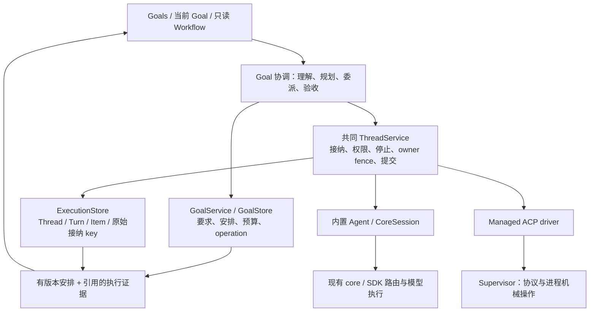
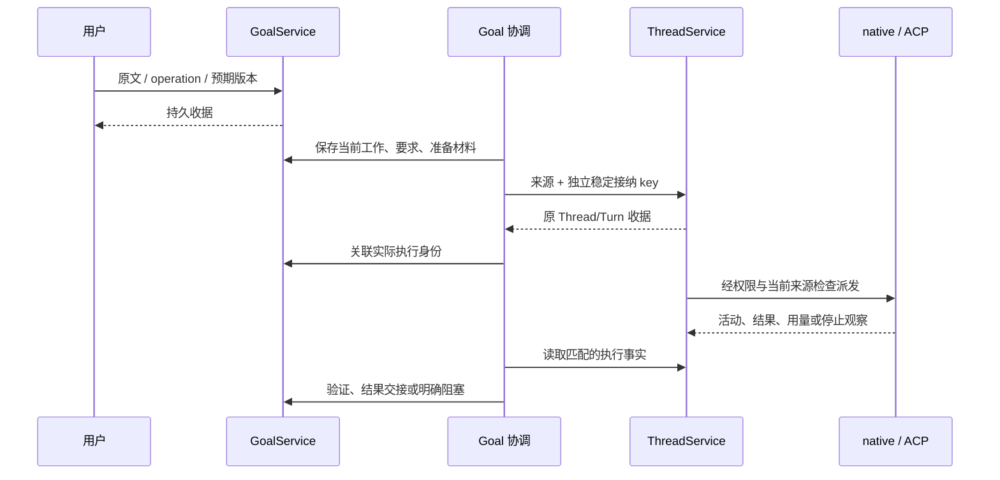

# BRO 执行重构：当前设计与验收状态

本轮依据 [重构 spec v0.2](BRO_ORCHESTRATOR_REFACTOR_SPEC.md)，统一 BRO 的执行接纳与控制，保留现有存储职责。**本轮 BRO 执行重构已完成本地实现与最终源码回归。** [验收映射](evidence/bro-goal-workflow/2026-10-16-refactor-acceptance.md)逐项说明 RF01–RF12 / A01–A22 的本地证明与范围；[最终摘要](evidence/bro-goal-workflow/2026-10-16-refactor-summary.json)记录源码绑定、归档发布和 CI 的分层状态。真实厂商 harness/provider 在本轮源码上的复验仍为未通过 gate。

BRO 面向 Goal 和长期并行工作流。它负责理解、规划、委派、协调和验收；实际工作统一交给 ThreadService。内置执行器可独立完成 Goal，外部 ACP harness 是可选 worker。未来 core persistent workflow state、状态权威迁移、通用动态图和 Goal owner handoff 不进入本轮。

此前的逐轮排查记录已完整保存在独立归档；本文只保留当前实现、必要复现入口、验收范围和剩余工作。

## 1 对象关系与执行归属

```text
Goals ← 当前 Goal：输入、进展、需要用户的事项 → Workflow（只读）
                    |
                 Goal G
                    ├─ owning Thread T0：规划、协调、整体完成评估
                    ├─ input Thread Ti：有身份的输入生成工作
                    └─ 工作 W：要求、依赖、历史结果保持稳定
                         ├─ 尝试 E1 → worker Thread T1 / Turn U1
                         └─ 接替 E2 → worker Thread T2 / Turn U2
```

| 对象 | 当前含义 |
| --- | --- |
| Goal | 独立目标、要求版本、完成条件、预算、运行意图和交付记录 |
| owner Thread | Goal 的逻辑 agent 身份；更换 worker 不更换 Goal owner |
| input Thread | 元数据与输入生成的受管工作线；关联 owner，不能执行 native 工具 |
| Thread | 逻辑 agent 工作线与适用路由设置作用域；同一 Thread 不同时运行两个 Turn |
| Turn | 一次已接纳推进；保留输入、来源、控制、资源报告和执行事实 |
| Item | 模型、工具或其他稳定执行记录；流式 delta 不创建新工作身份 |
| 工作 / 尝试 | 工作契约独立于执行者；尝试保留当时要求、请求的 worker、实际执行引用与结果 |

Thread 的策略语义沿用现有配置与 selector；本轮没有新增通用 Policy registry。一次工作尝试目前关联一个实际 Thread/Turn；不以改名消除旧记录，也不预建多 Turn 图引擎。



**ThreadService 是执行生命周期的共同权威。** Goal 协调器决定业务安排；Supervisor 管理 ACP 进程和协议，不获得另一份 managed Turn 控制权。通用 supervisor lease/control 不能接管受管工作。

Goal 协调 lease 与 ExecutionStore owner fence 是不同保障：前者约束安排的提交者，后者约束真实执行写入。Thread 是逻辑身份，不等于某个 OS 进程。

## 2 持久化与中断边界

| 现有组件 | 保留的事实与职责 |
| --- | --- |
| GoalStore | 要求、安排、operation receipt、预算与保留额度、输入处置、验证与归档引用 |
| ExecutionStore | Thread/Turn 接纳、FIFO、权限、控制、执行报告、owner/version fence 与 native checkpoint |
| CoreSession / ContextStore | 已有 native 模型/工具循环、context/routing 事实与恢复合同 |
| Artifact 存储 | 按内容身份读取的输入、产物、检查、报告与历史材料 |
| Supervisor ledger | ACP run/session、原始协议观察、进程停止和动作收据 |

没有新建并行 store、通用状态 backend、跨 store 全局事务或第二份 scheduler。Goal 的执行投影引用共同 Thread/Turn 事实；模型回复、UI 状态与内存变化不能宣布执行成功。



每个动作有自己的稳定 key。同一动作重试保留 key；不同内容复用 key 拒绝。接纳后关联提交失败时，按原 key 找回原 Thread/Turn，不创建替代身份。只有撤销原来源并在共同 admission 锁下确认没有接纳，才允许有界的新准备；未知的已接纳工作继续保留 fence。

这不是外部效果 exactly once 保证。原 owner 没有可信停止证明、工具效果未知、收据未确认或历史不完整时，保留阻塞，不能靠重跑消除不确定性。

## 3 Native、ACP 与工作接替

| 路径 | 当前实现与限制 |
| --- | --- |
| 规划、输入解释、语义审查、完成评估 | 通过受管 generation Thread/Turn；保留原始 prompt、来源、准备方案、SDK 报告与 Goal 核算 ACK |
| 内置 worker | 共同 admission/runner/commit、CoreSession 模型工具循环、权限、工作区与来源检查 |
| Managed ACP worker | 共同 Thread/Turn 控制；driver 调用 supervisor 的 start/prompt/observe/permission/stop |
| 直接 harness / 透明 ACP | 保留原入口；不因接入 ACP 自动获得 managed Goal 控制权 |
| 旧的无 Thread 绑定记录 | 保留必要的历史读取与原动作停止/对账；新工作不走旧的独立派发入口 |

一次 managed ACP session 保留明确的 BRO Thread/Turn/run/session 映射。ACP `end_turn` 只提供候选结果；停止、工具效果、检查和语义评估仍分别核对。协议 ACK 或 model 名称不证明私有 provider/context。

更换 worker 时先保存新选择，再协调旧执行停止和效果边界，冻结可交接材料，在新 Thread/Turn 中接续。原工作身份、旧 worker 来源和独立分支保留。ACP→ACP 与 ACP→native 接替已有本地证明；旧效果未知时不会启动冲突替代工作。

### 恢复范围

| 情况 | 当前行为 |
| --- | --- |
| 受管接纳已成功，Goal 关联丢失 | 原 key 找回原身份；查询不启动新工作 |
| 从未接纳且原来源已撤销 | 锁内确认缺失后，允许既有业务重试规则下的新准备 |
| 安全 native checkpoint、已停止 owner、效果和预算可核对 | 经既有恢复引擎继续原 Thread/Turn，不重新提交 prompt、不重放已确认读取 |
| 原 owner 仍活跃、pending read、来源已暂停或迟到撤销 | 拒绝继续，保留恢复/阻塞事实 |
| ACP Thread 仅有元数据、从未接纳 Turn | 原 owner 已确认停止且工作区与来源检查通过后，沿用原 Thread 和接纳 key 创建首个 session；不声称恢复私有 session |
| ACP 原 session 已记录、原 prompt 尚无派发 intent | 原 owner 与进程已确认停止、完整启动历史且支持 load 时，沿用原 Thread/Turn 加载原 session；保持原时限、MCP 摘要与原始输入 |
| ACP prompt 可能已提交、恢复 start 映射未知、私有状态/历史缺失 | 保持恢复/未知与 AcpSessionUnconfirmed，不补造停止证明，不重放 prompt，不退回 session/new |
| 旧 ACP run 的迟到停止/效果观察 | 保留原身份对账；不能直接覆盖新绑定或验证新要求 |

Native 与 ACP 冷恢复证明使用受控 SQLite checkpoint 图像；只有实际原执行关闭并 join、且 owner 确有停止证明时才转入该证明。pending read 若仍有未知效果，原 owner 不被强行退役，独立的效果 blocker 仍须保留。ACP Rust peer 会从原私有文件加载 nonce，再实际提交一次原 prompt、完成授权写入并确认停止；协议 load ACK 不证明所有厂商私有 context 无损。任意崩溃后的强制接管与导入外部私有状态不在该证明内。

## 4 资源、预算与证据

当前记录 selector、准备材料、可控资源绑定与实际报告。core 仍可能逐 step 准备 context，SDK fallback 保留；**完整的整 Turn 固定 model/context 尚未强制**。

首次派发前，实际 MCP descriptors 必须匹配已冻结的内容摘要。配置改变不能冒充旧执行已采用新配置；原接纳收据仍可查询。依赖材料、worker handoff 和检查都绑定具体要求与产物版本。

| 证据 | 可以说明什么 | 不能说明什么 |
| --- | --- | --- |
| 准备方案 / selector | 当时计划、允许的 route 与提供的材料 | 实际 serving provider/model 或完整私有 context |
| SDK attempt report | 对应请求实际报告的身份、用量、fallback 与接收区间 | 物理 provider attestation 或完整 provider 计算区间 |
| native content interval | 同一 clock_id、至少两个实际 content parts 的接收重叠 | 仅凭 admission、墙钟或不同 clock 证明并行 |
| 当前检查 / review / handoff | 该版本的产物验证与实际交接材料 | 旧证据自动适用于新要求 |
| 历史与归档 | 原执行活动、原 Thread/Turn 和原始报告 | 当前产物有效、允许重放或扩大权限 |

Native worker 的额度不足若仅来自其他当前 worker 的在途保留额度，会在原动作 key 下等待，持久记录 ResourceWait，并重新检查来源、lease 和预算。已花费额度、已结算但 usage 未知的保留额度、过期来源和硬限制不会被当作可释放资源。

等待可取消；SDK 仅在尚未 poll 该次 executor 时记录 no-dispatch abort。已取消或失败的旧 provider 调用不会因此按零计。当前此等待只覆盖 native worker，owner/input generation 与 ACP 私有费用不在同一等待保证中。

时间预算从 Goal 创建起累计，包括等待和暂停。已记录到达时间上限后，不再反复追加相同 halt；准入仍计算真实年龄。提高预算不会自动恢复，也不重置原计时。

### 历史读取的边界

原生归档必须匹配完整的已提交 operation receipt；blob 或相同文件名本身不够。当前证明覆盖实际原生执行、一次要求修改、真实 SQLite 归档、生产历史读取器和 UI 读取器。

历史投影仍限 48 KiB。超限时先省略 native 的选定 public 展示明细，增加 omission 计数并明确设置完整性为 false，保留原身份、SDK 报告和归档引用。ACP 的时间边界事件不做该缩减；仍超限或材料不一致时，继续返回明确的 unavailable。原始 Thread 历史和材料继续存在。

## 5 输入、UI 与完成

中间 Enter 默认作用于当前 Goal，右侧选择不隐式改变输入范围；Workflow 和分支在 MVP 中只读。查询、修改、控制与权限回复分别持久记录，并可以出现在同一条输入中。

System One 的分类与有限选择是建议。当前未启用经过校准的 typed 直接控制快路径，typed 提案仍经推理模型，最终由 runtime 校验并提交。权限卡和显式控制走各自有界 runtime 操作；模型文本不提供授权。

“先停”默认暂停，保留恢复意图。没有失败记录时可以澄清失败对象；询问不隐式重跑或恢复。反馈区分已记录、要求已保存、已派发、执行器接受、已采用与结果已验证，能力不足时保留“已提供/未确认”。

UI outbox 先保存原始身份再发送。确定拒绝时保留草稿；用户看到刷新后的状态后可再次 Enter。接受状态未知时保留原操作，不自动改 key、改变范围或重放。编辑器退出本身不提交输入。

Goal 默认交付经过验证、可 review 的结果即完成；人工验收只在显式合同中要求。分支通过不代替集成验证。预算受限、阻塞、暂停、停止和完成分别处理；历史结果不被覆盖，条件和证据不能为了通过验收而降低。

## 6 格式与代码入口

当前版本：**Goal IPC 8、DB writer fence 000033、Runtime 9、native 17、HTTP 2**。新增关联字段与 writer fence 保留旧身份和历史；旧 writer 不得删除新 fence 后继续写。没有进行未来 core persistence 或全量状态迁移。

| 阅读目的 | 入口 |
| --- | --- |
| Goal 安排与领域校验 | [goal.rs](../crates/bitrouter-orchestrator/src/goal.rs)、[workflow.rs](../crates/bitrouter-orchestrator/src/goal/workflow.rs) |
| 共同执行权威 | [service.rs](../crates/bitrouter-orchestrator/src/service.rs)、[worker.rs](../crates/bitrouter-orchestrator/src/service/worker.rs)、[ACP driver](../crates/bitrouter-orchestrator/src/service/worker/acp.rs) |
| Goal host 协调 | [goal_runtime.rs](../apps/bitrouter/src/goal_runtime.rs)、[native bridge](../apps/bitrouter/src/goal_runtime/native.rs)、[ACP bridge](../apps/bitrouter/src/goal_runtime/acp.rs) |
| 核算与等待 | [model_control.rs](../apps/bitrouter/src/goal_runtime/model_control.rs)、[quote_wait.rs](../apps/bitrouter/src/goal_runtime/model_control/quote_wait.rs)、[budget.rs](../crates/bitrouter-orchestrator/src/goal/budget.rs) |
| 历史与只读 UI | [historical.rs](../apps/bitrouter/src/goal_runtime/runtime_evidence/historical.rs)、[archive decoder](../apps/bitrouter/src/goal_archive.rs)、[UI evidence reader](../apps/bitrouter/src/goal_code/evidence.rs) |
| 提交与原生恢复 | [commit.rs](../crates/bitrouter-orchestrator/src/service/commit.rs)、[recovery.rs](../crates/bitrouter-orchestrator/src/service/recovery.rs) |
| 宿主持久化装配 | [goal_store.rs](../apps/bitrouter/src/goal_store.rs)、[agent_store.rs](../apps/bitrouter/src/agent_store.rs) |

## 7 本地验收与复现

| 已取得的证据 | 范围 |
| --- | --- |
| Native 三节点 workflow | 实际接收区间重叠、隔离的冲突 scratch 写入、读取已检查依赖、根交付验证 |
| Native 冷恢复矩阵 | 安全读取、活跃旧 owner、pending read、预先暂停与接纳期间迟到暂停；保留原 Thread/Turn 与累计核算 |
| Managed ACP / 接替 | Rust 协议进程、共同控制拒绝通用接管、已知/未知停止与工具效果、独立分支保留、原 key 对账 |
| ACP 元数据中断 | 实际 SQLite 关闭重开与 Rust peer；32 项共享恢复检查、11 项 Goal Thread 检查、3 次重复，以及活跃 owner / 已提交未知 prompt 拒绝；严格 Clippy 与 fmt |
| 预算与输入 | release/pause/SDK admission drop、丢失 ACK、冻结 quote、未知 usage 保留、真实 SQLite 时钟与显式恢复 |
| 当前 native 历史 checkpoint | 86 项 Goal runtime 检查、6 项证据检查、归档矩阵 3 次重复、严格全 workspace Clippy 与 fmt |
| 前一预算 checkpoint | 735 项 SDK 检查、4 项 Goal PTY、编辑器 10 次重复、6 个 doctest（1 ignored）；源码适用性单独核对 |

最终源码结果：**Summary [1172.177s] 4757 tests run: 4757 passed (5 slow), 24 skipped**。严格全 workspace / all-target / all-feature Clippy、fmt、6 个 doctest（1 ignored）与 dist-helper check 通过，源码无漂移，nextest 未报告 LEAK。完整 coordinator / TUI / SQLite-resource 夹具预留全局测试资源；场景内部并行、栈与产品上限保持原值；native 并行交付测试将原单个 45 秒等待拆为 worker handoff 与根验收两个各 45 秒的阶段，总允许等待因此增加。大型测试 future 使用堆分配，缺失的正向阶段收据仍按未知处理。原始超时、栈溢出、过强断言、初始化断开、LEAK 和中断运行均保留；真实 harness/provider 与 hosted CI 另列，不由本地 fixture 代替。

必要的 Rust fixtures、输入评测案例与测试驱动保留在仓库。执行与测试夹具不要求 Python。常用本地入口：

```sh
CARGO_PROFILE_DEV_DEBUG=0 CARGO_PROFILE_TEST_DEBUG=0 CARGO_INCREMENTAL=0 \
  cargo nextest run -p bitrouter --all-features --lib -E 'test(goal_runtime::)'

CARGO_PROFILE_DEV_DEBUG=0 CARGO_PROFILE_TEST_DEBUG=0 CARGO_INCREMENTAL=0 \
  cargo nextest run -p bitrouter --all-features --test goal_tui_pty
```

失败保留使用测试专用 `BRO_GOAL_FIXTURE_KEEP_FAILURES=1`。失败 filesystem/SQLite copy 不是进程图像或全部外部效果快照；历史未保留的文件和内存数据库不宣称已恢复。

独立本地归档根目录为 `/Users/kelsen/.codex/archives/bro-refactor/2026-10-16/`。各批次索引保存源码哈希、配置、原始失败、通过结果、独立解包校验及 Git bundle；归档发布状态和不可变 commit 见最终摘要。`native-history-prior-ledger5.md` 保存本文重写前的完整 1,339 行记录。主 PR 不复制这些多轮日志和快照。

首轮 hosted CI 暴露了全特性构建未覆盖的可选 ACP 依赖引用，以及新 Rust stable 对测试中旧原子 API 的弃用错误。本轮修正后，native 默认依赖图不含 ACP crate，关闭/开启 ACP 与 Rust 1.93 构建通过；共享执行仅保存原始权限材料，适配器解释协议类型，未提供的选项被拒绝且不产生选择记录。

Linux 还证明三个 worker 已完成但根验收未结束时，总 45 秒的测试等待偏短；现在分别等待交接与根验收，每阶段仍为 45 秒，整条测试的允许时间增加。实际并行/隔离/依赖与验收断言均保留，产品预算不变。

本地 full final31 的 help 用例报告一次输出 LEAK，原记录保留；随后同源码以两个外层测试槽运行完整回归，工作流内部并行与检测器保持原值，help 另作三次复核。完整回归、严格检查与原始 CI 失败分别保存在 `CI_PORTABILITY_INDEX.md` 及 `ci-portability-final36`。

最终覆盖核对发现上游 Linux 清单只选择 36 个集成测试目标中的 26 个。本轮增加 `native-goals` 分片运行其余 10 个，涵盖 Goals、Goal TUI 和相关 native/ACP 接口；新分片仅串行编译以限制链接内存，保留原测试并发与零自动重试。Rust、夹具、Cargo 与 nextest 配置均与 final36 相同；这项 CI 选择变化单独记在最终摘要，不能称全部仓库输入完全未变。新增选择由最终提交的 hosted CI 验证。

## 8 阶段结论与后续边界

| 阶段 | 本轮结论 |
| --- | --- |
| S0 | 对象、事实职责和可控资源边界明确；没有未来 core persistence 前置依赖 |
| S1 | 最小关联、原 key 对账、历史读取和格式 fence 接入；已确认无接纳与未知接纳分别处理 |
| S2 | 内置独立闭环、权限/停止、额度等待与安全 native checkpoint 继续通过本地证明 |
| S3 | Managed ACP 共同控制、worker 接替和受控同 session 恢复矩阵通过；恢复资格限首次 prompt 之前，未知效果保持阻塞 |
| S4 | 要求/策略来源、实际报告、当前与历史 UI 证据有明确适用范围；完整 Turn 固定 model/context 仍是后续 core 工作 |
| S5 | 两分支实际重叠、隔离写入、已检查依赖交接、要求修改及根验收接入共同执行 |
| S6 | 已替代的执行路径收敛，仍有历史/停止对账消费者的无绑定记录保留；最终本地全量与证据分层完成 |

main 的目录更新已合入；registry validate/build/check 通过且产物无漂移。独立归档、PR #981 和 exact-head hosted CI 状态见最终摘要；当前本地证明不扩展为真实厂商/provider 资格。未来 core persistent workflow state、完整 Turn 固定资源、动态节点/依赖编辑、子 Goal 分层和 Goal owner handoff 仍由后续 spec 处理。
