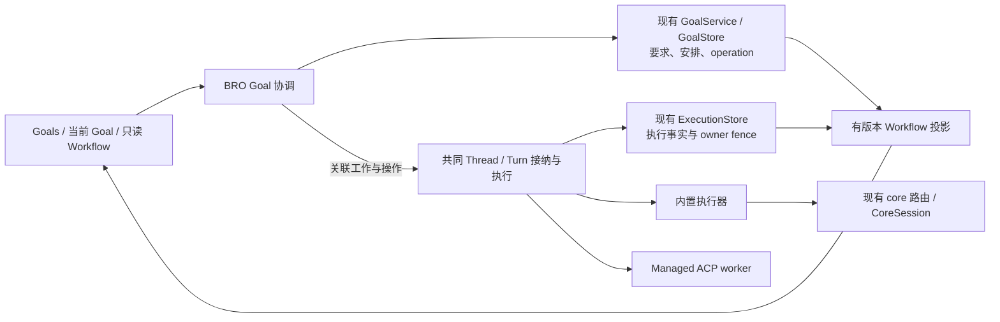
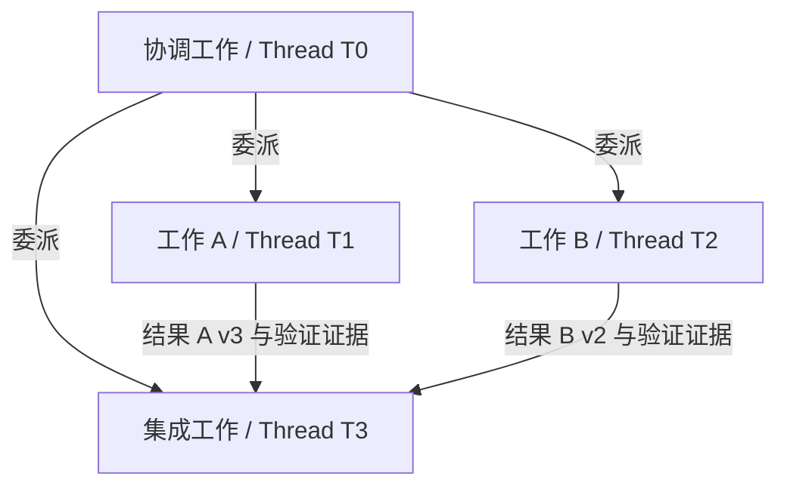
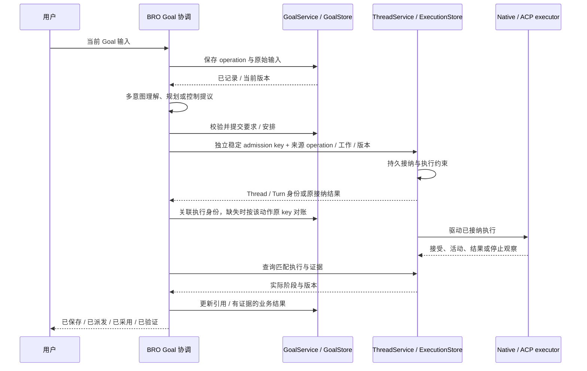

# BRO Orchestrator 重构规范

版本：**v0.2 · BRO 执行重构审阅稿**。日期：2026-10-15。

**本轮目标：统一 BRO 的对象关系、编排与执行路径，保留现有持久化边界和执行保障；core persistent workflow state、状态权威迁移及对应数据迁移另立后续 spec。**

v0.2 将 v0.1 中的跨 core 重构收回到 BRO 本身。core 持有 persistent workflow state 仍是后续架构方向，但不再是本轮依赖或验收条件。延后的是 persistence 的建设与归属迁移，不是删除 BRO 已有的保存、历史、幂等和恢复能力。

本文供 review 后指导重构；本次只更新文档，不授权启动实现，不表示相关能力已经完成。“待 review”条目不能被实现者当作已批准需求；第 12 节的后续工作不进入本轮退出条件。

源码核对基线：`fe9df6f8157945d3559789926326a7effb468db1`，并读取了当前工作区未提交的清理修改。下文“现状”指该工作区，不是 main、发布版本或生产验证结论。后续实施必须重新核对 checkout、差异与相关合同。

## 1 目标与合同范围

### 1.1 已确认的本轮选择

| ID | 合同 |
| --- | --- |
| RF01 | 本轮聚焦 BRO 执行重构，复用现有 core 路由与存储；不建设 core persistence，不迁移持久状态权威 |
| RF02 | BRO 负责理解、规划、委派、控制、执行协调和完成评估；通过现有 GoalService / ThreadService 及其 store 接纳并记录，不另建并行执行引擎 |
| RF03 | 内置执行器能够独立完成 Goal；外部 ACP harness 是可选 worker，不是运行 BRO 的前提 |
| RF04 | 一个 Goal 同时只有一个 owner Thread；owner 推进目标、协调分支并承担整体验收责任 |
| RF05 | 一条 Thread 承载一个逻辑 agent 的连续工作，使用一份当前适用的 routing policy；策略可以复用和更新 |
| RF06 | Thread 是 policy 作用域，Turn 是目标资源分配单位；本轮记录适用要求、策略、可控资源绑定和实际报告，完整固定 model/context 的路由约束按第 5 节延期 |
| RF07 | 一条受管 ACP session 对应一条 worker Thread；确认恢复同一 session 可保留 Thread，更换 harness 或新建独立 session 则创建新 Thread |
| RF08 | Workflow 统一表达委派、依赖、执行绑定、交接与结果采用；本轮复用已有工作记录与投影，不新增通用持久图引擎 |
| RF09 | 工作身份、要求版本和历史结果独立于具体执行者；更换 worker 不自动创建新工作或新 Goal |
| RF10 | managed Goal/native/ACP 工作进入共同执行接纳路径；每类事实有明确权威，Goal 安排引用 Thread/Turn 执行事实，不要求合并全部 store 或建立跨 store 全局事务 |
| RF11 | 目标修改、派发、接受、实际采用和结果验证分别记录；反馈只能陈述已有执行证据支持的阶段 |
| RF12 | 保留已确认的 Goals / 当前 Goal / 只读 Workflow 产品交互，以及默认经过验证、可 review 即完成的合同 |

本轮不提取新的 core crate，不重设计 core 的数据结构、checkpoint 或存储 API。当前 workspace 的 `bitrouter_orchestrator::core` 已参与 native 执行，不因延期未来 core persistence 而删除。未来职责边界不等同于当前 Rust 模块布局。

### 1.2 本轮与后续的范围

| 本轮交付 | 后续独立工作 |
| --- | --- |
| Goal / Thread / Turn / Item 映射与共同执行路径 | core 持久 workflow state 与状态权威接管 |
| 内置执行与 managed ACP worker 的共同接纳、控制、观察 | GoalStore / ExecutionStore / ContextStore 的重设计或合并 |
| 稳定工作身份、worker 接替、已有要求修改与失效传播 | 完整动态节点/依赖编辑、分层子 Goal 预算、Goal owner handoff |
| 现路由接入、可控绑定与实际报告、只读投影 | core 完整 Turn 固定 model/context、fallback 和压缩约束 |
| 为上述工作必需的最小字段关联与兼容处理 | 全量数据转换、跨 core 活跃执行接管与回退 |

保留 workflow state 的语义和 BRO 运行时视图；延后其在未来 core 中的持久化归属。资源调度可消费当前有版本快照，无需先维护一个等待同步的 core 状态镜像。不得为未来接口预建未使用的 `StateBackend`、图数据库、事务协调器或第二份 scheduler。

### 1.3 与现有合同的关系

本文处于 review 阶段，不自动替代当前生效协议。批准后，实施批次必须同步修订受影响条款，并把未迁移路径与已切换路径明确分开。

| 现有文档 | 本轮处理 |
| --- | --- |
| [Core v1 合同](ORCHESTRATOR_CORE_SPEC.md) | 复用现有路由和 native checkpoint 合同；不在本轮改写 durable authority 或重做 Core 内部调度。未来变更另行版本化修订 |
| [Standalone runtime](BRO_AGENT_RUNTIME_SPEC.md) | 复用身份、接纳、幂等、权限、停止、验证与恢复保障；将 managed Goal 执行接入现有执行合同，避免并列 owner |
| [Goal 产品 PRD](BRO_GOAL_ORIENTED_PRD.md) | 保留入口、输入、只读 UI、完成与证据要求；只同步本轮对象映射和实际执行归属 |
| [旧 Goal 实施合同](BRO_GOAL_ORIENTED_IMPLEMENTATION_SPEC.md) | Task/Execution 和 app Coordinator 是执行重构来源；保留仍有消费者的存储/历史保障，替代后再删除重复执行逻辑 |
| [ACP controller](ACP_CONTROLLER_SPEC.md)、[native ACP](BRO_NATIVE_ACP_SERVER_SPEC.md) | 保留协商、授权、session 和观察边界；新映射不使外部私有 session 变成可导入的 native checkpoint |
| [AI 重构](BITROUTER_AI_REFACTOR_SPEC.md)、[Decisions](DECISIONS_API_SPEC.md) | 沿用模型执行、转换、凭据和 typed 判断合同；不在本重构中复制 provider 客户端 |

不在范围：新的公开远程执行产品、跨设备迁移、任意图编程语言、自动回滚外部效果、未授权的 UI 接管、所有 ACP harness 私有上下文的无损迁移。现有 CLI、端口、环境变量和默认配置本 spec 不新增或删除；实施若改变这些表面，必须同步 shipped skill 与 plugin manifests。

## 2 本轮架构与事实职责

### 2.1 职责

| 组件 | 拥有的职责 | 边界 |
| --- | --- | --- |
| BRO Goal 协调 | 输入理解、规划、委派、要求修改、继续/停止协调、完成评估和 Workflow 投影 | 安排进入 GoalService；实际工作交给共同 Thread/Turn 路径，不再独立裁决执行终态 |
| BRO Thread/Turn 执行 | 复用 ThreadService 接纳、队列、steering、权限、owner、停止、验证和恢复合同；驱动 native / managed ACP | 同一执行只有一个控制 owner；适配器回报事实，不自行接管另一份生命周期 |
| 现有 GoalStore | 保存 Goal 要求、工作安排、operation receipt、版本与历史 | 执行结果投影引用 Thread/Turn 及证据来源，不成为可独立推进的执行终态 |
| 现有 ExecutionStore | 保存 Thread/Turn 执行事实、接纳 key、owner/version fence 与历史 | 不因 Goal 接入而绕过或建立第二个同义 store |
| 现有 core 路由与 CoreSession | 复用 model/context 选择、决策观察与 native checkpoint 路径 | 本轮不接管 Goal/Thread/Turn 持久权威，不重做其内部状态与存储 |
| App host | 数据库 backend、配置、身份认证、进程管理、装配与本地传输 | 保留现有存储装配；仅承载本轮必需的关联字段兼容 |
| SDK / AI 执行能力 | 复用路由候选、协议转换、选定目标调用、provider fallback、用量与计量 | 不反向依赖 BRO；资源方案与实际执行报告分别保留 |
| TUI / CLI | 提交用户输入，读取有界快照、历史与证据 | 不直接启动 worker、修改图或判定执行已结束 |

**统一的是执行接纳和控制机制；保留的是不同事实的现有存储职责。** GoalService 校验并提交要求与安排；ThreadService 接纳、驱动并记录执行。Workflow 通过明确引用组合两者，不能由一次模型回复、内存变化或 UI 状态把执行宣布为成功。

现有 Task/Execution 中仍用于恢复、检查或交接的记录不能直接删除。逐项确定事实来源与消费者；接入 Thread/Turn 后，用执行引用或只读派生替代重复终态，替代保障验证完成后再清理旧逻辑。

本轮不要求 GoalStore 与 ExecutionStore 同一事务提交。跨 store 的中断通过稳定 operation、接纳 key、明确阶段和对账处理；不能靠双写、重建 key 或全局事务框架掩盖未知效果。具体最小关联见第 6 节。

```text
User / TUI
    |
    v
BRO Goal coordination ----- existing GoalService / GoalStore
    |
    | stable operation + work / requirements references
    v
Shared Thread / Turn admission ----- existing ExecutionStore
    |
    +---- built-in executor ---- existing core routing / CoreSession
    +---- managed ACP worker --- negotiated harness capabilities

Workflow view = accepted arrangements + referenced execution evidence
Future core persistence is outside this delivery.
```



### 2.2 状态、意图和推断

- Goal 要求、工作安排、运行意图和执行事实都持久保存，但含义分别保留。“要求暂停”与“已确认停止”可以同时具有不同值。
- Workflow 记录已接纳的安排与实际关系；不是只有事件日志，也不是从 transcript 临时猜出的图。
- 推断的阶段、confidence、摘要和 routing features 可以用于资源选择，不能自行证明授权、测试通过、结果已采用或外部效果停止。
- 缺失、不完整、过期和未知必须可表达。普通 HTTP/harness 路径没有完整工作图时，仍可使用有限观察进行路由，不能被迫虚构 Goal 或完整执行状态。
- BRO 状态可以在 Turn 运行中更新；采用、派发和验证仍需各自证据。资源绑定的本轮保证与后续完整合同分开，见第 5 节。

## 3 对象、身份与生命周期

下表描述必须保留的语义，不要求每行对应一个 Rust 类型、服务或数据库表。

| 对象 | 身份和生命周期 | 必须保留的信息 |
| --- | --- | --- |
| Goal | 独立持久目标；同一时间一个 owner Thread | 目标、要求版本、完成条件、约束、授权、预算、运行意图、结果和停止原因 |
| Thread | 一条逻辑 agent 工作线；多个顺序 Turn；不绑定 OS 进程寿命 | 角色、owner/parent、连续历史、active policy、执行器/session 映射和控制事实 |
| Turn | Thread 内一次已接纳的执行推进；同 Thread 最多一个 active Turn | 输入/要求版本、激活身份、可控资源绑定与实际报告、执行和验证状态、预算与终止依据 |
| Item | 输入、输出、工具动作或观察的稳定记录 | 所属 Thread/Turn、内容/证据来源及生命周期；流式 delta 不是新工作或新 Turn |
| Workflow 工作节点 | 可追踪的工作/结果契约，独立于当前执行者 | 目标范围、要求版本、依赖、执行引用、结果引用和可推导状态 |
| Artifact / Evidence | 版本化产物或证据 | 内容身份、来源、要求/产物版本、实际检查、适用范围和未知项 |
| Policy | 可复用的资源选择策略；Thread 绑定当前适用版本 | 可选模型/context 策略、约束、配置来源与版本 |
| Operation / 采用记录 | 幂等操作与其实际处理阶段 | 原始请求、预期版本、处理结果、派发/接受/采用/验证证据关联 |

### 3.1 Goal 与 agent Thread

一个 Goal 对应一个 owning Thread；该 Thread 可以自己完成，也可以委派多个 child Threads。普通委派不自动创建新 Goal。子 Thread 可绑定独立 Goal 是保留的语义方向；本轮不新增子 Goal 创建、分层预算和自动控制传播功能，也不另设子 Goal 执行引擎。

同一 Thread 可以没有 Goal，也可以先后承担不同 Goal；同一时刻最多一个当前 Goal。这是另行确认的基数约束，不是由“每 Goal 一个 owner”反向推导。一个 policy 可被多个 Thread 使用；BRO 的策略关联更新不改写活动 Turn 的已记录要求与绑定。现路由内部行为按第 5 节单独声明。

默认用 BRO 主 Thread 持有根 Goal，外部 ACP Thread 作为 worker。不凭 Thread parent 自动推导预算分配、完成传播或暂停级联；子分支成功不代替根 Goal 的集成验证。

本轮更换 worker 保留 Goal owner。Goal owner handoff 延至后续；不能把普通 worker 接替当作 ownership transfer，也不能通过新建 Goal 掩盖该限制。

### 3.2 工作身份与执行身份

例如工作 W1 从 Codex Thread T1 交给 Claude Thread T2，W1 的要求、依赖和历史结果继续存在。记录 T1、T2 的交接/接替关系，而不是覆盖 T1 的 session、历史或产物来源。

Workflow 工作节点复用现有 Goal/工作记录，最小关联形状在第 11 节 review。不能通过删除 Task 名称消除稳定工作身份，也不能仅为了保留该身份再创建独立 Task scheduler、TurnService 或 Execution engine。一次工作尝试是否跨多个 Turn、旧 Execution 的哪些字段仍必需，要根据实际消费者决定，不预设一对一替换或强制保留同名类型。

## 4 统一 Workflow 语义

### 4.1 一份图，多种关系

| 关系 | 表达什么 | 不能由它自动推断什么 |
| --- | --- | --- |
| 委派 | 哪个 agent/Thread 分配了哪项工作或创建了 child Thread | 父完成后子才能启动 |
| 依赖 | 一项工作需要哪些有效结果/条件才能推进 | 上游发出 final message 就满足依赖 |
| 执行绑定 | 当前由哪个 Thread/Turn 推进工作 | 该执行已经开始或已经成功 |
| 结果采用 | 哪次执行实际获得了哪一版产物/证据 | 后来出现的新证据已被旧执行使用 |
| 交接/接替 | 新 Thread 接替旧执行者的工作范围 | 旧 worker 已停止，或私有 context 已无损迁移 |

Agent 树是委派关系的投影；依赖图和结果流转图是同一组持久事实的其他投影。关系含义必须保留，不根据时间先后或提交序号发明因果边。



### 4.2 依赖准入与版本

1. 依赖连接工作/结果契约；实际采用记录绑定具体要求版本、产物版本和证据。首批至少支持整项工作的结果交接，不预设任意输出端口语言。
2. 上游执行结束只是候选结果。满足声明的检查、语义评估和执行稳定条件后，才形成可交接结果。
3. 下游派发前固定实际获得的依赖材料；记录其内容身份。验收时核对当时输入与当前适用要求，不能事后补证据冒充已经消费。
4. 上游修改后，重新评估受影响下游；旧结果作为历史保留。能证明仍有效的成果可复用，不能无条件全部复用或全部重跑。
5. 当前要求版本中的阻塞依赖不能成环；委派边不参与同一套拓扑排序。修复迭代通过新的要求/产物版本与 Turn 表达，不把历史回访误判成非法依赖环。
6. 等待依赖、等待资源、等待授权和执行效果未知是不同原因。只读投影可以推导汇总状态，但不能另有一套事实裁决。

### 4.3 本轮调整边界

本轮保留已有 Goal/工作要求修改、控制、依赖失效重评和 worker 接替。完整动态新增/删除节点及改依赖功能移至第 12 节，不作为本轮验收条件；不能把这些已有调整或只读图展示描述成任意动态改图已经完成。

本轮支持的变更仍作为有版本操作提交：检查所属 Goal、工作身份、引用有效性、授权和受影响范围，提交后协调旧执行与新派发。不能删除历史，也不能因为要求已保存就允许冲突写入重叠。

Workflow 的领域语义与未来动态能力保持兼容；不提前建设动态图存储或通用操作语言。

## 5 Thread policy 与 Turn 资源绑定

### 5.1 已确认的目标语义与本轮范围

已确认的长期合同仍是：Thread 为路由策略作用域；Turn 激活时选择一次 model 与初始 context 方案，整轮固定该绑定，新事实仍可追加。排队输入不提前占用实际推理资源。

**本轮不以改造 core 来完整强制该合同为退出条件。** 当前 native 已复用 CoreSession，现有 context 准备仍按模型 step 发生。BRO 重构复用这条路径；不能仅新增 Turn 字段就声称内部 context 重选已停止。

S0 列明各路径的可控范围、实际报告和限制；本轮记录 Thread/Turn、适用 policy/要求版本、BRO 提供的材料来源以及已有选择/采用报告。普通模型请求和透明 harness 路径不被强制创建 BRO Goal/Turn。

### 5.2 本轮资源接入要求

| 行为 | 本轮要求 |
| --- | --- |
| 激活与接纳 | 关联有效要求、policy 和已授权材料；排队期间变化重新核对，不覆盖原始输入 |
| BRO 可控制的显式资源选择 | 沿用已声明绑定；不能通过修改 Thread 设置伪装活动 Turn 已采用新 model/context |
| 工具结果、文件读取、消息与 steering | 保留权限边界、实际输入与采用证据；新事实可以追加 |
| 现 core 的逐步 context 准备与 SDK fallback | 保留现行为和实际报告；明确与完整固定目标的差距，不重写 core 或在 BRO 复制 router 来弥补 |
| 新要求超出当前可控资源能力 | 保存要求，保守结束/阻塞受影响推进，再用新 Turn 接续；不能报告修改已被旧执行采用 |
| provider / 私有 context 不可见 | 如实标记未知或不受控；配置 ACK 不充当执行证据 |

每次模型请求的输入证据与资源决定频率是不同粒度。保留现有模型/工具身份、输入版本及执行报告，不要求本轮改造所有调用为新的固定 context 协议。仅当实际路径具备完整控制和证据时，才能声明该 Turn 的固定资源保证。

未来完整合同下，更换选定模型或替换初始 context 方案需要新 Turn；本轮不新增隐式切换机制，也不删除现有 fallback/checkpoint。任何接续都保持工作身份，不重放已确认工具效果。

### 5.3 决策与执行证据

分别保存用户请求的 selector、core 选定的 model/context、实际执行报告和未知项。路由 alias、ACP model 名称或配置 ACK 不证明实际 provider/model。

外部 harness 的模型请求必须能关联到本轮绑定，才能承诺整 Turn 的固定模型合同。无法关联或无法控制内部调用时，能力投影必须声明未验证/不受控范围；不能凭 ACP 协议接入成功假装已经强制整个私有循环。此限制不阻止独立工作的原生执行或原有透明模型 API。

Turn 的 context 合同覆盖 BRO/core 实际提供和管理的材料。外部 harness 私有历史、压缩和内部 agent context 只按公开能力观察；内部自行增加的上下文不被伪称为 core 已选择的 context。

### 5.4 规划和输入理解也不得旁路

规划、生成式推理、review 和完成评估同样是模型工作，必须具有受管的执行身份、资源决定、预算与实际用量记录；不能只统一 worker，却保留 app Coordinator 直接调用 SDK 的无身份旁路。

普通生成式规划通过 owner Thread 或明确受管的子 Thread/Turn 执行。owner 正在执行时，不能在同 Thread 偷开第二个 active Turn；保持输入处理可用的调度方案须在 S0 记录。普通查询不自动启动 worker；确需模型工作时仍遵循相应接纳合同。

System One 多意图判定、有限选择及现路由辅助判断继续使用已有有界决策调用，不要求每个判断创建 worker Turn。保留来源、权限、预算、幂等、输入/结果和用量记录，复用现有 operation/计量路径；不新增 core 决策数据库，不把普通生成式工作改名为辅助判断绕过受管执行，也不递归创建路由 Turn。

## 6 共同执行与现有存储闭环

### 6.1 提议、提交、派发

1. 输入先以稳定 operation 身份保存。相同 key 和内容重试返回原结果；同 key 不同内容拒绝。
2. 模型或 BRO 基于有版本快照形成提议。长时间模型调用不占状态提交锁。
3. GoalService 核对并提交有效要求/安排及 operation；BRO 协调器检查当前工作范围、依赖和预算。用户 operation ID 是因果关联，不直接作为所有分支共用的接纳 key：每个工作尝试/接纳动作独立持久生成或确定性派生稳定 key，确保请求前已保存或可从已保存事实重建，再请求 ThreadService。
4. ThreadService 按既有 owner、权限、队列、资源和执行能力规则接纳，返回 Thread/Turn 身份；执行接纳持久化失败不得启动新效果。
5. 在 Goal 工作记录中关联接纳身份和适用版本。若接纳已发生但关联尚未保存，按该接纳动作原 key 查询/对账；并行工作和后续合法接纳动作有不同 key，重试同一动作则保持原 key，不把关联缺失当作从未执行。
6. native/ACP 观察进入共同执行记录；Goal 与 Workflow 依据明确执行引用和有效证据更新投影、依赖交接或完成。网络超时、结果尚未同步或断线不代表没有执行。



上述步骤不是跨 store 原子事务，也不与工作区/外部副作用原子提交。接纳后不假设一定能撤销；关联写入失败或要求并发变化时，按原身份对账并执行适用的停止/采用校验。实现不承诺外部效果 exactly once，不靠新建 key 或重跑整个 Turn 消除不确定性。

### 6.2 权限、资源与停止

- BRO 的接纳不能扩大 host/harness 权限。共同执行路径和适配器在实际动作前执行可控的权限与资源检查，结果通过现有记录回报。
- 逻辑暂停意图、已请求取消、协议接受取消、worker 已停止、相关效果已稳定分别表达；收到 final message 或 foreground idle 不直接证明完整停止。
- 同一工作区的冲突写入必须由可执行隔离或排他控制约束；不能用内部图节点状态代替实际约束。
- 权限撤销和安全停止不能因为 Turn 绑定固定而失效。受影响未派发操作不得继续；在途效果按实际可控能力协调。
- 本地执行的所有线程/进程只有一个控制 owner；旧 owner 的命令和直接状态提交必须拒绝。迟到执行观察保留原 operation/执行身份，由当前 owner 对账后记录；不能丢弃可能解除未知效果的事实，也不能让旧结果直接覆盖当前绑定或满足新要求。

每类事实的权威不等于跨 store 的全局锁或事务。本轮只补共同执行所需关联和对账；要求版本变化后，旧结果不能满足新要求，后续派发仍需重新核对授权、依赖和停止边界。

## 7 Native 与 ACP 的共同执行合同

### 7.1 适配能力

内置执行器和 managed ACP worker 共用工作引用、Turn 接纳、运行意图、可控资源信息、执行观察、停止和结果记录。它们可以使用不同驱动实现，不能各自决定同一执行的权威终态。透明 `bro acp serve <agent>` 和直接 harness 入口保留原模式，不自动升级为 managed workflow。

Native 可以控制其模型/工具循环；ACP 只使用实际协商的会话、输入、权限、模型和恢复能力。BRO 不模拟不存在的控制能力，也不把外部 harness 的私有会话替换成 native checkpoint。

映射保留 BRO Thread/Turn/operation 与原生 ACP session/request/toolCall 身份。不能用字符串碰巧相同代替明确关联，也不能默认每个 prompt 请求、每条模型消息或每个 running/idle 更新就是一个完整 BRO Turn。

### 7.2 更换 worker

```text
Goal G0 -- owner --> BRO Thread T0
  Workflow W1: 当前工作、要求版本与历史结果保持
       old binding --> Thread T1 / harness A / session A
       handoff     --> Thread T2 / harness B / session B
  Policy P 可以复用；T2 在自己的新 Turn 激活时重新分配资源。
```

交接顺序：

1. 保存接替意图与影响范围，限制旧版本后续派发。
2. 协调旧 Turn 和相关写入停止，核对已发生/未知效果以及工作区版本。
3. 保存可交接材料：当前目标、约束、代码/产物版本、已确认结果、验证证据、未完成与未知事项。
4. 创建新 harness session 对应的新 Thread，记录接替关系及其 policy 绑定；不要求生成另一套策略内容。
5. 新 Turn 在最新适用 state 上分配资源，并记录实际获得的交接材料。目标与已有结果不因更换执行者而重置。

旧效果未知时，不能让接替 worker 启动冲突写入。独立且可证明不受影响的工作可以继续。重连或重启后能确认恢复同一 ACP session 时保留原 Thread；不能确认连续性时保留恢复/未知状态，不能静默声称恢复成功。

## 8 Goal、输入与产品合同

### 8.1 完成与停止

BRO owner Thread 提出完成评估；机器检查和语义评估提供证据；BRO 依据共同执行记录核对要求/产物/证据版本及执行稳定事实，通过现有 GoalService 提交完成。默认经过验证、可 review 的交付即可完成，人工验收仅在 Goal 显式约定时成为必需条件。

子 Goal、分支或单个 Turn 的成功不代替集成验证。预算耗尽、usage limit、阻塞、用户暂停/停止和目标完成分别表达；保留部分结果与解锁条件。未知外部费用不按零计，未验证结果不报告通过。

Goal 预算约束其工作范围内的资源分配。复用并保留现有跨并行接纳/核算保障，不能向每个 worker 发放完整剩余预算。子 Goal 的独立额度、分层汇总和控制传播移至后续，不从 parent Thread 自动推导，也不在本轮重做预算存储。

失败后的业务重试/改派由 BRO 根据已提交事实提出，通过共同执行路径接纳；协议请求重试与工作重跑分别记录。重试规则只有一份实际使用的判断，不在 scheduler、UI 与提交层分别实现相互漂移的副本。

### 8.2 输入与生效反馈

沿用 PRD：中间 Enter 默认作用于当前 Goal，可同时包含询问、要求修改和执行控制；右侧选择不隐式改变输入范围。System One 做多意图与有限选择，复杂修改由推理模型处理；要求经 GoalService 校验提交，控制按共同执行路径应用，模型回复本身不使变更生效。

“先停”默认暂停，保留恢复意图；明确停止才结束本轮推进。询问不隐式修改 Goal、恢复执行或重新运行。没有失败记录时先澄清失败对象，不编造原因。

| 反馈 | 必需依据 |
| --- | --- |
| 已记录 | 原文与 operation 已持久保存 |
| 要求/安排已保存 | 当前版本中的相应变更已提交 |
| 已派发 | 对应执行身份的实际派发事实 |
| 执行器已接受 | 原生/协议合同中的匹配接受记录 |
| 已采用 | 对应 Thread/Turn 的版本采用证据；能力不足时只能陈述已提供/已送达 |
| 结果已验证 | 匹配要求、产物与检查的实际证据 |

新要求超出当前可控执行能力时，先保存并协调到后续 Turn；不能报告当前 Turn 已采用新模型或新材料。第 5 节的现路由限制仍须显示。暂停、取消和更换 harness 的反馈同样区分意图与效果。

### 8.3 UI 与 CLI 保留

- 裸 `bro` / `bro code` 保持 Goals 入口；创建、查看与执行的副作用边界保持明确。
- 当前 Goal 为主要交互面；Workflow、分支和底层 session 在 MVP 中只读，展示现有 Goal/执行记录的关联投影与新鲜度；不需要 core 持久图。
- `bro claude`、`bro codex` 等保留直接交互；不恢复已删除的 `bro code <agent>`。
- `bro acp serve <agent>` 保留服务指定 harness 的透明 ACP 用途；它不自动获得新 managed workflow 的内部控制权。
- UI detach、浏览、重连和历史查询不隐式取消、批准、重放或恢复工作。

## 9 从当前实现收敛

### 9.1 已核对的来源与目标

| 当前来源 | 可复用的事实/保障 | 收敛目标 |
| --- | --- | --- |
| [app goal_runtime](../apps/bitrouter/src/goal_runtime.rs) | 规划、输入理解、依赖交接、验证与 ACP 协调 | 规划与协调归 BRO；实际执行进入共同 Thread/Turn 接纳，移除独立推进同一事实的 Goal scheduler |
| [GoalService](../crates/bitrouter-orchestrator/src/goal.rs)、[goal_store](../apps/bitrouter/src/goal_store.rs) | 要求版本、operation 幂等、CAS、历史与证据 | 保留原存储职责；增加共同执行必需的身份关联，执行终态以引用事实为准，不迁入 core |
| [ThreadService](../crates/bitrouter-orchestrator/src/service.rs)、[ExecutionStore](../crates/bitrouter-orchestrator/src/store.rs)、[agent_store](../apps/bitrouter/src/agent_store.rs) | admission、FIFO/steering、owner fence、效果和恢复保障 | 接入 managed Goal / ACP 执行；复用原事实与提交合同，不另建同义 Turn/Item authority |
| [native Agent 适配](../crates/bitrouter-orchestrator/src/agent/native.rs) | 已经 bind/restore CoreSession | 拆分职责并复用现有执行路径；不能把 native 与现 Core 描述成完全独立的两套引擎 |
| [Workflow Task/Execution](../crates/bitrouter-orchestrator/src/goal/workflow.rs)、[依赖材料](../apps/bitrouter/src/goal_runtime/dependencies.rs) | 稳定工作、当前版本 handoff、冻结消费证据 | 复用工作记录，关联 Thread/Turn 与实际采用证据；替代验证后删除重复执行状态推进，不引入新的持久图存储 |
| [ContextStore](../crates/bitrouter-orchestrator/src/core/context_router/mod.rs)、[资源决定](../crates/bitrouter-orchestrator/src/core/routing.rs)、[SDK selection](../crates/bitrouter-sdk/src/routing/plan.rs) | work/evidence/view/decision、资源选择与采用记录 | 复用原合同和路径，只关联实际报告与 BRO 执行；不合并存储、不重写逐步 context 调度 |
| [workflow_state 提取](../apps/bitrouter/src/workflow_state/mod.rs) | 跨 harness 可见信号和路由优化 | 保留推断与事实的界限，不接管授权、产物验证和执行终态 |
| [ACP supervisor](../apps/bitrouter/src/supervisor.rs)、[ACP client/controller](../crates/bitrouter-orchestrator/src/acp) | 会话/进程所有权、协议协商、更新、控制 | 作为共同执行合同的 adapter；不能与另一进程 owner 同时控制同一 session |

当前 Task 依赖是 Task ID，消费时再固定具体 handoff。保留此证据保障。当前 DAG 安装后没有一般性的新增/删除节点与改依赖操作；本轮不补齐这些能力，也不宣称动态改图已经完成。

### 9.2 兼容与切换不变量

- 保留原始 ID、操作 key、要求版本、历史事件、已确认结果、成本来源和未知效果；身份转换必须有显式映射。
- 同一执行在任一时刻只有一个生效 owner 和接纳路径。分批接入时明确受管范围；不保留旧 Goal loop 与新 Thread runner 同时启动同一工作。
- 切换旧执行路径时停止相关新派发，协调并确认旧执行/写入边界，再启用新路径。晚到观察保留原身份，由当前 owner 对账，不被当作新的执行授权；这不是 core 活跃数据接管工程。
- 旧 Execution 不预设一对一映射新 Turn；保留工作尝试、执行绑定、检查和产物来源。旧 Core root Turn/Run/AgentTurn 不改名合并；仅建立本轮实际需要的显式关联。
- 无法安全恢复的历史保留可读与明确 blocker，不创建虚假的活跃 Thread、不重放已完成效果、不丢弃未完成操作。
- 仅为必要关联新增字段或记录；列明兼容读取、旧记录缺失关联的处理与实际影响。没有结构变化时不强制制造数据迁移。确有格式转换时不依赖模型调用，不删除历史或触发执行；完整 core 切库与回退方案另立后续 spec。

### 9.3 实施阶段与退出条件

| 阶段 | 工作 | 退出条件 |
| --- | --- | --- |
| S0 范围与映射 | review 第 11 节；冻结工作/Goal/Thread/Turn 引用、事实职责、输入调度与路由能力边界 | 无 core persistence 前置依赖；无新增空 crate、通用 backend 或占位执行器 |
| S1 最小关联与兼容 | 复用现有 store 的幂等、版本和 owner fence；补齐必要执行引用、原 key 查询与对账 | 关联中断和重复接纳可核对；原记录/历史可读；存储保障无回归 |
| S2 共同执行 | 接入 native Thread/Turn/Item，保持工具/权限/停止/验证边界 | native 可独立完成工作且重启不会重放确认效果 |
| S3 ACP 与交接 | managed session 映射、能力投影、新 Thread 接替与共同控制；保留透明模式 | Rust ACP 进程 fixture 通过换 worker、同 session 恢复、取消与未知效果矩阵；不包含 Goal owner handoff |
| S4 资源接入与证据 | 关联 policy、要求、可控绑定与现有路由报告，明确未强制的范围 | 可准确解释请求、选定、实际采用与未知；保留现 core 行为，不以完整固定 context 为门槛 |
| S5 Goal 协调收敛 | 依赖采用、已有要求修改、输入、完成与只读 Workflow 投影接入共同执行 | 内置执行器可独立完成 Goal；两分支真实重叠，依赖验证及受影响传播闭环通过 |
| S6 清理与回归 | 删除已被替代的重复执行循环和无用状态写入，更新指南、合同和验收 | 无双 owner；现有 store/checkpoint 保留；全量回归通过且证据分层 |

阶段可以按最小闭环交叉推进，但不能跳过依赖保障或用 fixture 验收代替真实能力声明。每阶段只提交已实际使用的结构；删除旧路径前列明其消费者和替代证据。

## 10 验收与证据

以下只验收本轮 BRO 重构，不是当前测试通过声明。每项证据绑定源码版本、配置、输入/产物版本和执行环境；实现时维护一份映射，不堆积多轮原始日志到主 PR。v0.1 的 core 独立持久状态与动态改图验收已移出本轮，下表以 v0.2 为准。

| ID | 必须证明的行为 |
| --- | --- |
| A01 | 无未来 core persistence 也能运行重构后的 BRO；Goal 保存、历史和现有冷查询/恢复合同保留；普通路由不被强制创建 Goal |
| A02 | 同一操作重复提交返回原身份；不同内容复用 key 拒绝；旧版本和旧 owner 不能提交生效 |
| A03 | Goal 安排引用共同执行事实；managed native、Goal 和 ACP 路径不重复启动同一次工作，Workflow 投影不另行推进执行终态 |
| A04 | Goal owner、委派工作及 child Thread 可追踪；普通委派不创建 Goal，worker 成功不自动完成根 Goal；不要求新增子 Goal 功能 |
| A05 | 同一 policy 可被多个 Thread 复用；本轮接纳记录适用要求/策略来源，不改写活动 Turn 的原绑定记录；现路由行为单独声明 |
| A06 | 工具结果/消息追加保留输入和采用证据；可控资源遵守所声明绑定；现 core 逐步 context 与 ACP 私有行为不被虚报为整 Turn 已固定 |
| A07 | 新要求超出可控能力时准确反馈未采用，接续/阻塞不伪报完成，不重放确认效果；现 SDK fallback 报告保留，不要求本轮改造其合同 |
| A08 | 委派与依赖边可在同一 Workflow 投影；提交顺序不被误画成因果或依赖 |
| A09 | 上游 worker final message 不解锁下游；当前有效结果和必需验证才解锁 |
| A10 | 下游实际获得的依赖版本固定；晚到/变更证据不能冒充旧执行已采用；过期结果拒绝 |
| A11 | 修改上游使受影响下游重评，独立分支保留；旧结果可查且不能无依据用于新要求 |
| A12 | 已有要求修改和 worker 接替保留工作身份、要求版本与历史；不要求新增动态节点或依赖编辑 |
| A13 | 两个独立分支实际执行区间重叠；相关共享写入具有可执行隔离，不能用同时 admission 代替并发证明 |
| A14 | 同 session 的已确认恢复保留 Thread；新 session/新 harness 新 Thread，工作身份与结果连续 |
| A15 | worker 接替前确认旧执行/写入边界；停止或效果未知时不启动冲突写入 |
| A16 | 一个用户 operation 的不同工作/接纳动作有独立稳定 key，同一动作重试保持原 key；意图已保存但未接纳、接纳后关联未保存、派发后结果提交前及停止确认前中断，均按原身份对账和保守恢复；迟到旧结果不覆盖新绑定或直接满足新要求 |
| A17 | 输入、要求保存、安排调整、送达、采用、验证分别有证据；查询不启动执行，明确暂停不被复杂输入漏掉 |
| A18 | 外部 ACP 不支持控制、没有完整历史或模型/私有 context 不可验证时，真实显示限制并保留边界 |
| A19 | 权限、过期授权、撤销、根 Goal 预算和未知效果不会因执行统一或沿用资源绑定被绕过 |
| A20 | 经过验证可 review 默认完成；显式人工验收、预算耗尽、阻塞、暂停和停止按各自条件处理 |
| A21 | 本轮必要字段/关联变化保持旧身份、历史和不确定性；无关联旧记录不被伪造恢复；冷查询不执行，协议变化要么兼容要么明确拒绝 |
| A22 | Goals、当前 Goal、只读 Workflow 与原生 harness 入口无回归；UI detach 不改变执行意图 |

证据分层：

1. 纯状态/领域测试证明版本、关系与准入；不要只写逐行镜像实现的断言。
2. 使用真实数据库的集成测试证明现有提交、关闭重开和 owner fencing 无回归；实际发生关联格式变化时验证对应兼容，不要求未来 core schema/migration 测试。
3. Cargo 构建的 Rust ACP/process fixtures 证明协议、进程停止、交接和断线场景；源码/测试不引入 Python 解释器依赖。
4. 至少一个实际 ACP harness 的受控闭环证明其已声明能力；若未完成，标注 live gate 未通过，不把 fixture 结果扩大为所有 harness 可用。
5. native 与 ACP 受控闭环分别记录；实际 provider/model、成本与私有 context 的未验证项保持明确。
6. 源码修改交付前运行仓库要求的全量 nextest（缺失时 cargo test）、clippy、fmt；平台、hosted CI 与真实 provider 证据分别标注，不互相替代。

## 11 本轮待 review 的实现决定

本轮范围已经收缩；以下只决定 BRO 的最小落地方式，不重新引入第 12 节的工程。未确认的建议不能被实现者当作既定需求。

| ID | 待定问题 | 本稿建议 |
| --- | --- | --- |
| D1 | 工作尝试、Goal/Thread/Turn 与 operation 的最小关联 | 区分来源 operation 与每次接纳动作的稳定 key；复用现有记录，列明必要字段和消费者；不预设 Execution 必删、必留或等于 Turn；只做必要兼容与对账 |
| D2 | owner 正忙时的输入、规划与完成评估调度 | 有界判定继续处理控制；生成式工作复用 owner 的合法边界或受管子 Thread/Turn，不能同 Thread 双 active 或保留无身份模型旁路 |
| D3 | 各执行路径的现路由兼容与可控边界 | 列明 BRO 可固定部分、现 core/SDK 行为、ACP 未验证部分及报告方式；不以新增 router 或 core persistence 补缺 |

## 12 后续独立 spec 的工作

这些方向保留在路线中，**不阻塞本轮 S0–S6，不纳入 A01–A22，也不授权在实现时顺带建设**。它们有不同依赖，不要求绑成下一次大重构。

| ID | 后续工作 | 后续需解决的合同 |
| --- | --- | --- |
| F1 | core persistent workflow state 与 durable authority | core/BRO/host 的提交边界、领域校验、包归属和独立状态访问；版本化修订 Core 合同 |
| F2 | 状态迁移与存储整合 | 是否整合 GoalStore / ExecutionStore / ContextStore，旧身份/历史映射、活跃执行接管、旧 owner fence 与回退；不能假定只换 adapter 就完成 |
| F3 | 完整 Turn 固定 model/context | 一次分配与逐步请求的边界、provider fallback、初始材料替换/压缩/淘汰、容量不足后的新 Turn，以及 ACP 可强制范围 |
| F4 | 完整动态 Workflow 编辑 | 新增/删除节点、修改依赖、已消费结果的失效传播与在途执行协调；不预设通用图语言 |
| F5 | 子 Goal 分层能力 | 显式关联、额度分配、核算汇总、父子暂停/停止/阻塞和完成传播；不能从 Thread parent 自动推导 |
| F6 | Goal owner handoff | ownership transfer、历史/context/证据交接和旧 owner 停止证明；不同于本轮 worker 接替 |

审阅重点：确认本轮共同执行路径、每类事实的现有权威、最小身份关联和资源能力声明。批准后实施先解决 D1–D3，并为实际受影响合同和验收建立映射；历史测试报告不能证明本轮重构或后续 F1–F6 已完成。
