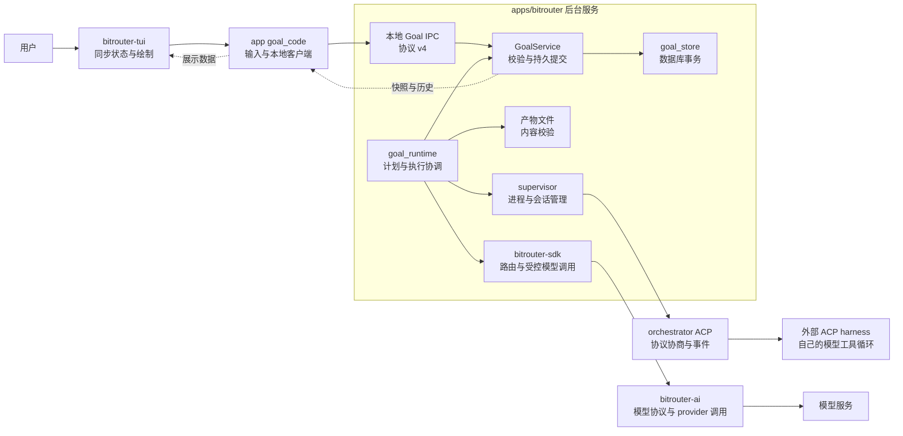
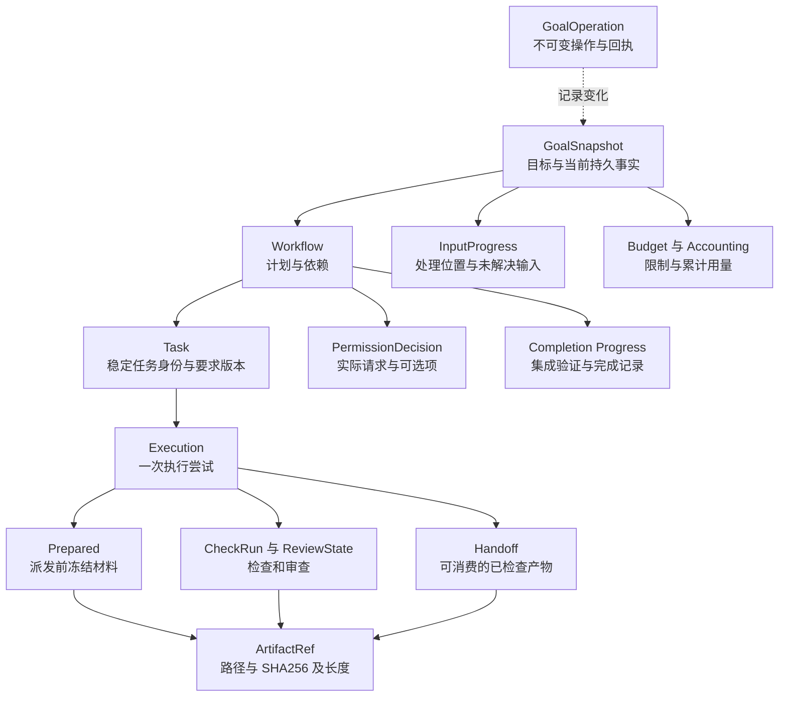
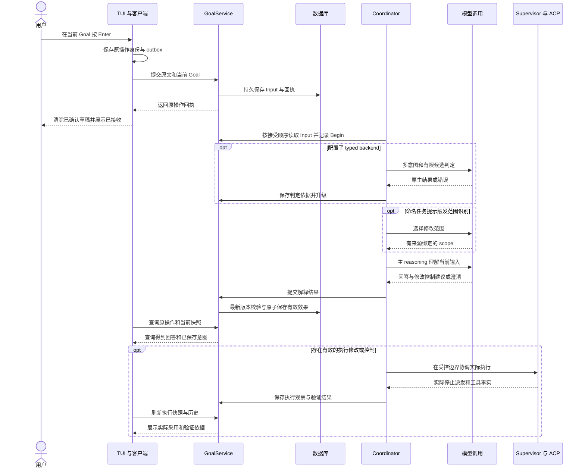
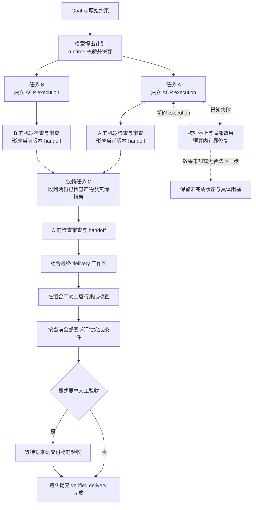
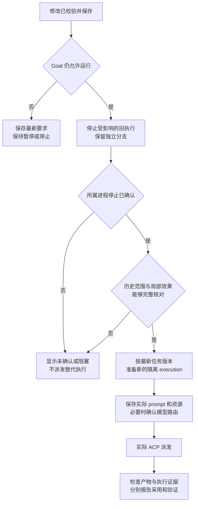

# BRO Rust 设计与实现审阅指南

BRO 当前通过持久化 Goal 编排长期、并行的 ACP 工作流。模型提出计划和修改建议，领域规则决定哪些变化合法，后台服务执行外部操作，TUI 展示结果并接收用户意图。理解这四种职责及其边界，是审阅本次 Rust 实现的主线。

本文以 PR #981 的 `fe9df6f8157945d3559789926326a7effb468db1` 为代码基线，日期为 2026-10-15；同时说明它依赖的既有模型路由、native runtime 和 ACP 基础设施。后文的简化方案属于待审阅建议，不表示代码已经按这些方案重构。

**这是重构前的历史审阅快照。** 下文的独立 Goal 执行路径与 IPC v4 图对应上述基线，不代表后续批次的当前实现。重构范围见[重构规范](BRO_ORCHESTRATOR_REFACTOR_SPEC.md)，实际已迁移路径、协议版本、验证结果和未完成项见[实施记录](BRO_ORCHESTRATOR_REFACTOR_IMPLEMENTATION.md)。

## 1 阅读范围与入口

| 入口 | 当前行为 | 谁负责推进工作 |
| --- | --- | --- |
| `bro`、`bro code` | 进入 Goals，用户选择或明确创建 Goal | BRO Goal runtime |
| `bro claude`、`bro codex` 等 | 进入对应 harness 的原生界面 | 用户和该 harness |
| `bro acp serve <agent>` | 为外部 ACP client 提供指定 harness 的 stdio 接口 | 外部 client 和该 harness |
| 不带 agent 的 `bro acp serve`、`bro task ...` | 保留的 native Thread 执行路径 | native `ThreadService` |

Goals 是默认界面。浏览目录、读取一个 Goal、展开右侧 Workflow 不创建任务。`bro code --workspace PATH` 只为新建 Goal 指定工作区，已有 Goal 保留自己的工作区。`bro code <agent>` 已移除；原有 native Thread/session 没有被重命名或自动导入为 Goal。

建议先读第 2 节了解分层，再沿第 5、6 节跟踪一次输入和一次交付，最后审阅第 10 节的设计问题。产品约定见 [PRD](BRO_GOAL_ORIENTED_PRD.md)，工程合同见 [implementation spec](BRO_GOAL_ORIENTED_IMPLEMENTATION_SPEC.md)。

## 2 分层与执行权限

下图表示运行时职责和调用关系。`bitrouter-orchestrator` 同时提供 Goal 领域模块、ACP 模块和既有 native runtime；图中将不同职责拆开表示。

| 层 | 核心职责 | 权限边界 |
| --- | --- | --- |
| `bitrouter-tui` | 草稿、焦点、导航、绘制、键盘动作含义 | 不依赖 app、SDK 或 orchestrator；没有 async runtime，也不运行 scheduler |
| app `goal_code` | 终端 I/O、本地 IPC、未确认提交、证据读取和展示投影 | 用户请求仍由服务校验；UI 选中某个分支不改变中间输入范围 |
| orchestrator `goal` | Goal 类型、状态变换、版本检查、预算与完成规则、`GoalStore` 合同 | 不管理具体 ACP 子进程；通过宿主提供的 store 提交 |
| app `goal_runtime` | 调用模型、选择任务、协调 ACP、检查、恢复和完成 | 必须先取得有效持久记录，才能据此推进外部工作 |
| app `supervisor` 与 orchestrator `acp` | 子进程、session、协议、权限请求、停止和事件捕获 | 管理协议与进程事实；不替 Goal 宣布交付完成 |
| SDK 与 AI | 路由、调用阶段、协议编解码、usage 和估算依据 | 模型返回的建议不直接获得 Goal 执行权限 |

应用依赖 TUI、orchestrator、SDK 和 AI；orchestrator 依赖 SDK/AI，SDK 依赖 AI。TUI 保持独立。`goal_runtime` 拆出的多个文件仍是同一个 `Coordinator` 的实现，没有各自独立的状态所有者。

源码入口：[main](../apps/bitrouter/src/main.rs)、[Goal UI host](../apps/bitrouter/src/goal_code.rs)、[Goal runtime](../apps/bitrouter/src/goal_runtime.rs)、[Goal 领域](../crates/bitrouter-orchestrator/src/goal.rs)、[工作区架构](DEVELOPMENT.md)。

## 3 核心对象与版本

图中是 Rust 对象的包含与引用关系，不是 SQL 表关系。Task、Execution 等嵌套在 Goal 快照中。

| 对象或字段 | 含义 | 审阅时要区分 |
| --- | --- | --- |
| `GoalSnapshot` | 当前目标、要求、运行意图、工作流、输入、预算和计量 | 快照是当前事实的聚合，不等于全部历史 |
| `revision` | 每次持久变化的版本 | 续租、计量也可能推进它 |
| `requirements_revision` | Goal 的有效要求版本 | 接收一条查询不自动改变要求 |
| `Task.requirements_revision` | 任务自己的要求版本 | 不受影响的任务可以保留旧版本，继续服务新的 Goal 要求 |
| `Execution` | 一次具体尝试，绑定工作区、任务版本、原 Goal 要求和实际 run | 任务身份、执行身份、supervisor run 和 harness session 是不同身份 |
| `GoalOperation` | 操作 ID、内容 fingerprint、版本、时间与操作内容 | 相同身份和内容返回原回执；同身份不同内容拒绝 |
| `ArtifactRef` | 内容的路径、SHA-256 和字节长度 | 读取时校验内容；引用本身不证明检查通过 |
| `Prepared` | 实际派发前准备的 prompt、资源和检查依赖 | “已经提供材料”与 harness 私有采用、实际工具使用分开记录 |

Goal 没有一个囊括一切的 `status`。运行意图是 `Run/Pause/Stop`；执行观察是 `Requested/Running/Candidate/Failed/Unknown`；检查、停止、恢复、预算和完成各自有事实。UI 的 running、blocked、needs-you 等来自这些事实的组合，避免一个简化状态掩盖“已暂停但停止尚未确认”之类的情况。

源码：[GoalSnapshot 与操作合同](../crates/bitrouter-orchestrator/src/goal.rs)、[Workflow 与 Execution](../crates/bitrouter-orchestrator/src/goal/workflow.rs)、[输入状态](../crates/bitrouter-orchestrator/src/goal/input.rs)、[资源合同](../crates/bitrouter-orchestrator/src/goal/resources.rs)。

## 4 状态如何持久化

宿主当前使用同一数据库中的两个主要表：`bro_goals` 保存当前 head 的序列化 payload，`bro_goal_operations` 保存不可变操作记录。Task、Execution、权限和完成记录没有各自一张独立业务表。产物、报告和冻结上下文存放在文件中，由 `ArtifactRef` 引用。

一次有效变化经过：读取当前快照 → 校验身份、版本与规则 → 构造新快照和回执 → 事务内同时提交两者。CAS 表示只有预期版本仍匹配，才能替换当前 head；模型调用期间不长时间持有提交锁。

产物文件和数据库不是跨介质原子事务。代码先保存产物，再提交其引用；引用提交失败不能成为继续外部工作的授权，但可能留下未引用文件。不能把“文件写出来了”视为 Goal 事实已提交。

客户端还保存 durable outbox，即未确认操作的本地记录。回执丢失后查询原操作身份，不能凭 UI 没收到响应就盲目重发。后台的 coordinator lease 与版本检查阻止旧 owner 继续提交；外部 supervisor 另外维护实际进程和启动身份。

Goal 提交和 supervisor 启动也不是一笔事务。后台先保存派发意图，再通过原始启动身份协调 supervisor 结果和 Goal execution 映射；无法核对时保留未知状态，不能靠清空记录重新派发来恢复。

历史中的已协调旧 execution 可从当前快照移出，完整内容仍在不可变历史及校验过的归档中。读取旧历史不重新启动执行，也不重置当前版本次数和累计预算。

源码：[GoalStore 合同](../crates/bitrouter-orchestrator/src/goal.rs)、[数据库实现](../apps/bitrouter/src/goal_store.rs)、[迁移](../apps/bitrouter/src/db/migration/m20240101_000028_create_bro_goals.rs)、[outbox](../apps/bitrouter/src/goal_code/outbox.rs)、[产物](../apps/bitrouter/src/goal_artifacts.rs)、[历史归档读取](../apps/bitrouter/src/goal_archive.rs)。

## 5 一次中间 Enter 的完整路径

中间输入始终属于当前 Goal。右侧选中节点是阅读位置；指定任务需要明确引用或得到受约束的语义范围绑定。

各模型调用仍受共同预算、计量和持久记录约束；图中合并了这些重复步骤。当前没有校准后的 typed 直接控制阈值：配置 typed backend 后，proposal 仍进入 reasoning；没有配置时直接走 reasoning。部分命名分支输入还会经过独立 scope reasoning。

| 输入 | 允许发生的变化 |
| --- | --- |
| “现在进展如何” | 返回已记录事实，要求版本和运行意图保持不变 |
| 没有失败记录时问“为什么又失败了” | 可以澄清所指尝试或日志；不编造原因，不由此暂停或重跑 |
| “修改 text 分支，保留 numbers 分支” | 保存合法修改，传播到依赖任务；无关任务保留版本和执行 |
| “先停一下” | 默认按暂停理解，保留恢复意图；不能据此推导额外需求修改 |
| 假设或引用某个命令 | 讨论该动作，不自动取得执行权限 |
| `/decision <id> ...` | 只响应实际、当前的权限请求及其 offered option；持久允许需要明确选择 |

仅查询的澄清不会新增完成条件。修改、控制或理解失败留下的未解决事项，则可能阻挡完成。`/input <id> <reply>` 对应原输入；精确的 `/input <id> /withdraw` 可以撤回尚未提交的未解决请求，不撤销已发生效果。

源码：[drive_input](../apps/bitrouter/src/goal_runtime.rs)、[范围识别](../apps/bitrouter/src/goal_runtime/input_scope.rs)、[输入提交规则](../crates/bitrouter-orchestrator/src/goal/input.rs)、[提交适配](../apps/bitrouter/src/goal_code/submissions.rs)。

## 6 从并行任务到 Goal 完成

planner 提出任务和有向依赖图，runtime 验证后执行。下面是两个独立任务加一个依赖任务的示例，任务数量和图结构不是代码写死的模板。

ACP 返回只形成候选。BRO 还要取得实际机器检查、候选审查及可追溯的 handoff。依赖任务收到的是冻结的上游产物和实际检查报告，之后的 review 校验当时实际提供的材料。

最终交付有独立的组合工作区和检查。分支各自通过不能替代组合后的验证；机器检查通过也不能自动证明全部开放语义要求满足。完成评估读取完整 objective、当前任务来源和实际证据，最后由 runtime/domain 检查版本、未解决输入、相关在途工作、产物与显式验收，再提交完成。

源码：[派发和候选处理](../apps/bitrouter/src/goal_runtime.rs)、[检查](../apps/bitrouter/src/goal_runtime/checks.rs)、[依赖材料](../apps/bitrouter/src/goal_runtime/dependencies.rs)、[集成与评估](../apps/bitrouter/src/goal_runtime/completion.rs)、[完成规则](../crates/bitrouter-orchestrator/src/goal/completion.rs)。

## 7 修改如何实际影响执行

要求保存后，runtime 限制旧版本继续取得新的派发或权限，并按受影响任务及其依赖协调执行。它控制自己提供的下一份 prompt、资源和工作区；不能任意改写 harness 私有的在途上下文。

自动协调仅覆盖代码能确认的窄范围：完整且未复用的工具历史、明确的私有工作区路径、已结束的受支持本地操作、真实权限结果、进程停止与稳定工作区。失败且没有 permission 请求的本地工具还有受限协调路径；失败本身不证明没有部分效果。成功但未请求权限、范围不明、未结束或外部效果仍会阻塞。

自动权限只选择符合当前授权的实际一次性选项。它检查所有声明位置与原始路径参数，拒绝外部路径、symlink、冲突范围及控制 metadata 写入。ACP 声明和路径校验不能替代 OS sandbox。

资源方面，planner 可选择配置中的 MCP ID、带版本的 skill 材料、相对工作区 context 和可用 BRO 模型路由。材料在派发前冻结；可选 route control 需要真实协商和确认。配置选择、材料提供、controller 确认、实际工具使用和物理模型身份是不同事实。

源码：[权限与自动选择](../apps/bitrouter/src/goal_runtime/permissions.rs)、[原始权限材料](../apps/bitrouter/src/goal_permission_material.rs)、[恢复协调](../apps/bitrouter/src/goal_runtime/recovery.rs)、[停止边界](../apps/bitrouter/src/goal_runtime/stop_boundary.rs)、[资源准备](../apps/bitrouter/src/goal_runtime/resources.rs)。

## 8 预算与当前实现边界

| 限制 | 当前含义 |
| --- | --- |
| 总 elapsed time | 从 Goal 创建开始，包括等待和暂停；提高上限不自动恢复工作 |
| managed token estimates | 配置价格下的受控模型 token 估算；已有消费与并行预留共享同一预算 |
| 未知费用 | harness、工具、完整外部账单可能未知，不能展示为零或宣称完整账单硬上限 |
| 未知调用结果 | 未取得可靠结算依据时保留预留，不能因回调丢失就释放后重复花费 |
| 修复次数 | 当前 task 版本最多三次执行；当前 task 保留执行列表另有十六条边界，历史归档不重置当前次数与预算 |
| 工作流规模 | 每个 Goal 最多三十二个任务；不是无限规模调度系统 |
| 记录与分页 | 单快照、操作或查询页上限 1 MiB；目录和历史按有界页读取 |
| 执行环境 | 当前隔离要求 Git repository root；没有通用子目录映射或全局 OS sandbox |

预算耗尽不等于完成；已有、仍有效的完整验证证据可能支持无需新付费调用的完成，否则保留部分结果和未满足条件。单个分支受阻时，其他独立授权分支可以继续。UI detach 后后台继续已接受工作；崩溃后读取原身份和效果，不能自动重放未知外部操作。

源码：[预算](../crates/bitrouter-orchestrator/src/goal/budget.rs)、[计量](../crates/bitrouter-orchestrator/src/goal/accounting.rs)、[模型调用控制](../apps/bitrouter/src/goal_runtime/model_control.rs)、[修复](../apps/bitrouter/src/goal_runtime/repair.rs)。

## 9 测试分层与验证结果

| 层次 | 代表位置 | 能证明的范围 |
| --- | --- | --- |
| 领域与存储 | `tests/goals/`、orchestrator Goal 测试 | 状态规则、CAS、回执、权限、预算及完成条件 |
| runtime 集成 | `goal_runtime/tests.rs`、Rust ACP fixture | 实际进程、HTTP、IPC、数据库和派发链；模型判断使用固定 fixture |
| TUI reducer | `bitrouter-tui/src/goals/tests.rs` | 导航、草稿、焦点、只读和 effect 生成 |
| 实际 PTY | `tests/goal_tui_pty.rs` | 真实终端输入、权限卡、信号、恢复、退出和重连 |
| 真实模型输入评测 | `goal_runtime/tests/live_input/` | typed/reasoning 与持久 fixture Goal 的效果；不派发真实 ACP 工作流 |
| 真实 harness campaign | 最终验收摘要 | 特定配置与实际 harness/provider 路径的完整交付；不是所有品牌或生产认证 |

原完整本地验证记录 4,675 项通过、24 项既有 opt-in 跳过；doctest 6 项通过、1 项既有忽略。随后 Windows 的 test helper 条件和路径 fixture 有单独修正及适用范围记录。[基线 fe9df6f8 的 CI](https://github.com/bitrouter/bitrouter/actions/runs/38760348667)已通过三平台测试和 Clippy；检查总计 28 项成功、7 项按工作流规则跳过。

真实并行验收记录了运行中 Enter、独立分支保持、旧执行协调与替换、实际检查依赖传入、组合验证和自主完成。输入评测保留 54 条 corpus 与 18 条 sequence 记录，禁止的持久效果为零；原生控制选择仍有错误，定义明确的动作匹配为 16/23，不能把持久效果安全当成输入语义准确率。q03/q07 为人工确认，其余标签仍是 draft。

最终摘要、原始源码绑定与复现入口见 [证据索引](evidence/bro-goal-workflow/README.md)、[62 项验收对账](evidence/bro-goal-workflow/2026-10-15-final-acceptance.md)、[复现步骤](evidence/bro-goal-workflow/REPRODUCE.md)。完整旧日志与多轮快照保存在 [独立归档固定提交](https://github.com/bitrouter/bitrouter/tree/382c2b58c5c25b02805175a33d60707dc4227b46)，[archive.json](evidence/bro-goal-workflow/archive.json)记录来源和校验值。历史失败保留原结论。

## 10 已知设计问题与简化候选

以下来自对基线代码和两份独立 Rust 审阅的核对。静态可确认的结构问题与尚待运行验证的触发场景分别标明。

| 问题 | 当前依据与影响 | 简化候选 | 必须保留或先明确 |
| --- | --- | --- | --- |
| 每次 execution 重采源基线 | `launch` 重读源 HEAD/diff/untracked；依赖和集成要求相同 base_commit。源目录变化导致晚启动分支失配的拒绝路径明确，触发场景尚待复现 | Goal 工作轮次持久冻结一次 baseline，后续执行复用 | 普通要求修改保留无关分支；导入外部源变化需单独定义，不能每个要求版本自动换基线 |
| 重试资格分散 | domain、scheduler、projection 各自组合次数、replacement 和修复条件 | 共享纯资格计算，将结果投影为 UI 文案 | 提交时按最新状态再验，不能信任 UI 计算或删掉版本与效果检查 |
| 输入反复扫描历史 | `next_input` 从最后已处理 Input 翻页查找；找不到时后续轮询重扫非输入记录 | 有截止点的增量读取，或专用可索引 Input 查询 | 顺序、并发新增输入、重启、去重与完成围栏；性能收益尚未测量 |
| 两套检查执行骨架 | task 和 delivery 都保存请求、运行、保存报告、捕获工作区、提交结果 | 仅抽共同 I/O 和证据读取 helper | 两类产物和版本仍分开；集成检查必须实际重跑，未知 Requested 不能自动重放 |
| 内部使用协议枚举读快照 | 同进程也构造 Get，再匹配 Reply 的理论错误分支 | 带 owner/identifier 校验的类型化读取 | IPC 边界仍校验协议，不能公开无验证的底层 store |
| 多阶段模型理解 | 可选 typed advice 后仍 reasoning，部分输入另有 scope reasoning | 评估 scope 与主理解合并，以及 typed advice 的实际收益 | 这是语义与成本取舍；不能删掉宿主范围、版本和权限检查 |

关键代码：[重采基线](../apps/bitrouter/src/goal_runtime.rs#L1697)、[依赖要求同基线](../apps/bitrouter/src/goal_artifacts.rs#L267)、[集成要求同基线](../apps/bitrouter/src/goal_runtime/completion.rs#L126)、[重试准入](../crates/bitrouter-orchestrator/src/goal/workflow.rs#L1140)、[UI 投影](../apps/bitrouter/src/goal_code/projection.rs#L118)、[输入历史扫描](../crates/bitrouter-orchestrator/src/goal/workflow.rs#L676)。

测试组织还有四个具体候选：

| 问题 | 调整方向 | 覆盖边界 |
| --- | --- | --- |
| 旧 review 竞态依赖固定三秒延迟 | 使用 entered/release 屏障，确定新版本先提交、旧响应后返回 | 保留实际 worker、版本拒绝、独立 execution 不重启等断言 |
| 确定性 HTTP 故障链耦合真实模型评测 | 将 timeout、503、矛盾分布加固定 reasoning 响应，提取为默认离线回归 | 真实语义评测继续独立 opt-in，不把固定 fixture 当模型质量证明 |
| 二十个 Scenario 共用近八百行驱动 | 共享具体 setup/helper，各场景明确写动作，完整闭环保留一个 baseline | 不删独特故障，不换成更大的通用测试 DSL |
| PTY 与 daemon 生命周期重复 | 抽启动、就绪、退出和共同终端 I/O | 保留新帧、termios、信号、编辑器回收；不同 ACP peer 不合成万能模拟器 |

源码：[runtime 测试驱动](../apps/bitrouter/src/goal_runtime/tests.rs)、[故障注入](../apps/bitrouter/src/goal_runtime/tests/live_input/sequences.rs)、[真实评测入口](../apps/bitrouter/src/goal_runtime/tests/live_input.rs)、[Goal PTY](../apps/bitrouter/tests/goal_tui_pty.rs)。当前没有足够证据支持删除完整命名测试；相似 setup 在数据库、进程、IPC 和 PTY 边界上可能保护不同故障。

## 11 差异规模与源码阅读顺序

以下是基线 fe9df6f8 相对 PR base eafa8383 的新增行，未扣除 4,178 删除行；不包括本审阅文档。按文件路径区分实现与测试，实现文件仍可能含内嵌单测。

| 分类 | 文件数 | 新增行 |
| --- | --- | --- |
| Rust 实现路径 | 75 | 18,506 |
| 独立 Rust 测试与模拟程序 | 47 | 18,721 |
| 最终证据和复现材料 | 18 | 4,768 |
| 开发文档 | 15 | 1,546 |
| 静态测试数据 | 2 | 828 |
| Skill 文档 | 7 | 216 |
| 配置与其他文件 | 9 | 82 |
| 合计 | 173 | 44,667 |

实现路径进一步分为 runtime 6,085、领域模型 4,971、TUI 2,136、UI host 1,929、存储/产物/权限材料 1,547、已有系统接入 1,838 行。静态样本中的 SSE 按原始提交字节计入二十六行；因其 Git binary 属性，普通 numstat 不显示这个行数。

| 阅读顺序 | 源码 | 主要问题 |
| --- | --- | --- |
| 1 | [goal.rs](../crates/bitrouter-orchestrator/src/goal.rs) 与 [workflow.rs](../crates/bitrouter-orchestrator/src/goal/workflow.rs) | 哪些身份、版本和状态变化是权威事实 |
| 2 | [goal_store.rs](../apps/bitrouter/src/goal_store.rs) | head 与操作如何原子提交和去重 |
| 3 | [goal_runtime.rs](../apps/bitrouter/src/goal_runtime.rs) | 输入、规划、派发如何进入同一后台协调器 |
| 4 | [input.rs](../crates/bitrouter-orchestrator/src/goal/input.rs) 与 [input_scope.rs](../apps/bitrouter/src/goal_runtime/input_scope.rs) | 什么能改要求，什么只回答或澄清 |
| 5 | [permissions.rs](../apps/bitrouter/src/goal_runtime/permissions.rs) 与 [recovery.rs](../apps/bitrouter/src/goal_runtime/recovery.rs) | 什么证据支持授权、替换和恢复 |
| 6 | [checks.rs](../apps/bitrouter/src/goal_runtime/checks.rs) 与 [completion.rs](../apps/bitrouter/src/goal_runtime/completion.rs) | 候选如何成为已验证交付 |
| 7 | [goal_code.rs](../apps/bitrouter/src/goal_code.rs) 与 [goals.rs](../crates/bitrouter-tui/src/goals.rs) | 持久事实如何投影为界面，输入如何绑定原身份 |
| 8 | [公开 Goal 测试](../apps/bitrouter/tests/goals.rs)、[runtime 测试](../apps/bitrouter/src/goal_runtime/tests.rs)、[PTY 测试](../apps/bitrouter/tests/goal_tui_pty.rs) | 每个失败边界由哪种测试保护 |

## 12 本轮审阅需要作出的选择

优先明确工作轮次的输入基线语义：建议固定一次，显式导入源变化，普通要求修改继续复用。随后可在保持行为的批次中统一重试规则、处理输入增量读取、抽检查骨架和类型化读取；测试先修确定性时序与离线故障覆盖，再整理巨型驱动和 PTY 基础设施。

是否合并 scope 与主 reasoning、是否继续把 typed advice 放在配置后的输入路径，需要单独用相同语义样本比较错误、成本和延迟。现有证据不能给出可删除代码比例或已实现的速度收益。

审阅时需要保留的核心复杂度包括：持久化回执与版本复验、未知效果阻断、真实权限来源、受限修复、共享预算预留，以及组合产物上的最终验证。这些对应真实崩溃和并发边界。减少重复规则与执行样板时，应让这些边界更集中、更容易核对。
