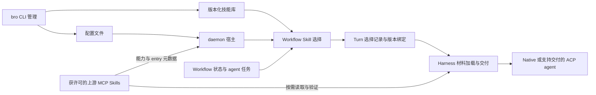

# CLI 管理面与 Workflow Skills 分配

状态：**执行基线 v0.5 / G00–G11 约定本地范围已完成**。日期：2026-10-20。
源码基线：`54c822a34d4dbfd75d484ca35e108b497048efef`。
审阅修订：裸 `bro` 确保 daemon 后台就绪后退出；裸 `bro agents` 返回当前连接的
agents。移除 UI 不缩减 orchestration 或 ACP/MCP/skills 的既有运行能力。

本文记录移除第一方 TUI、保留简单 CLI onboarding 与管理交互，并由 daemon
根据 workflow 为 agents 选择 skills 的目标设计。用户已要求采纳建议并整理成
后续 `/goal` 可逐步实现的契约。G00 审计与 G01 共享非 UI 逻辑迁移已有本地证据；
G02 的简单 onboarding 与裸 bro 后台启动、G03 的只读连接快照已完成本地验收。
G04 单次会话、队列与审批控制及非 UI 业务回归已完成本地验收；
G05 已删除 UI 与绘制依赖；G06 的 MCP 配置 CRUD 已完成本地实现与回归。
G07 的本地/Git 版本化 skills 安装与 G08 的 managed daemon 宿主迁移已完成本地验收；
G09.1–G09.6 已完成本地验收：gateway、native 来源/选择/批准、根与支持文件
实际交付、原绑定恢复和冷 explain 均有当前源码证据；G10 载体与 G11 完整集成已完成本地验收。
v0.5 分别验收 MCP Skills gateway 与 native host，结论限定固定规范和本地
fixtures；外部 adapter、真实服务与 hosted CI 资格单列。G07 安装不代表 host 激活。

阅读顺序：本文定义产品与技术约束；[Goal 执行计划](CLI_ONLY_AND_WORKFLOW_SKILLS_GOALS.md)
定义 G00–G11 的范围与完成门槛；[实现记录](CLI_ONLY_AND_WORKFLOW_SKILLS_IMPLEMENTATION.md)
只记录实际证据。用户启动某一阶段的 `/goal` 才授权执行该阶段；阅读文档或其中
的示例不会启动 goal，也不自动授权后续阶段、远程发布或真实付费实验。
起点源码、协议操作、消费者与测试映射见 [G00 审计附件](CLI_ONLY_AND_WORKFLOW_SKILLS_G00_AUDIT.md)；
最终 A01–A28/M01–M10/C/T 当前证据、真实检查和整个 spec 的交付边界见 [G11 验收附件](CLI_ONLY_AND_WORKFLOW_SKILLS_G11_ACCEPTANCE.md)。

## 1. 已确认的方向与执行默认

| 分类 | 内容 |
| --- | --- |
| 用户已确认 | 删除 `bro code`，不提供第一方 agent 对话或行式聊天替代品 |
| 用户已确认 | 保留简单 CLI onboarding、配置与管理交互 |
| 用户已确认 | 保留 MCP、ACP、skills 的 CLI 管理能力 |
| 用户已确认 | `bro` 直接添加、修改、移除 MCP 配置 |
| 用户已确认 | `bro` 安装、更新、卸载 skills |
| 用户已确认 | daemon 根据 workflow，为各个 agent 选择并提供合适的 skills |
| 用户已确认 | 裸 `bro` 首次完成 onboarding，之后确保同一配置的 daemon 后台就绪并返回 shell |
| 用户已确认 | 删除 agents 控制台，裸 `bro agents` 返回当前连接的 agents |
| 用户已确认 | 保留必要 orchestration，以及 orchestrator 中用于 context routing 的 ACP/MCP/skills 能力 |
| 采纳建议后的执行默认 | 编号/名称与回车搜索；有类型的连接实例；本地/Git 版本化技能库；保留现有能力后再删除 UI |

第 12 节将此前待审项整理为执行默认、按源码核验项和明确延期项。常规内部实现
选择由执行阶段自行完成并记录；只有改变已确定的产品行为、权限、数据保留或
引入本文范围外的外部副作用时才需要新的用户决定。不得把源码核验变成重复确认。

目标产品具有三个入口：结构化 CLI、原生 harness launcher、现有 API/协议。
原生 agent runtime、orchestrator、headless 执行、MCP gateway 和 ACP 服务保留。
删除工作不得移除它们仍使用的共享逻辑。

本项不新增 GUI、REPL、交互 dashboard、常驻菜单、执行调度器或 workflow 引擎。
不以恢复 OSS origin MCP server 作为 skills 分配方案；现有上游 MCP 聚合和
Skills-over-MCP relay 继续遵守各自边界。G09 先补协议能力检查，再接入明确获
许可的 MCP-origin skills；host 加载责任只属于执行该加载的 daemon/Harness，
不由 gateway 转发成功或外部 ACP 连通推定。

### 1.1 保留、移除、重构的判定

| 处理 | 对象 | 实现与审查边界 |
| --- | --- | --- |
| 保留 | Thread/Turn、Core 调度、委派、队列、审批、验证与恢复 | 继续调用既有 owner；G00 的 C01–C08/T01–T15 追踪业务回归 |
| 保留 | ACP 服务与已协商操作、MCP client/gateway/relay、模型与 context routing | 删除 UI 不缩减协议能力，不把“不支持新增 skill 交付”解释成停止支持该 agent |
| 保留 | 原生 harness launcher、headless/API 与历史配置 | harness 可保留自己的界面；BRO 不接管其交互，不改其全局配置 |
| 移除 | 第一方 Code/agents 控制台、绘制、composer、热键、交互事件循环 | G05 删除；业务操作先取得无 UI 入口与测试证据 |
| 重构 | 权限/prompt/plain/cost 等共享逻辑 | G01 迁入实际所有者，保持权限默认、输出与身份语义 |
| 重构 | onboarding、裸 bro 与 agents 默认入口 | G02/G03 改为有限步骤问答、后台就绪与只读快照 |
| 重构 | task managed 的产品 CLI 宿主 | G08 迁入 daemon，保留 Core、session/store 与恢复身份 |
| 增量 | MCP CRUD、版本化 skills、workflow 选择和交付 | G06–G10 分别验收；不能用删除 UI 的证据替代新增功能证据 |

判断依据是仍存在的业务消费者和执行语义。仅依赖 UI 的展示可以删除；兼有
业务职责的模块应拆分。文件名含 `chat`、`tui`、`pty` 不构成整文件删除依据。

## 2. 起始源码事实与缺口

以下固定记录 G00 对上述源码基线的检查结果，不是当前工作区的实时状态。
G01 之后已迁移的消费者、已交付的命令与实际证据见实现记录；后续实现前重新核对
相关源码。不得据本表覆盖已经完成的工作，也不能把目标列直接当作已实现事实。

| 当前事实 | 依据 | 本项需要的变化 |
| --- | --- | --- |
| 裸 `bro` 可以进入已保存 ACP harness 的 Code UI | [onboarding.rs](../apps/bitrouter/src/onboarding.rs) | 移除自动进入对话；重写 onboarding 完成条件 |
| `code` 同时承载 native BRO 和外部 ACP 对话；另有隐藏 `tui`、`chat` | [main.rs](../apps/bitrouter/src/main.rs) | 删除全部第一方对话入口 |
| 裸 `agents` 和 `agents attach` 仍可打开独立控制台 | [agent_sessions.rs](../apps/bitrouter/src/agent_sessions.rs) | 删除 renderer，保留后台操作所需的客户端能力 |
| onboarding 和登录选择器依赖 TUI crate | [prompt.rs](../apps/bitrouter/src/prompt.rs) | 替换成独立的简单问答 |
| ACP headless 使用 TUI 中的权限、prompt 展开和 plain transcript | [acp_cli.rs](../apps/bitrouter/src/acp_cli.rs) | 迁出共享逻辑，文本输出脱离 Ratatui |
| `mcp check` 可用；隐藏且废弃的 `mcp add` 只返回 YAML stub | [main.rs](../apps/bitrouter/src/main.rs) | 提供真正的配置 CRUD，重新定义 list/add 语义 |
| skills CLI 只有 list/init，项目与全局检查使用现有发现规则 | [skills/cli.rs](../apps/bitrouter/src/skills/cli.rs)、[skills/root.rs](../apps/bitrouter/src/skills/root.rs) | 增加安装生命周期与统一管理目录 |
| Harness 能发现 skill 元数据和版本化材料 | [skills/mod.rs](../crates/bitrouter-orchestrator/src/harness/skills/mod.rs) | 接入受管理的技能库与安装版本 |
| managed Harness 发布 skill catalog，并可按 ID/version 返回材料 | [managed.rs](../crates/bitrouter-orchestrator/src/harness/managed.rs) | 增加选中、激活和交付语义 |
| Core 的材料选择读取 required materials，尚非 workflow 自动 skill 选择 | [core/session.rs](../crates/bitrouter-orchestrator/src/core/session.rs) | 将 workflow 选择结果绑定到 Turn |
| 起点的 `task managed` 在客户端装配 App 和 NativeSession；G08 已迁移执行宿主，验收见实现记录 | [managed_task.rs](../apps/bitrouter/src/managed_task.rs) | 保留原身份与 Core authority；workflow 选择仍由 G09 接入 |
| native MCP 配置在 daemon 启动时绑定 | [BRO_HARNESS_RESOURCES.md](BRO_HARNESS_RESOURCES.md) | 写入结果与运行态生效分别报告 |

当前 runtime 与 Core/managed 路径的集成范围不是本文重新定义的事实。
实现必须遵守 [runtime contract](BRO_AGENT_RUNTIME_SPEC.md) 和
[Core contract](ORCHESTRATOR_CORE_SPEC.md)，不得为了共用名词新增第二个执行循环。

## 3. 目标架构与所有权



| 所有者 | 职责 |
| --- | --- |
| `apps/bitrouter` CLI | 参数解析、简单问答、安装事务、配置编辑和结果输出 |
| daemon host | 本地库/MCP 来源可见范围、调用者/workspace 授权、配置与存储装配 |
| orchestrator 的 workflow/context 决策路径 | 候选过滤、skills 选择、Turn 绑定、持久化选择结果 |
| Harness | 本地版本/MCP held entry 读取与验证、指令交付、来源与关联文件访问约束 |
| 现有执行服务 | 继续拥有任务推进、审批、取消、事件、持久化与恢复 |
| SDK / AI executor | 继续负责各自模型、协议和路由职责；不承接 skill 安装器 |

“daemon 选择”表示 daemon 承载并授权 orchestrator 的选择操作。它不要求把
选择算法写进 daemon transport，也不意味着 CLI 自己维护一套 workflow 状态。

包独立与进程所有权分别审查：`bitrouter-orchestrator` 的协议、资源和执行 API
必须能脱离 TUI 调用；app 仍负责 CLI、daemon、配置落盘与数据库装配。
当前 SDK 仍包含 MCP gateway/relay 和配置类型，native MCP client 与 skills 则在
orchestrator Harness。删除 TUI 不隐含一次完整 SDK/gateway 所有权迁移。

## 4. 移除与保留的 CLI 表面

| 表面 | 目标 |
| --- | --- |
| `bro code`，包括 `code <agent>` | 删除 |
| `bro tui`、`bro chat` 及对应兼容分支 | 删除；不保留可进入旧 UI 的隐藏别名 |
| 裸 `bro` | 首次 onboarding；确保 daemon 后台就绪后返回 shell |
| 裸 `bro agents` | 返回 daemon 当前实际连接/托管的 agents 快照并退出 |
| `bro agents attach` | 删除 TUI attach 入口；观察与审批改用显式命令 |
| `bro init`、provider 登录和必要确认 | 保留简单问答 |
| `bro launch`、`bro codex`、`bro claude` | 保留原生 harness 启动；终端交给子进程 |
| `bro run`、`bro task run`、`bro task managed` | 保留 headless 入口；按第 9 节统一资源选择 |
| `bro acp serve` 与 ACP 检查、记录和演化命令 | 保留协议及管理能力 |
| MCP、tools、skills、provider、路由与服务管理 | 保留并补齐本文定义的管理能力 |
| HTTP、local socket、MCP gateway、ACP | 保留已有边界，不隐式扩大远程权限 |

历史命令删除后应返回明确的命令错误和迁移指引，不能重新打开 UI。
不要求为每一个 TUI 操作重建一条 CLI 命令；必须覆盖仍保留的任务生命周期，
且逐项列出主动取消的 UI 能力，例如 composer、对话切换、picker 和 inspector。

## 5. 简单 onboarding 与交互规则

### 5.1 裸命令

- 首次、未配置、stdin/stderr 均为终端时：运行 onboarding；成功后启动 daemon。
- 已配置时：复用 `bro start` 的配置定位、跨进程启动锁、状态探测与 readiness
  等待，确保 daemon 后台运行，再输出结果并退出；不是前台 `serve`。
- 同一配置的 daemon 已就绪时复用该进程；不重复启动、不隐式重载新配置，
  不重启正在工作的 daemon。配置 saved/running 差异按现有契约报告。
  经 source-specific locator 与实际状态核验的运行实例本身足以复用；客户端不必
  再提供一次性启动凭据，也不因当前 YAML 缺失而强制重做 onboarding。
- 非交互且配置可用时同样执行 ensure-start；需要 onboarding 输入时明确报错
  并指向非交互参数，不等待输入、不暗中替用户选择 provider 或资源。
- “已配置”不能再以 `chat.agent` 是否存在判断；有效 Router 配置或可用的
  零配置输入是本地配置状态，连通性由明确的检查结果单独表示。
- 仅观察到 child PID 不算启动成功。超时、提前退出和就绪分别报告；readiness
  超时后不重复 spawn，也不把可能仍运行的进程说成已停止。
- 自动启动作用于所选本地配置；显式远程目标不静默回退或另起本地 daemon。

### 5.2 向导

保留现有分步、选择 provider/auth method、重复添加和完成提示的 UX；替换交互
实现。步骤保持为 Providers → Agents/Resources → Finish：

1. 解析并显示配置目标，检查已有凭据，选择登录或使用已检测的凭据。
2. 选择/配置 ACP agent，可选配置 MCP、安装 skills；不因删除 Code 而删去这些
   资源入口。允许跳过，避免缺少外部 harness 阻断 Router 启动。
3. 保存并汇总完成项、跳过项、失败项。裸 `bro` 路径继续 ensure-start 并退出；
   显式 `bro init` 可保留 save-only 选择。原生 harness 启动由明确命令或选择触发。

Router 保存成功后，可选资源步骤失败应保留已经完成的结果，允许单独重试。
取消当前步骤不继续执行后续副作用。配置未完成和可选资源未完成分别报告。
检测到 executable、登记配置、ACP initialize 成功、当前已连接也分别报告；
不能把 catalog 中选了一个 harness 就称为安装成功或已连接。

G02 先交付向导框架和已有 provider/agent 步骤；尚未交付的资源操作明确指向
后续管理命令。G06/G07 交付对应事务后，最终资源步骤复用相同的配置编辑和
安装操作，不在向导中实现第二套写入器。G11 必须验证可选 MCP/skills 步骤的
完成、跳过、失败后重试及已保存 Router 配置的保留，不能永久用提示文字代替。

### 5.3 交互与输出

- 采用编号/名称输入、回车提交关键词过滤、`[Y/n]` 确认；可使用颜色。
  这条路径可同时脱离 Ratatui 与 Crossterm，选择器只需标准行输入输出。
- 本次不实现方向键/即时搜索，不为它们引入替代的 raw-key/redraw 框架。
- 不维护 alternate screen、固定底栏或自有 composer。隐藏密钥回显需要独立的
  最小终端实现；标准库的普通行输入本身不提供跨平台隐藏回显。
- 密钥输入隐藏回显；提示、进度和诊断写 stderr。
- 每个问题都有非交互参数路径。stdin 已用于配置/密钥输入时，不争用该输入。
- `--yes` 只接受已定义的默认值和确认，不完成浏览器 OAuth，不扩大权限，
  不覆盖未知文件，也不自动解决来源或 skill 名称歧义。
- 保留现有 JSON 默认报告与 `--human`；事件流使用 NDJSON，stdout 不混入提示。
- EOF、Ctrl-C、无效选择、重定向、broken pipe 有明确终止行为。

## 6. MCP 与 ACP 管理

### 6.1 MCP 目标命令

```text
bro mcp list
bro mcp show <name>
bro mcp add <name> --url <url>
bro mcp add <name> --command <program> -- <args...>
bro mcp edit <name>
bro mcp remove <name>
bro mcp check [name]
```

上表作为目标命令基线。共同支持 `--config <path>`；完整 HTTP headers、stdio
env、aggregate、tool prefix 等配置可通过 `add/edit --from <file|->` 提供，
文件内容复用现有单个 `McpServerConfig` 结构。`--from` 与 transport 快捷参数互斥。
`edit --from` 完整替换指定的单个条目；省略字段按该结构的默认值处理。
配置 map key 与条目名称必须一致，重命名不通过隐式覆盖其他条目完成。
`edit` 无参数且在终端时使用 `$EDITOR` 编辑单个条目，保存后仍经过完整校验与
并发检测；非终端调用必须提供完整编辑输入。`add` 参数不足时可使用简单问答。

命令语义：

- `list/show` 读取所选配置，输出来源路径；敏感 headers/env 值默认隐藏。
- `add` 对已有名称报冲突；`edit` 更新已存在条目；`remove` 只移除配置条目。
- 配置读取成功不表示 endpoint 可达；`check` 才执行连接和工具发现。
- `list` 表示已配置服务器。旧 registry 浏览语义由独立 `search` 表达，
  registry 浏览不是本次完成 CRUD 的前提。
- 写配置不自动启动 MCP 进程，不安装配置中命令的依赖，也不修改远端服务器。
- 复用现有 transport、名称和 URL 校验，不另造一套 MCP 配置格式。

配置编辑遵循现有配置解析顺序；显式 `--config` 优先。没有保存文件时，
使用 onboarding 的明确创建路径，不能根据 daemon 的工作目录猜测写入位置。
相对路径在任何 `chdir` 前解析，输出实际绝对路径。

写入流程为读取原文与版本 → 修改目标节点 → 校验完整候选配置 → 检查并发变更
→ 原子替换。保留无关节点、注释和顺序；不支持无损编辑的文档结构应拒绝修改
并给出 `$EDITOR` 路径，不得静默重写整个文件。密钥值不能进入 diff 或普通日志。
编辑使用尚未插值的源文档，保留 `${VAR}` 等引用；不能序列化已经展开环境变量的
运行配置来替换用户文件。检查版本与替换之间须有同一目标的锁或等价并发保护。

写入结果首先为 `saved_only`。复用
[configuration state contract](CONFIGURATION_STATE_CONTRACT_SPEC.md) 报告
reload/restart 要求。native MCP 的启动绑定仍要求 restart；不把普通路由 reload
当成 native MCP 已更新。保存命令不自动重启正在执行任务的 daemon。

### 6.2 ACP

`bro agents` 管理 agent 定义、发现与兼容性检查；`bro acp` 提供协议入口及
协议相关记录操作；`bro run` 执行 headless 请求。移除 renderer 不改变这些分工。

本项要求保留 `agents list/check/inspect/scaffold/conformance` 等现有非 UI 能力。
ACP 定义的直接 CRUD 本次延期，保留现有 scaffold/检查/协议能力；不增加 `acp add`
等新入口。已支持的 session 操作仍须有第 10 节要求的非 UI 调用路径。
ACP native session ID、BRO Thread ID 与 supervised run ID 继续保持不同身份。

### 6.3 裸 `bro agents` 的连接清单

默认命令返回 daemon 当前实际连接/托管的 agent 实例，不再打开控制台或仅显示
help。`agents list` 继续表达 agent catalog/config inventory；`agents sessions`
保留监督运行记录的语义。三个集合不能相互冒充。

一行表示一个可证明存活的 runtime/session 实例：同一 agent 类型的多个
session 保留不同身份。idle 但连接仍存在的实例继续显示；只配置、仅安装、
已停止或仅有历史记录的 agent 不进入默认 connected 集合。

清单从现有执行服务、ACP controller/session 与 native worker 的真实状态聚合，
只建立只读投影，不新增第二个状态权威。当前 supervisor 的 list 包含保留的
stopped/failed 运行，不能直接无过滤复用。ACP route lease 也不是连接存活证明。
native 的冷 Thread 记录与 ACP client attachment 不能自动当成一个活跃 worker。

最小输出包含带 kind 的实例身份、agent/harness、状态、所属 workflow/Thread
或 run/session 绑定，以及已确认的 model/resource 摘要；未知值明确标记。
第一版覆盖 daemon 直接托管的 native worker 和 supervised ACP session；G03
也从各自所有者投影 native ACP session attachments 与 managed Core channels。
保留父子绑定与现有分页上限。其他连接仅在相应宿主有可信存活证据时纳入，并标记
来源；无可靠证据时报告覆盖范围，不用路由 lease 或历史记录补齐。G00 必须列出
所有当前 agent 接入路径，G03 逐项处理，不能只列一个最容易读取的子集就宣称完成。

查询不启动尚未连接的 agents，不通过批量 initialize 来制造连接清单，也不
为了查询而启动 daemon。daemon stopped、running-with-zero-agents、查询失败
必须可区分。inference-only 客户端不因为向 Router 发过请求就被列为已连接 agent。

### 6.4 保留的 orchestration 能力

必要 orchestration 由现有服务继续提供，CLI 通过明确命令调用：

| 能力 | 保留的执行语义 | UI 删除后的入口 |
| --- | --- | --- |
| Thread/Turn/Item 与上下文连续性 | durable 身份、历史、FIFO、工具结果和恢复边界 | 显式提交/继续、检查、历史与事件命令 |
| 委派与子 agents | spawn/delegate/wait、依赖、独立 review 与结果回收 | headless 任务触发既有 scheduler；CLI 检查与控制 |
| 运行约束 | 并发/工具/时间/输出预算、workspace 隔离、owner fencing | 任务参数、配置和结构化状态 |
| 输入与执行控制 | enqueue、steering、approval、取消、暂停队列与明确恢复 | 有身份和幂等键的单次管理命令 |
| MCP/skills/AGENTS.md | 发现、读取、选择、绑定、激活、实际交付和 provenance | CLI 管理 + orchestrator/Harness 执行 |
| ACP session | 已支持的 auth、load/resume/fork、mode/config、permissions、cancel 与更新流 | CLI 或协议服务；保留 adapter 能力检测 |
| session routing 与费用 | controller scope 下的 route set/reset、确认的 model 与 attributable cost | 有 session 目标的管理命令/事件，不能替换成全局 route preview |
| verification、artifacts 与恢复 | check 证据、文件/结果引用、checkpoint、未知副作用阻塞 | 结果报告、检查与显式恢复入口 |

“所有功能”指保留当前实现实际支持的能力与协议协商结果，不扩大成未实现的
整个协议标准。每项现有能力必须有 headless/API 调用证据；不能以 UI 入口消失
为理由把它退役。新增 workflow skill 自动选择另列增量实现证据。

## 7. Skills 安装生命周期

### 7.1 CLI

```text
bro skills list [--global]
bro skills show <name> [--global]
bro skills init <name>
bro skills install <source> [--skill <name>] [--ref <ref>] [--global]
bro skills update <name> [--ref <ref>] [--global]
bro skills uninstall <name> [--global]
```

默认 scope 为当前项目，`--global` 为当前用户的 BitRouter 资源库。安装与库查询结果
包含 scope、项目/库路径、安装标识、来源和精确版本。同名跨 scope 的候选保留
独立身份；命令只修改指定 scope，选择阶段不靠裸名称消除歧义。
`list` 默认检查项目 scope，`--global` 检查用户 scope；daemon 取得两者中授权可见
的候选。显式绑定只给裸名称而出现多个候选时，要求补充 scope/安装身份。
`init` 保持在调用目录创建 skill 源文件的语义，返回创建路径，不取得安装身份；
创建成功不自动登记为已安装。其余项目 scope 命令共同支持 `--workspace <path>`；
它与 `--global` 互斥。源文件脚手架与受管理库的 scope 操作分别处理。

第一版来源支持本地 skill 目录和 Git 仓库。仓库含多个 skills 时通过
`--skill` 选择；终端可展示编号列表，非终端歧义时报错。`--ref` 仅用于 Git。
本地安装为完整目录快照，后续源目录变化不修改已安装版本。

复用标准 `SKILL.md` frontmatter 与现有格式校验，不要求第三方 skills 增加
BitRouter 私有字段。workflow 绑定与操作者偏好存于 BitRouter 管理数据。

### 7.2 目录与版本契约

安装到 BitRouter 自己的目录：

```text
<project-root>/.bitrouter/skills/
<BITROUTER_HOME-or-default-home>/skills/
  installed.json
  versions/<bundle-digest>/
    SKILL.md
    references/...
    scripts/...
    assets/...
```

项目根为明确 `--workspace` 所指项目，否则最近 Git root，无 Git 时为
调用目录。路径在 CLI/daemon 改变工作目录前捕获，并受 workspace 授权约束。
上图两种 scope 各有自己的安装清单和版本目录；具体名称按第 12 节执行默认。

native 候选从实际任务 workspace 定位：若该目录存在显式安装清单，使用该
独立项目库，否则使用最近 Git root 的项目库（无 Git 时使用 workspace）。
显式库为空、清单损坏或路径不安全时不回退到更大的 Git 范围。原绑定保存真实
library 路径和实际任务 workspace；后续创建子目录库不改写旧绑定。读取原版本
仍核对 caller/workspace、原 scope/receipt 和当前 Git 根关系，不通过新 alias
或其他父目录补偿已经失去授权的来源。

安装清单记录来源、请求的 ref、解析出的 commit/内容摘要、选中 skill、版本目录
和安装归属。bundle digest 覆盖整个材料包的相对路径与文件内容，不能只 hash
`SKILL.md` 而遗漏 references/scripts/assets。安装的 receipt 和 active alias
使用同一原子发布边界；发布前的临时目录不成为可选候选。
已发布版本对 CLI 不可变；每个 scope 的 install/update/uninstall 使用锁或
版本 CAS，防止并发更新丢失、重复名称覆盖或清理仍被引用的版本。
安装初始上限为每 bundle 32 MiB、1,024 个普通文件，`SKILL.md` 沿用现有
256 KiB 上限；host 配额更小时取更小值。不允许路径逃逸或用符号链接绕过配额。

现有 `skills/`、`.agents/skills/`、`.codex/skills/`、`.claude/skills/` 发现能力
保留为兼容检查来源。它们不因被发现就成为 `bro` 所拥有的安装；不移动、删除
或覆盖其他工具管理的内容。自动选择默认使用受管理库；外部目录进入候选需
由操作者明确允许，并同样取得不可变快照。

### 7.3 安装、更新、卸载

- 安装：获取完整目录 → 限定路径/大小并校验格式 → 计算版本 → 原子发布。
  不执行安装 hooks 或 skill scripts，不读取来源目录之外的符号链接目标。
- 更新：准备新版本并校验后才移动 active alias。失败保留旧版本；本地冲突
  明确报告。跟踪 branch 的安装可更新到其新 commit；固定 tag/commit 的安装
  保持固定，除非显式提供新 ref。网络更新只由用户命令触发。
- 卸载：先从后续候选中移除安装 alias；已绑定任务仍可读取原版本。
  有活跃/可恢复绑定引用的版本不得物理删除。清理必须与持久化引用同步。
- `list/show` 区分 managed/unmanaged、来源、scope、版本和格式问题；
  发现文件、安装完成、被选中、交付完成是独立状态。
- 新安装/更新可在后续 Turn 取得新 catalog revision 后使用，不要求为扫描文件
  重启 daemon；本文不因此承诺 native MCP 配置也支持热更新。

不得为简化卸载而删除 native harness 的全局 skill 目录，或把 `--yes` 当成
覆盖 unmanaged 内容的许可。运行中版本引用必须可跨 daemon 重启恢复。

第一版不做物理版本 GC：卸载保留完整版本与 receipt，报告 retained 状态。
G07 证明 alias 已移除、版本仍可由新的 CLI 进程检查；G09 再证明既有运行绑定
与 daemon 重启后的恢复。后续 GC 需另有设计和持久引用验证，不作为本次实现前提。

### 7.4 MCP Skills 扩展与本地安装的边界

[官方 Skills overview](https://modelcontextprotocol.io/extensions/skills/overview)
及 [本阶段固定的 stable specification](https://github.com/modelcontextprotocol/ext-skills/blob/c1aa87e4c381c82b99aa37471d0eae4ab50f9985/specification/stable/skills.mdx)
定义 MCP 上的发现、读取、完整性和 host 约束；本节与
[MCP Skills 验收附件](CLI_ONLY_MCP_SKILLS_ACCEPTANCE.md) 以其 `2026-07-28` 基准
区分角色。附件记录规范 commit/正文摘要，并区分扩展要求与产品策略；M01–M10
是 A27/A28 的唯一细化清单，不另造安装器或 runtime。

- **G07 本地安装器**：继续使用本地/Git 完整快照和安装 ID；安装不激活，
  `bro skills list/show` 仍为本地只读检查，不连接 MCP 或导出本地库。
- **gateway / A27**：保留 Skills 协议、完整 entry、Resources、缓存语义与
  来源命名空间；调用上游前核对其扩展/Resources 声明，目录方法另行判断能力。
  G09.1 已补齐起点的 relay 能力门控缺口并验证零越权方法请求；证据见实现记录第 14 节。
- **native host / A28**：G09 接入操作者显式允许且 caller/workspace 可见的
  MCP 来源。身份为 host 分配的 server label/配置身份加原 skill URI，保留完整
  entry；按需读取、使用前校验、来源隔离、内容绑定批准和恢复按附件验收。
- **外部 host**：G10 按具体 adapter 证明交付与约束；不恢复 OSS origin MCP，
  不把 MCP 技能缓存转成 harness 发现目录中的本地安装。

第一版 native host 拒绝 `resources=dynamic`，gateway 可以继续转发；来源配置
或连接成功不自动允许 skill 进入候选。普通资源读取不激活 skill。远端支持文件
按需读取，不经过 G07 的整包预取流程；未知来源不得自动提升为本地来源。
本地安装配额与 MCP 清单/host/context 预算分别执行，不能用其中一项代替另一项。
支持基准清单不要求一次性加载全部文件；4 个 skills/64 KiB 是本产品的初始选择
预算，不能当作扩展协议上限或缩减 512 文件/16 MiB 清单支持的依据。

URI 使用通用 URI/IRI 语法校验，不通过 URL 规则改写 scheme、authority、大小写
或来源身份。rootless/无 authority 路径与其他 scheme 同样检查路径中的明确
`SKILL.md` 和技能父目录名；query/fragment 保留在完整原 URI、entry 与批准中，
不参与目录路径比较。相对支持文件按 skill 根内的文件路径解析，原清单是唯一
可读集合；百分号编码或参数使多个原 URI 对应同一相对路径时拒绝猜测，要求
精确 URI。路径越界、非清单项和跨源仍在读取前拒绝，不解析 authority 为主机。

来源许可使用启动时配置 `skills.mcp_sources.<mcp_servers 配置键>`，声明精确的
绝对 workspace 以及 `local` 或认证后的 `api_key_ids`/`user_ids`。它只限制来源
可见性，不取代已有 caller/workspace、工具权限和逐 skill 批准。默认空配置。
上游自报名称不参与授权；残留许可不能创建已删除的 MCP 配置或保留可用访问。
只读执行可连接获许可的 skill 来源，但不暴露 MCP 工具。传输和来源策略变更
仍需显式重启生效；G09 的选择/激活不能把这些静态许可当作内容批准。

## 8. Workflow 驱动的 skill 选择与激活

### 8.1 选择输入和策略

复用现有 workflow assessment、任务与 agent 职责，不维护第二份 workflow 状态。
输入包括调用者与 workspace、workflow 标识/阶段（若已知）、本次任务、agent
职责、可见 catalog revision、适配器能力，以及操作者的显式 include/exclude。
没有 workflow 事实时保留 unknown，不伪造已识别阶段。

catalog 保留本地安装与获许可的 MCP 来源。后者使用完整 entry 元数据进行
准入，不为列举或批准预取正文；显式 URI 也走同一来源授权和选择边界。
没有允许 MCP skills 来源时，继续只从本地受管理库选择。

`bro task run` 与 `bro task managed` 使用可重复的 `--skill SELECTOR` 和
`--exclude-skill SELECTOR` 表达显式约束。selector 为 `project:INSTALLATION_ID`、
`global:INSTALLATION_ID` 或 `mcp:SERVER:URI`，保留 URI 本身的冒号。include 是
必需项，exclude 阻止选择；相互矛盾的约束在提交前拒绝。native Thread 保存在
原 config，managed 保存在原 TaskInput/重试指纹；旧 daemon 未声明
`skill_constraints` 时新客户端拒绝提交，不能静默忽略。直接 URI 只在元数据
阶段使用同一获许可来源 lookup，成功后仍须逐 skill 内容批准，不预取正文。

候选先按 scope、来源许可、格式、可交付能力和上下文预算过滤。必需技能不可用
时阻止该任务开始并报告；可选技能不可用时记录原因。明确禁止的 skill 不可由
语义匹配重新加入。不存在匹配时允许选择空集，不强塞默认技能。

选择策略复用现有 decision-native/context 决策链：在冻结的候选元数据上
选择有界子集，并记录理由。显式绑定规则优先；语义选择失败时使用明确的
unknown/空集或操作者声明的必需集合。不能静默再起一个 agent 或反复付费重试。
初始默认最多选择 4 个 skills，初始 skill 指令合计不超过 64 KiB，且必须同时
满足现有 host/context/model 的更小上限。必需项超限时报错，可选项超限记录
排除原因；不静默截断正文，不通过换模型或放宽权限绕过限制。
这些数值是保守的执行默认，不是性能结论；配置与测试可以进一步收紧，扩大
操作者已声明的上限须走正常配置授权。不得为语义选择另起独立 agent/服务。

选择尚未提交时，用户 steering、signal 或 manifest 变化会使旧评估失效。
在现有调度器的安全边界重新绑定评估所用的上下文与剩余预算，并按最新事实
评估；原 catalog、显式约束和旧评估/用量记录保留。同一已提交的评估 intent
不能因查询、重试或恢复再次付费执行。最终集合提交后，该 Turn 的来源版本、
批准与预算绑定冻结，不能借重评估替换仍在使用的正文。

### 8.2 Turn 边界

1. 准备激活任务，取得该任务可见的 catalog snapshot 与 workflow 事实。
2. 为执行该任务的 agent 选择 skills，解析为本地精确 bundle version 或
   MCP 精确 held entry；不伪造远端整包已下载。
3. 校验来源许可、交付能力、初始指令预算、材料上限和所需批准；加载时按需
   读取并验证 SKILL.md，持久化选择及本地版本/MCP entry 引用。
4. 完成该 Turn 的 context/model 绑定后，才发起生成与工具执行。
5. Turn 内可按需读取已绑定 bundle/manifest 的材料，不切换版本或重新选集合。
6. 新 Turn 或子 agent 的任务分配可基于新的 workflow 事实重新选择。

队列输入的 durable acceptance 与 Turn 的执行准入分别保留。排队时尚未选择
skills 的任务，可在激活时因必需技能缺失转为明确的 blocked/failed 状态；不能
撤销既有 acceptance identity，也不能以新身份重复提交作为补偿。

选择必须在最终 context/model 准备和容量确认之前完成；不能在路由已经确认
后附加未经计入预算的 skill 正文。该顺序不改变现有 model/context 绑定权，
不冻结工具结果、steering 或正常的历史追加。

父 agent 的 skills 不无条件复制给子 agent。每个子任务按职责和可见范围取得
自己的选择记录；已有显式用户约束继续适用。阶段改变只能影响后续安全的任务
分配边界，不能在一个正在执行的 Turn 中撤走仍被使用的指令。

### 8.3 激活、加载与权限

选中 skill 后必须有明确的 activation 路径：把带来源、版本和目录信息的 skill
指令放入该任务的约定上下文位置。现有“通用 evidence/material JSON”返回成功
不足以代表 skill 指令已经激活；必须定义并验证 agent 实际收到的内容。

原有 system、直接用户指令、适用 `AGENTS.md` 和权限边界继续生效。skill 不能
自行修改 caller grant、增加 MCP 工具或免除审批。读取 references 和运行 scripts
是不同操作；scripts 仍通过已授权的工具执行，安装或选择不会自动执行它们。

MCP 正文作为带来源的任务数据进入 user/context 消息，低于直接用户指令；
system 只声明固定的处理规则，不能把远端正文提升为 system 指令。该消息必须
计入最终上下文预算，并保留完整 entry 的来源绑定；不能因上下文重建、压缩或
子任务继承丢失来源标记，或让未批准的子任务间接获得已激活正文。

MCP-origin 内容还须满足附件 M05–M08：每次使用前校验、原 server/manifest
约束、host 执行的逐 skill 批准、嵌套激活同意及持久缓存来源。第一版忽略远端
`allowed-tools` 等扩大 grant 的声明；既有工具审批仍保留。批准记录绑定文件
集合而非裸名称或连接，任一文件增删改均使旧内容批准失效。

批准仍通过单次 CLI 操作完成。native Thread 使用已有 pending/answer，
`mcp_skill.activate` 不受 `task run` 的普通命令自动批准策略覆盖。managed
任务通过 `task managed-status` 读取原请求，再用 `task managed-answer` 指定
原 session/input、daemon boot 和 consent ID。host 根据该 ID 取得原 agent
Turn、owner epoch、完整 entry digest 和权限版本，先 ACK 批准事实再读取正文。
拒绝可选项时不加载它；拒绝必需项时保留原 acceptance 并明确收束失败。
答复丢 ACK 可重读同一 operation receipt；冷查询不恢复 owner，不接受新的批准。
Native local 协议提升为 v19，拒绝会对所有 pending 自动答复的旧 v18 客户端。
HTTP v2 保持现有路径，声明 `explicit_skill_consent`，对 MCP skill 的 `/inputs`
答复额外要求 `skill_consent: true`；普通命令答复不能隐式批准新内容。
原 checkpoint/manifest 同时要求 `native_skills_v1` 与 `context_views_v1`，
使不理解技能绑定和批准状态的旧 core 在恢复准入时拒绝，而不是忽略字段继续。

首次读取或校验失败时，尚未激活的可选项可以保留选中意图并记录明确排除原因，
但正文不得进入模型。必需项，或已经加载/使用的原版本随后不可验证时，保留原
绑定和 acceptance 并明确收束失败，不能停留在 Runnable 或改取新版本。读取
期间 caller 权限、输入上下文或 steering 发生变化时，取消并丢弃旧读取结果，
依据当前边界重新处理；取消或已过期的请求不产生新的可用正文。

本地 references/assets 使用 bundle 内相对路径，MCP 文件使用原 server 的 held
manifest 和 skill 根相对 URI，均按需读取并保留来源。拒绝越界、逃逸符号链接
和超过上限的内容。Native Core 以 `skill_read {skill_id, reference}` 承接模型的
文件请求，复用原 tool intent/结果与持久边界。它只读取当前 Turn 已选中且仍获
批准的原 manifest；结果只返回文件承诺与交付凭据，正文保存到原 WorkUnit，
以带父来源和逐文件 digest/size 的 user 数据进入后续模型上下文，不能作为
普通工具结果正文遗留给下一 Turn。读取脚本只取得数据，不执行脚本、不自动
激活嵌套 skill、不授予工具权限。第一版只向模型交付 UTF-8 且无 NUL 的文件。
文件缓存与原预算另需协商 `native_skill_files_v1`；旧 core 不得忽略后恢复，
旧 Turn 未冻结文件预算时也不能事后获得该工具。累计文件数据预算冻结于原
Turn，并受 host 单文件上限和最终上下文/model 预算约束；超预算不截断内容。
有效指令、已加载材料与后续上下文
压缩的关系须接入现有 context contract，不能把卸载理解为删除历史事实。

### 8.4 持久化与检查

每次选择至少记录：

- 所属 workflow/Thread/Turn/agent 或相应外部身份映射，以及输入状态版本；
- catalog 和策略版本、可用 workflow 事实、候选与排除原因；
- 所选本地 skill 安装 ID、bundle digest、scope，或 MCP 的 server label/
  配置身份、原 skill URI、完整 held entry 与资源清单；以及选择理由；
- 交付方式、实际加载状态、内容版本，以及失败/不支持原因。

这些信息复用现有 durable event/receipt/checkpoint 边界，不新建竞争性的任务数据库。
接受记录前须先持久化版本引用；不确定的 ACK 按原操作键查询，不能重复分配任务。
恢复复用已提交选择与原版本，不因当前磁盘内容变化重新选择。
MCP held entry 至少保留到其指令离开模型上下文，不能随 Turn 结束提前释放。
恢复先重验原缓存；原内容不可取得、来源或授权已失效时明确阻塞，不用新 entry
替换旧绑定。刷新和重新批准只为后续显式安全边界准备，不在 Turn 内悄悄换版本。

MCP 根正文与已加载文件缓存复用原 WorkUnit 中已 ACK 的字节，按原 Turn/held entry 隔离；
不另建安装、发现或缓存索引。每次使用重新核对 caller/workspace、当前配置身份、
来源许可及原字节的 size/hash/完整 frontmatter。仅资源来源离线时可继续使用原
缓存，但不为新 Turn 补造候选；当前连接若明确未声明扩展，仍拒绝使用。工具目录
或 server instructions 所属连接失效时保留既有执行门控，不能以缓存为由移除
这些资源。冷历史查询不尝试连接或恢复执行 owner。

增加只读 `bro skills explain --thread <id> --turn <id>` 作为 native 检查入口。
managed native 使用 `--managed-session NAME --request-id KEY`；两者均可通过
`--agent-turn ID` 检查原输入内的精确子/根 work unit。其他执行身份采用各自
显式 selector，不能把 supervised run ID 解释成 Thread ID。
命令直接只读原数据库，验证原 checkpoint/ACK/分页与来源内容承诺；不初始化
App、daemon、MCP 或执行 owner，不重读当前 skill 文件。当前配置仅解析数据库
地址及其环境变量，不因无关 provider/MCP 配置失效而阻断历史检查；可用
`--database-url` 显式选择既有数据，SQLite 强制只读、不创建缺失数据库。
输出区分选中、已记录的验证字节、精确 SDK 模型上下文已准备及可用的实际调用
观察；支持文件只报告原路径/URI、原始字节 digest/size，以及包含确切来源数据帧
的模型请求，不输出正文或为查询读取源文件。不把模型准备当作网络发送或遵循证明。历史 step 不再保留的调用明细明确
为 unknown，而非零调用；更晚的输入或失联 owner 不改变所查询的原始身份。

### 8.5 状态与证据边界

以下是不同事实的证据要求，不要求另造一套状态机。一个安装可以服务多个 Turn；
卸载后仍可能存在使用原版本的已提交绑定。
MCP-origin 条目不经过本地 installed/retained alias 阶段；从元数据可用、selected
到 activated/delivered 分别记录，entry/缓存保留依附件处理，不伪造本地安装。

| 事实 | 最少证据 | 不能据此推断 |
| --- | --- | --- |
| installed | 指定 scope 的 committed alias/receipt 指向完整版本 | 已进入候选或已被选择 |
| selected | 对目标 Turn/agent 持久化精确集合、版本、预算与理由 | 指令已经进入 agent 上下文 |
| activated | 按该执行路径的契约装配 skill 指令并计入 context 预算 | 外部 adapter 已确认接收 |
| delivered | 模型请求或具体 adapter 的接收证据与绑定版本一致 | agent 必定遵循指令或任务质量通过 |
| retained | alias 已移除，原版本与历史 receipt 仍在 | 新 Turn 可以继续选择已卸载安装 |

失败报告指出未完成的具体步骤，保留原执行身份和已提交事实。只有 catalog、
日志或通用 material 返回成功时，不能把 activated/delivered 填为成功。

## 9. 各类 agent 的交付范围

| 执行方式 | 目标交付契约 |
| --- | --- |
| daemon 托管的 native agent | Harness 直接装配选定指令与版本化材料 |
| daemon 管理的外部 ACP agent | 通过明确支持的 adapter 交付材料/只读目录/上下文，并记录结果 |
| `bro launch` 原生 harness | 保留启动；只有实现并验证 delivery adapter 后才声称支持动态 skill 分配 |
| 仅通过 HTTP inference gateway 接入的 agent | 保留模型路由；无上下文授权和交付机制时报告 skill 分配 unsupported |

ACP 协议连通、MCP 注入成功和模型流量 routed 都不单独证明 skill 已加载。
每个 adapter 明确声明支持的交付方式和版本绑定；不支持时不能显示为成功。

G10 的具体交付契约是 local prompt instructions：Codex 为 ACP text，Claude
须在本连接声明 embeddedContext，并接收 user context 中的 text resource。
两者保留原安装 receipt、whole-bundle version、版本路径、session/输入身份；
不声称 native activation、受保护支持文件访问或 MCP host 兼容。MCP-origin
必需项明确 unsupported；`--approve-all` 不改变来源准入。
`run --background` 接受 scope/installation 约束并按输入复用原决策服务；原
supervisor journal 先确认决策及准备回执，再 dispatch。控制协议升为 v3，普通
v1/v2 操作兼容，新约束在旧请求中拒绝。`agents list` 展示路径契约，`agents
show` 展示连接能力及原输入事实，不能把 catalog 能力当作 live readiness。
四项/64 KiB 指令及 2 MiB 序列化 ACP 请求是本地字节准入；vendor 的 token
预算、历史保留与压缩仍由外部 agent 负责，能力须报告
`model_context_budget_verified: false`。后续输入排除 skill 不证明旧历史已清除。
原生斜杠命令保持原消息形状并跳过自动选择；同输入要求必需 skill 时拒绝。

对于声明必需 skills 的任务，不支持交付必须在执行准入时拒绝；已受理的排队
输入按第 8.2 节记录结果，不能直接丢弃。

G08 将 `task managed` 的产品 CLI 改为 daemon 客户端。daemon 在既有
NativeSession/Core 上装配 session 和资源，继续写原 `bro_managed_sessions`
journal；不增加镜像任务库或 Thread 身份。保留原 session/harness ID、local
caller、workspace/mode 与释放条件；仅已确认 released 的 session 才能增加 epoch
接续。库消费者仍可自行嵌入 NativeSession。实际本地证据见实现记录第 13 节。

owner-local managed v1 与 Thread v19、HTTP managed channel 分别协商。提交绑定
daemon boot、session name、request-id 和输入；同键查询原 Core receipt，不重放。
ACK 丢失仅查询原键/boot，不自动重提交或切到新 boot。新增 `task managed-status`
被动查询与 `task managed-cancel` 精确取消；旧 daemon 缺少 v1 时明确拒绝，无
嵌入式回退。CLI 断开不取消，Ctrl-C 请求取消；daemon 负责清理与 join。
未知提交/副作用、lost owner 或未确认 release 继续阻塞，不自动退役或接管。
默认模型使用运行 daemon 的 startup 配置；省略 session 时仍生成 UUID。
初版最多 4 个 active native sessions，在资源准入前拒绝超限。
保留既有 native verification 的工具 outcome 语义与原始输出；现有 shell 正常
退出但非零 exit_status 仍记作 Succeeded，非零码本身不会使 verification 失败。
这是原执行层限制，G08 不把迁移解释成该语义已修复；拒绝/未执行的检查仍失败。
命令与输出细节见 [CLI reference](CLI.md#native-tasks-through-the-managed-core)。
该迁移不代表 workflow skills 选择完成，也不替代 G09 的 A19 选择权切片。

外部直连且未由 daemon 接受/管理的 agent 不能宣称获得 daemon 级 workflow 分配。
远程执行 skills 安装、跨用户技能库和 Cloud 多租户交付不在本次范围内；
获许可的上游 MCP skills 按第 7.4 节作为远端资源按需消费，不属于远程安装。

## 10. 无 TUI 的观察与人工审批

删除 attach 前必须提供或验证以下非 UI 操作：列举与检查、历史/事件、待输入、
答复、取消、停止和明确的恢复。事件 follow 只追加文本或 NDJSON；不会变成 REPL。

命令基线分开表达现有身份：

```text
bro threads list
bro threads show <thread-id>
bro threads history <thread-id>
bro threads events <thread-id>
bro threads start <thread-id> --prompt-file <path>
bro threads enqueue <thread-id> --prompt-file <path>
bro threads steer <thread-id> --turn <turn-id> --prompt-file <path>
bro threads pending <thread-id>
bro threads answer <thread-id> --turn <turn-id> --request <request-id> <decision>
bro threads cancel <thread-id> --turn <turn-id>
bro threads resume <thread-id>

bro agents
bro agents sessions
bro agents show <run-id>
bro agents events <run-id>
bro agents pending <run-id>
bro agents prompt <run-id> --prompt-file <path>
bro agents cancel <run-id>
bro agents answer <run-id> --request <permission-id> --option <option-id>
bro agents stop <run-id>
bro agents remove <run-id>
```

这些是目标拼写和最低能力清单，不是新调度接口。native `resume` 仅对应明确的
queue resume；execution recovery 必须遵守已有安全条件，不能由一个 resume
动词无条件启动。G00 记录完整语法与能力映射；G04 按实际能力完成 parser、
版本协商和操作路径，不得把尚未实现的 server operation 描述成已有能力。

ACP mode/config/session route 等已有操作也要提供非 UI 调用路径，并保留各自
作用域；采用 `agents mode`、`agents config`、`agents route` 子命令族，查询与
写入共享明确的 run/session 目标，写入仍需现有 lease/fence。G04 固定具体参数
并同步 CLI/skill。单次 prompt/start/enqueue 命令不是交互聊天循环。
若现有 transport 尚未暴露某项 runtime 操作，按其版本协商和授权规则扩展，
不能伪称当前版本已经支持。

命令复用现有版本、caller、server instance、Thread/Turn/request、幂等键或
supervisor lease fence。短命 CLI 的 lease 申请与释放必须包围同一操作，过期
答复拒绝；不把名字相同的 approval 迁移到新 Turn，不允许以 TUI 删除为由降低授权。

这组命令还须满足以下可验证的控制契约；G04 固定参数时不能省略其中的语义：

| 场景 | 必须可观察的结果 |
| --- | --- |
| 提交与 ACK 不确定 | 输出或保留原请求键、目标身份及 server instance；只按既有幂等契约查询或精确重试，不换键再次执行。只能查询本次启动内的 ACK 时，明确该缓存的期限和重启后的 unknown |
| 观察与执行分离 | `events --follow` 断开或 Ctrl-C 只停止观察；取消执行使用显式控制命令。历史分页/事件缺口、游标失效和重新同步分别报告，不能把不完整的流称为完整历史 |
| 审批 | pending 返回实际请求及可接受的 decision/option；answer 绑定原 Turn 或 ACP permission 与 fence。工具写入和 verification 分别需要审批时，分别回答；查看 pending 不授予控制 lease |
| 暂停、加载与恢复 | queue resume、resident load/unload、close 与 execution recovery 分开。只读查看不重建 grant，不启动执行；显式 load 也不自动恢复。恢复使用实际检查过的 checkpoint/epoch 条件，未知副作用保持阻塞 |
| 会话设置与路由 | 查询注明 agent 已确认值、未知或 unsupported；写入以原 adapter 的能力、确认与 run/session scope 为准。失败不乐观更新为成功；全局 route preview 不能替代会话控制 |

Native runtime instance、supervisor control boot、ACP native session 与 Core epoch
是不同身份域。CLI 参数和报告须注明其所属域；协议升级时记录旧/新版本可执行的
操作、拒绝行为及回归证据，不通过静默降级来重新提交已接受的操作。

现有 foreground ACP、后台 supervisor、native task 的默认审批行为不同，必须
分别列出并保留审查记录。不能为避免等待而统一改为 approve-all。
允许 `Ask` 后台任务的前提是 pending/answer 管理链路可用并返回所需身份；
该链路未交付的中间版本必须拒绝无法响应的 Ask 提交，而非创建无限等待任务。

不要求恢复 TUI 的 composer、热键、会话内菜单和布局；不需要它们即可观察或
终止任务、回答已授权的请求并检查 skill 选择结果。

## 11. 删除清单、迁移与交付阶段

### 11.1 共享逻辑先迁出

| 当前耦合 | 处理 |
| --- | --- |
| `bitrouter_tui::permission` 被 headless/supervisor 使用 | 迁到实际的 ACP/权限所有者，只迁仍有调用者的逻辑 |
| `machine` 中 prompt 展开和命令数据被 headless 使用 | 保留所需解析与数据，删除纯 UI reducer/快捷键 |
| `plain::Transcript` 依赖 journal/render/writer/Ratatui | 直接从协议事件输出普通文本，保留 NDJSON/quiet 契约 |
| supervisor 读取 TUI cost provenance 常量 | 迁到费用/协议元数据的实际所有者 |
| `agent_sessions` 混合 CLI client 与 UI projection | 保留 start/list/stop/remove 等客户端，移除 deck 和输入循环 |
| `chat/` 含 headless wire、日志与信号复用 | 逐调用迁移；不能整个目录盲删 |
| `actions` 含 TUI metadata 和共享操作 | 删除 TUI 字段/适配器，保留仍服务 CLI/API 的操作 |
| `chat` 配置字段 | 按消费者迁移；`chat.model` 仍被 headless 默认模型使用，不能整体删除 |

删除 `crates/bitrouter-tui`、native/ACP Code driver、dashboard、selector renderer，
以及只服务这些路径的 tests、fixtures 和依赖。构建图不应再有 Ratatui。
`similar` 当前也被 orchestrator 使用，不因 TUI 删除而误删。简单密码输入如需
终端库可保留最小依赖。默认 prompts 移除 Crossterm，按第 5.3 节实现；
独立的隐藏回显支持不等于保留完整的输入/绘制框架。

PTY 测试仍可用于输入回显、Ctrl-C、重定向、launcher 子进程与退出行为；
删除画面布局、光标移动和旧快捷键断言，不要求删除所有 PTY 基础设施。

### 11.2 配置、历史与文档

- `chat.agent` 不再控制裸命令启动。UI bindings/hotkeys 等废弃配置给出明确
  迁移提示；headless 仍使用的模型与 prompt 配置先迁移再退役。
- 不自动覆盖旧配置，不删除 Thread、ACP native history、metering 或运行记录。
- 已运行 daemon 的升级遵守现有 idle/handoff/restart 条件，不在执行中强换进程。
- CLI flags、默认配置和 wiring 真正变化的同一实现变更必须同步
  `skills/bitrouter/`、相关 plugin manifests、CLI reference 和必要的 AGENTS 说明。
- 当前“BitRouter 不安装 skills”的说明由新安装契约替换。源代码、安装帮助与
  新行为必须一致；文档准备阶段不提前把当前 CLI 文档改成未实现的命令。
- 产品文档在 `bitrouter-docs` 仓库处理；本仓库保留开发设计与实现记录。
- 每个阶段落地时，更新其对应的旧 TUI、onboarding 和 skills 安装责任说明；
  runtime、权限、ACP/MCP 协议边界和历史证据仍保留。未实现部分继续标明目标状态。

### 11.3 实施顺序

每个 G 编号对应一个可单独启动和完成的 goal。细节、边界、验证与可复制提示词
只在 [Goal 执行计划](CLI_ONLY_AND_WORKFLOW_SKILLS_GOALS.md) 维护，避免两套任务清单漂移。
复杂阶段的内部检查点也在该计划维护；检查点通过不代表整个阶段通过，不自动
改变已启动 goal 的范围。执行记录负责保存已做内容、失败原因与下一步，便于跨轮继续。

| 阶段 | 可审查结果 | 完成门槛 |
| --- | --- | --- |
| G00 | 当前能力、消费者、测试与命令映射基线 | 原有能力无 UI 路径逐项可追踪；不改 runtime |
| G01 | 共享权限、prompt 展开、输出和 metadata 解耦 | 保留行为；非 UI 业务不再引用 TUI 类型 |
| G02 | 轻量 onboarding 与 ensure-start | 无 Ratatui/Crossterm prompt；后台就绪后退出 |
| G03 | connected agents 真实状态投影 | 默认快照准确，catalog/历史/不可用分别可判定 |
| G04 | CLI 观察、审批、会话和队列控制 | 保留 orchestration 能力有非 UI 操作与回归证据 |
| G05 | 删除第一方 TUI 与依赖 | G01–G04 完成；原有 headless/API/launcher 无回归 |
| G06 | MCP 配置 CRUD | 原子编辑、并发检测、敏感值和 saved/running 边界正确 |
| G07 | 版本化技能库与安装生命周期 | 安装/更新/卸载及引用保留事务通过验证 |
| G08 | `task managed` 的 daemon 托管迁移 | session/存储身份与恢复条件保留，无重复执行 |
| G09 | MCP Skills 协议/host 对齐、workflow 选择和 native 激活 | 先完成 A27/M01–M03，再完成 native A28/M04–M10 与实际上下文/恢复证据 |
| G10 | 第一批外部 ACP skill 交付 | Codex/Claude adapter 有各自能力和交付证据 |
| G11 | 集成与全契约验收 | A01–A28 与 M01–M10 有对应证据，未验证范围准确列出 |

各阶段是实现批次，不是可把半套语义标成完成的理由。外部 agent 尚未验证时，
完成报告只能声称已验证的 native/adapter 范围。删除 Code 不以外部厂商支持所有
交付方式为前提，但必须保留可操作的管理入口并明确 unsupported。

实施拆成两条可单独审查的工作线：第一条是保留全部当前运行能力的 UI 解耦，
第二条是 MCP CRUD、skills 安装和 workflow 自动分配等已确认目标的增量。
新能力未实现不能被写成既有功能已保留的证据，也不要求为了去掉 renderer
先重写整个 orchestrator。G00–G05 是 UI 解耦线，G06–G10 是资源增强线；默认串行
执行便于单独审查，不表示所有阶段在技术上必须串行。UI 删除的发布门槛是全部现有能力
有无 UI 路径，新增资源能力的发布门槛是各自验收完成。

两个可审查的交付边界分别是：G05 完成后，用户可仅靠 CLI/API 操作全部原有
能力，项目不再包含第一方 TUI；G11 完成后，再加上本 spec 定义的 MCP CRUD、
版本化 skills 与 daemon workflow 分配的本地集成证据。G05 不承诺尚未实现的
资源增强，G11 不能用 G05 的成功替代技能交付证明。

## 12. 后续 goal 的执行决策

用户本轮要求遵循建议。下表将前版审阅项固定为执行默认；未知的源码/平台事实
由对应阶段用证据核验，不再要求用户为同一建议重复确认。实现不得把未验证事实
写成已完成，也不得自行扩展延期项。

| ID | 决策 | 执行默认与责任阶段 |
| --- | --- | --- |
| R01 | 裸 `bro` | ensure-start 后台 daemon，确认就绪后返回 shell；G02 |
| R02 | 管理库路径和 scope | 项目 `.bitrouter/skills`；用户 BitRouter home 下的 `skills`；G07 |
| R03 | 安装来源 | 本地目录与 Git，完整目录快照；G07 |
| R04 | 自动候选来源 | 默认受管理库，外部本地目录显式允许并快照化；MCP 来源按 R13；G07/G09 |
| R05 | 选择与预算 | 复用现有决策链，显式约束优先；最多 4 个、初始指令 64 KiB，再受 host/model 上限约束；G09 |
| R06 | ACP agent 定义 CRUD | 本次延期；保留现有定义/检查和全部已支持会话操作；G04 |
| R07 | `task managed` | 保留命令与身份，执行宿主迁入 daemon；不作为 G05 删除 UI 的前置条件；G08 |
| R08 | 外部交付 | 第一批为 Codex/Claude ACP；其他 adapter 保留既有功能，新 skill 交付按能力明确 unsupported；G10 |
| R09 | 非 UI 管理命令 | 第 10 节 namespaces，复用已有操作和 fence；G00 映射，G04 落实 |
| R10 | 旧 UI 命令 | 删除 code/tui/chat/attach renderer 入口，保留迁移错误；G05 |
| R11 | connected agents | 第 6.3 节带 kind 的 native/ACP 实例投影；G00/G03 核对所有接入路径 |
| R12 | onboarding 输入 | 编号/名称 + 回车搜索，去除 Ratatui/Crossterm，隐藏回显采用最小独立实现；G02/G05 |
| R13 | MCP Skills | G09 先完成 gateway 能力门控，再消费显式允许的 MCP 来源；host 按需加载、验证和批准，不转成本地安装、不恢复 origin；G10/G11 分别补外部交付和集成 |

## 13. 验收标准

| ID | 场景 | 必须成立 |
| --- | --- | --- |
| A01 | CLI help 与旧入口 | code/tui/chat/agents attach 不再启动第一方 UI；裸 agents 返回实际连接快照 |
| A02 | 首次与重复 onboarding | 保留分步配置体验；裸 bro 确保后台 daemon 就绪后退出，重复调用不产生重复进程 |
| A03 | 非终端与脚本 | 参数完整可执行；歧义/缺参数明确报错；无交互等待 |
| A04 | prompts | EOF/Ctrl-C 恢复输入状态；密钥不回显；stdout 结构化结果可解析 |
| A05 | MCP CRUD | 两类 transport 与完整配置字段可保存；名称冲突、缺项和敏感值处理正确 |
| A06 | 配置事务 | 并发修改被检测；失败不覆盖原文；无关配置与注释保留或明确拒绝修改 |
| A07 | 保存与生效 | saved_only、reload/restart 与目标 daemon 证据一致，无自动任务中重启 |
| A08 | 安装来源与格式 | 本地/Git、多 skill 歧义、无效 frontmatter、越界和配额失败可解释 |
| A09 | bundle 完整性 | references/scripts/assets 属于同一固定版本；安装过程不执行脚本 |
| A10 | 更新失败/固定版本 | 旧版本继续可用；固定 ref 不被无提示移动；本地冲突不被覆盖 |
| A11 | 卸载与恢复 | 新 Turn 不再选择已卸载 alias；运行/恢复任务仍取得原版本 |
| A12 | scope 与同名 | 项目/用户/调用者/workspace 不串用；unmanaged 内容不被误删 |
| A13 | 自动选择 | workflow/任务/agent 职责可导致不同选择；无匹配可为空；必需项失败明确 |
| A14 | Turn 绑定 | 集合与版本固定；预算包含指令；正常工具结果和 steering 仍可追加 |
| A15 | activation | 请求中确实含约定 skill 指令；只发布 catalog 或 material 不算交付成功 |
| A16 | 多 agent | 子任务独立分配并保留父约束；不无条件复制所有 skills |
| A17 | 选择恢复与观察 | committed 记录可重读，恢复复用原版本；冷检查不启动 agent/MCP 或付费选择 |
| A18 | 权限与审批 | skill 不增加 grant；Ask 能通过 CLI 回答；过期/错 Turn/fence 答复被拒绝 |
| A19 | daemon 托管 | task managed 和其他保留路径遵守声明的宿主与选择权，无本地静默回退 |
| A20 | 外部适配器 | 分别验证加载成功与 unsupported；routed/MCP 连通不能替代加载证据 |
| A21 | headless/API 保留 | ACP permissions、prompt 展开、NDJSON/text/quiet、费用来源和运行身份可用 |
| A22 | 依赖与删除 | workspace 中无 bitrouter-tui；bro 依赖图无 Ratatui/Crossterm；无残留 UI 事件循环 |
| A23 | 历史与配置兼容 | 旧配置可迁移/可解释；durable history 和已接受任务不被删除或重放 |
| A24 | 文档与分发 | skill、manifests、AGENTS、CLI reference 与实际发布的命令一致 |
| A25 | connected agents 真值 | idle 连接、活跃 worker、停止历史、未启动配置和 daemon 不可用分别可判定；不通过启动 agents 填充列表 |
| A26 | orchestration 与协议无回归 | 第 6.4 节逐项覆盖 headless/API/CLI；UI 删除不丢失会话控制、委派、上下文路由、审批或恢复 |
| A27 | MCP Skills gateway | 附件 M01–M03：上游能力门控、完整协议/缓存语义、来源隔离和反向读取；直接/聚合实际协议 fixture 通过 |
| A28 | MCP Skills host | 附件 M04–M10：许可来源、entry/URI 身份、按需读取/校验、内容批准/权限、隔离缓存与持久恢复；native 实际交付及外部 adapter 分别验收 |

实现验证采用 Cargo-built Rust fixtures，无新增 Python 源码/解释器要求。
按变更运行有意义的命令、事务、恢复、协议与进程级测试。修改源代码后完成
仓库要求的 all-features tests、Clippy 和 fmt；schema/生成物变化时运行相应
dist-helper 检查。PTY 与 provider 测试只证明各自实际执行的范围。

本地通过、hosted CI、真实 provider/ACP adapter 和跨平台验证分别记录。
同一 A 项可以由多个阶段逐步覆盖。阶段完成只声明其卡片负责的切片，例如 G04
证明人工审批可操作，G09 再证明 skill 不扩大 grant；G04 证明控制能力可达，G05
再证明删除 UI 后仍可达。实现记录须列出每项已覆盖和剩余范围，不能因一个切片
通过就把整个 A 项标成最终通过。

当前 G00–G11 有本地完成证据，UI 删除后的原有能力、MCP CRUD、版本化技能库、
managed daemon 宿主与 native workflow skills 已通过本地回归。v0.5 的 A27 与
A28 native 切片按 M01–M10 独立验收；外部 adapter 交付属于 G10，跨阶段集成
审计属于 G11。G10 与 G11 已完成约定本地验收，全部 A/M/C/T 当前证据见 G11 附件。安装与协议转发不替代实际 host 激活证据。
各阶段的实际运行证据与未验证资格见实现记录。

代码量仅用于安排工作，不作为 goal 的完成条件。对本基线的只读估算为：UI 解耦
生产 Rust 净减约 1.7–2.1 万物理行，含测试约 2.7–3.5 万行；新增完整资源能力后
可能分别净减 0.8–1.7 万与 1.3–2.9 万行。实际差异在 G05/G11 按相同口径记录，
不得通过删除业务测试、恢复保证或协议能力凑行数。

G11 同口径实测：Rust 468581 → 465518 行，净 −3063；旧文件移除 38538 行，
总增删 +39201 / −42264（含迁移与新增业务验收）。此实测取代上述只读估算；
逐文件口径和 G05/G11 对比见 G11 附件，不影响验收门槛。
